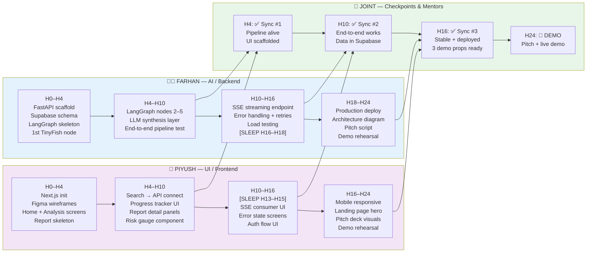

# 👥 Team Dynamics — Ghar Search @ HackIIITD 2026

> **Team**: Farhan Rahaman Mallik (AI/Full-Stack Lead) + Piyush Kumar Gautam (UI/Frontend)
> **Hackathon**: HackIIITD 2026 @ IIT Delhi | 24-hour build
> **Institution**: KCC Institute of Technology and Management, Greater Noida

---

## 1. Team Roles & Responsibilities

### Role Definitions

| Person | Primary Role | Secondary Role | Off-limits |
|---|---|---|---|
| **Farhan** | AI pipeline (LangGraph, FastAPI, TinyFish, LLM prompt engineering) | Backend Supabase schema, DevOps, API integration | Fine-grained CSS, icon selection |
| **Piyush** | Next.js UI, component design, UX flows, animations | Supabase client queries, frontend state | LangGraph nodes, LLM prompts, FastAPI routes |

### RACI Matrix

| Task | Farhan | Piyush |
|---|---|---|
| LangGraph orchestration design | **R, A** | I |
| TinyFish API integration | **R, A** | I |
| LLM prompt engineering / rule engine | **R, A** | C |
| FastAPI route design | **R, A** | I |
| Supabase schema & RLS policies | **R, A** | C |
| Next.js page structure & routing | C | **R, A** |
| Component library selection (shadcn/ui etc.) | I | **R, A** |
| UI animations & micro-interactions | I | **R, A** |
| Report rendering component | C | **R, A** |
| Progress stream UI (SSE visualization) | C | **R, A** |
| Architecture diagram (for pitch) | **R, A** | C |
| Demo flow & data seeding | **R** | **A** |
| Pitch deck content (tech sections) | **R, A** | C |
| Pitch deck visuals & design | C | **R, A** |
| Mentor session logistics | **R** | C |
| Git repo hygiene & branching | **R, A** | I |
| Environment variables & secrets | **R, A** | I |
| Final deployment & smoke test | **R, A** | C |

**Legend**: R = Responsible (does the work), A = Accountable (makes the call), C = Consulted (input needed), I = Informed (kept in loop)

---

## 2. Work Breakdown by Phase — 6-Hour Blocks

### 🟢 H0–H4 | Setup & Foundation

| Time | Farhan | Piyush |
|---|---|---|
| H0:00–H0:30 | Environment setup: Python venv, FastAPI scaffold, LangGraph install | Node/Next.js project init, shadcn/ui setup, folder structure |
| H0:30–H1:00 | Supabase project creation, schema design (properties, reports, users tables) | Figma quick wireframe → 3 screens (Home, Analysis, Report) |
| H1:00–H2:00 | TinyFish API key test, write first wrapper function, check rate limits | Build static Home page with search input component |
| H2:00–H3:00 | Draft LangGraph StateGraph skeleton — 5 nodes defined, no logic yet | Build Analysis "loading" screen with progress steps component |
| H3:00–H4:00 | Seek first **Technical Mentor** slot. Review architecture. Implement node 1 (RERA fetch) | Build Report page skeleton — risk score display, Red/Amber/Green badges |

**H4 Sync Checkpoint** ✅: FastAPI running locally, Next.js running locally, 1 LangGraph node functional, 3 UI screens scaffolded.

---

### 🟡 H4–H10 | Core Build Sprint

| Time | Farhan | Piyush |
|---|---|---|
| H4–H5 | LangGraph node 2: Builder history fetch via TinyFish | Connect Home search → API call → navigate to Analysis screen |
| H5–H6 | LangGraph node 3: Locality safety (crime/news sentiment) | Progress tracker component wired to SSE stream from FastAPI |
| H6–H7 | LangGraph node 4: Price fairness (market comparison) | Report detail sections — legal, builder, locality, price panels |
| H7–H8 | LangGraph node 5: LLM synthesis + rule engine → structured JSON output | Risk score gauge component (visual, animated) |
| H8–H9 | End-to-end pipeline test with real TinyFish data — fix failures | Polish report UI with real JSON shape from Farhan's test output |
| H9–H10 | Seek **Domain Mentor** slot. Supabase RLS setup, report persistence | Seek **Design Mentor** slot (optional). Refine UX copy & labels |

**H10 Sync Checkpoint** ✅: Full pipeline runs end-to-end with at least 1 real property. Report UI renders real data. Data persists in Supabase.

---

### 🔵 H10–H16 | Integration & Stability

| Time | Farhan | Piyush |
|---|---|---|
| H10–H11 | Wire FastAPI streaming endpoint (SSE) — emit progress events per node | Consume SSE in Next.js — update progress UI in real-time |
| H11–H12 | Error handling: TinyFish 429 → cache fallback, node timeout → partial result | Error states on UI — graceful degradation per section |
| H12–H13 | Supabase auth (magic link or simple email) — protect report generation | Login/signup flow UI, protected routes |
| H13–H14 | **SLEEP BLOCK for Piyush** (H13–H15). Farhan: Load test pipeline with 3 concurrent reports | — |
| H14–H15 | Optional 2nd Tech Mentor slot. Fix performance issues found in load test | — |
| H15–H16 | Demo data seeding — 3 pre-analyzed properties ready in Supabase for demo | **Piyush wakes** — review all UI, fix visual bugs spotted in integration |

**H16 Sync Checkpoint** ✅: System stable under demo load. Auth works. SSE streaming works. 3 demo properties ready. Error states handled.

---

### 🔴 H16–H24 | Polish, Pitch & Demo Prep

| Time | Farhan | Piyush |
|---|---|---|
| H16–H17 | **SLEEP BLOCK for Farhan** (H16–H18). Piyush: Mobile responsiveness pass | Landing page hero — value proposition copy, CTA |
| H17–H18 | — | Footer, about section, trust signals (RERA logo, legal disclaimer) |
| H18–H19 | **Farhan wakes** — deployment push (Railway for FastAPI, Vercel for Next.js) | Final visual polish — typography, spacing, color consistency |
| H19–H20 | Smoke test production deployment — all 3 demo properties work live | Business Mentor slot (Piyush attends too) — pitch narrative input |
| H20–H21 | Architecture diagram for pitch deck (Mermaid → export) | Pitch deck design in Canva/Figma — 8 slides max |
| H21–H22 | Write pitch script — 3-minute version. Rehearse with Piyush. | Pitch deck visuals finalized. Demo flow documented. |
| H22–H23 | **Full Demo Rehearsal #1** — Farhan demos, Piyush watches for gaps | Fix any gaps found in rehearsal |
| H23–H24 | **Full Demo Rehearsal #2** — Piyush demos backup flow | Pre-record backup demo video (see Section 9) |

---

## 3. Communication Protocol

### During the Hackathon

- **Primary channel**: In-person (we're at the same table — no Slack overhead)
- **Async notes**: Shared `NOTES.md` in repo root — append-only, timestamped entries for anything decided
- **Critical updates**: Tap on shoulder. No "hey check Slack." We are present-first.
- **Branch naming**: `farhan/feature-name` and `piyush/feature-name` — merge to `main` only at sync checkpoints
- **PR reviews**: Skip for internal work during hack. Direct merge with comment. Code review is post-hack.

### Conflict Resolution

If there's a disagreement on a technical or design decision:

1. **State positions clearly** — each person gets 60 seconds uninterrupted
2. **Identify the real constraint** — is this a time issue, a technical risk, or a preference?
3. **Default rule**: If it's technical → Farhan decides. If it's UX/visual → Piyush decides.
4. **Escalate to mentor** only if it's a strategic product decision that neither can resolve.
5. **Timer rule**: Any disagreement must resolve within 5 minutes or we go with the simpler implementation and revisit post-hack.

> **Principle**: Disagreement is fine. Extended debate during a 24-hour hack is not. Speed beats perfect.

---

## 4. Energy Management

### Sleep Schedule

| Person | Sleep Block | Duration | Rationale |
|---|---|---|---|
| **Farhan** | H16:00 – H18:00 | 2 hours | Backend is stable by H16; Piyush handles UI solo |
| **Piyush** | H13:00 – H15:00 | 2 hours | Integration is Farhan's domain at H13; Piyush can rest |

### Break Schedule (both)

| Block | Activity |
|---|---|
| Every 2 hours | 5-minute stand-up, water, walk |
| H6 | Proper meal — don't skip, cognitive cost is real |
| H12 | Meal + 15-minute walk outside venue |
| H18 | Light snack; no heavy meal before demo prep |

### Caffeine Protocol
- Farhan: Coffee at H0, H8, H20 (3× max — avoid jitter during demo)
- Piyush: Tea/coffee at H0, H10 (lighter — he sleeps earlier)
- No energy drinks after H20 — crash risk during demo window

### Focus Mode
- Headphones on = deep work, text-only interruption
- Headphones off = available to talk
- Respect each other's focus mode ruthlessly

---

## 5. Decision-Making Framework

| Decision Type | Decision Maker | Input From | Time Limit |
|---|---|---|---|
| Tech stack / library choice | **Farhan** | Piyush (UX impact) | 3 min |
| API integration approach | **Farhan** | — | 5 min |
| UI component design | **Piyush** | Farhan (data shape) | 3 min |
| Scope cut (what to drop) | **Joint** | Both | 5 min |
| Demo flow sequence | **Farhan** | Piyush | 3 min |
| Pitch narrative | **Farhan leads, Piyush reviews** | Both | 10 min |
| Which mentor to approach | **Farhan** | — | 2 min |
| Feature add (new idea mid-hack) | **Reject by default unless both agree** | Both | 2 min |

**The Golden Rule**: Any decision that takes more than 10 minutes of discussion is not a hackathon decision — it's a post-hack decision. Pick the simpler path and ship.

---

## 6. Risk Register

| # | Risk | Owner | Probability | Impact | Mitigation |
|---|---|---|---|---|---|
| R1 | TinyFish rate limit hit / credits exhausted | Farhan | 🔴 High | 🔴 High | Implement response cache in Supabase on first call; use 3 pre-seeded demo properties |
| R2 | LangGraph orchestration deadlock / infinite retry | Farhan | 🟡 Medium | 🔴 High | Add node-level timeout (30s max); circuit breaker pattern with fallback partial result |
| R3 | Supabase RLS misconfiguration locks us out | Farhan | 🟡 Medium | 🔴 High | Test RLS in dev project first; have service-role key fallback for demo |
| R4 | RERA data inconsistent for demo property | Farhan | 🔴 High | 🟡 Medium | Pre-select 3 demo properties from states with known good RERA data (MH, KA) |
| R5 | SSE streaming breaks in production (CORS/Nginx) | Farhan | 🟡 Medium | 🟡 Medium | Fallback to polling every 3s if SSE fails; test on Railway staging before H18 |
| R6 | Next.js build failure at deployment | Piyush | 🟢 Low | 🔴 High | Run `next build` locally at H16 before pushing; fix TS errors incrementally |
| R7 | Demo WiFi at venue is unreliable | Both | 🟡 Medium | 🔴 High | Mobile hotspot as backup; pre-record demo video (see Section 9) |
| R8 | One team member hits a wall / burnout | Both | 🟡 Medium | 🟡 Medium | Mandatory sleep blocks enforced; other person covers domain during rest |
| R9 | Judge asks question neither can answer | Both | 🔴 High | 🟡 Medium | Pre-prepare "we haven't validated X yet" honest answer; don't bluff |
| R10 | Scope creep from mentor or excitement | Both | 🔴 High | 🟡 Medium | Scope freeze at H10 — no new features after that; log ideas in `BACKLOG.md` |

---

## 7. 24-Hour Work Plan — Swim Lane Flowchart



---

## 8. Emergency Protocol — Critical Integration Failure (H22+)

> **Scenario**: A key integration (TinyFish, LangGraph pipeline, Supabase, or SSE) breaks 2 hours before demo.

### Decision Tree

```
Is the demo LIVE or PRE-RECORDED acceptable to judges?
    ↓ YES (most hackathons accept both)
→ Switch to pre-recorded video immediately (see Section 9)

Is the failure in the PIPELINE (Farhan's domain)?
    ↓ YES
→ Farhan debugs. Piyush rehearses pitch + prepares static mockup backup.
→ Farhan has 45 minutes to fix. After that → switch to backup.

Is the failure in the UI (Piyush's domain)?
    ↓ YES
→ Piyush fixes. Farhan prepares to demo via curl/API directly if UI fails.
→ Judges often appreciate "raw API demo" — shows engineering depth.

Is the failure in DEPLOYMENT (production only, local works)?
    ↓ YES
→ Demo from localhost using mobile hotspot. Explain "production deployment
  in progress" — this is acceptable and honest.

Is EVERYTHING broken (unlikely but plan for it)?
    ↓
→ Demo from Figma prototype + pre-recorded video + pitch on problem depth.
→ Judges have funded ideas with no working code. Confidence + problem
  clarity can still win.
```

### Emergency Contacts During Hack
- **Hackathon organizer helpdesk**: Know the location in the venue by H2
- **Railway/Vercel status page**: Bookmark before hack starts
- **Supabase status**: https://status.supabase.com — check if it's a platform issue

---

## 9. Backup Plan for Demo

Maintain all three backup levels. Build them progressively.

### Level 1 — Production Live (Primary)
- Full stack deployed: FastAPI on Railway, Next.js on Vercel, Supabase cloud
- 3 pre-seeded demo properties; demo flow rehearsed 3× before presentation
- Risk: Network, deployment failures

### Level 2 — Localhost Live (First Backup)
- Both Farhan's laptop (backend) and Piyush's laptop (frontend) running locally
- Connected via local network / mobile hotspot
- Triggered: Production deployment fails
- Prep: Ensure `localhost` demo runs cleanly by H20

### Level 3 — Pre-recorded Video Demo (Second Backup)
- **Record at H23:00** using OBS or Loom — 90-second walkthrough of full flow
- Script:
  1. User enters property address (15s)
  2. Pipeline starts — show progress tracker animating (20s)
  3. Report appears — narrate 3 key risk flags (40s)
  4. Show risk score with Red/Amber/Green badges (15s)
- Upload to YouTube (unlisted) and have link ready on phone
- Triggered: Both live options fail, or venue WiFi is unusable

### Level 4 — Figma Prototype + Static Report (Last Resort)
- Piyush maintains Figma prototype updated to match actual UI by H20
- Farhan prepares a printed / PDF sample report from a pre-run analysis
- Triggered: Everything breaks
- Pitch becomes: "We have a working system — here's what it looked like at H20 before the deployment incident. The architecture is solid."

---

## 10. Skill Gap Analysis

### Current Skills vs Hackathon Requirements

| Domain | What We Have | What We Need | Gap | Bridge Strategy |
|---|---|---|---|---|
| **LangGraph** | Farhan: read docs, knows LangChain | Production-ready StateGraph with parallel nodes | 🟡 Medium | Use LangGraph quickstart template; keep nodes simple; don't use complex features |
| **TinyFish API** | Neither has used it before | Fast integration, error handling, rate limit management | 🔴 High | Read docs at H0; write wrapper in first 30 min; test ALL endpoints before H2 |
| **FastAPI Streaming** | Farhan: familiar with FastAPI; SSE less so | Production-grade SSE endpoint | 🟡 Medium | Use `sse-starlette` library; copy working example from docs at H1 |
| **Supabase RLS** | Farhan: used Supabase, RLS basic | Correct RLS for multi-user report isolation | 🟡 Medium | Use Supabase AI assistant in dashboard; test policies with 2 test users |
| **Next.js App Router** | Piyush: familiar | SSE consumption, streaming UI | 🟡 Medium | Use `EventSource` API; find working example before hack; test locally |
| **Real-time UI** | Piyush: has done polling | SSE-driven progress tracker | 🟡 Medium | Keep it simple: update state on each SSE event; avoid complex WebSocket |
| **RERA domain knowledge** | Neither is a domain expert | Enough to sound credible to judges | 🔴 High | Domain mentor at H8–H10; read top 3 RERA explainer articles at H0 during setup |
| **Pitch & storytelling** | Farhan: campus experience | VC-style problem-solution-traction pitch | 🟡 Medium | Use pitch framework: 1-liner → problem → demo → market → ask |
| **UI design taste** | Piyush: good instincts | PropTech-credible, trust-inspiring design | 🟢 Low | Use shadcn/ui defaults; avoid over-designing; clean > clever |
| **Business model** | Neither has modeled it | Defensible pricing and GTM story | 🔴 High | Business mentor at H20; prepare 3 pricing scenarios by H18 |

### Gap Bridging — Pre-Hack Homework (Do Before Arriving)

- [ ] Farhan: Run through LangGraph "Multi-Agent" quickstart — build a 3-node graph tonight
- [ ] Farhan: Sign up for TinyFish developer account, get API key, test 1 call
- [ ] Farhan: Read Supabase RLS official docs — understand `auth.uid()` policies
- [ ] Piyush: Build a working SSE consumer in Next.js App Router — just a counter
- [ ] Both: Read the top 5 RERA scam stories on MoneyControl / Economic Times — know the enemy
- [ ] Both: Watch one Indian PropTech pitch (NoBroker, NestAway) on YouTube — know the space

### Known Unknowns — Accept and Manage

| Unknown | Our Response |
|---|---|
| TinyFish data quality for specific properties | Use only MH/KA/DL properties for demo — known good data |
| LLM consistency in risk classification | Use structured output (Pydantic) + few-shot examples in prompt |
| Judge scoring criteria | Build for "works + solves real problem + credible market" — covers most rubrics |
| Competitor awareness | Research top 3 during H8 Domain Mentor prep; have differentiation ready |

---

*Last updated: HackIIITD 2026 prep | Team: Farhan + Piyush | KCC Institute of Technology and Management*
