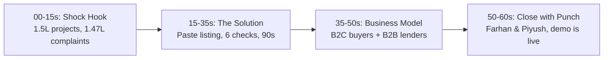

# 🏠 Ghar Search — Elevator Pitches
### HackIIITD 2026 | Quick-Draw Scripts for Every Context

---

> [!TIP]
> **Looking for the 2-Minute Co-Pitch for Farhan & Piyush?**  
> See the stage-ready dual-presenter script: [`two-minute-pitch.md`](file:///d:/hackiiit/PLAN/Pitch/two-minute-pitch.md) (with timing, words, and screen cues).

---

## ⏱️ 60-Second Version
*Full elevator pitch — use for judges, panels, and anyone who asks "what are you building?"*

---

> "India has 1.5 lakh RERA-registered real estate projects and 1.47 lakh homebuyer complaints — basically one fraud or dispute per project. The problem is that verifying a listing means manually crawling 30-plus state RERA portals, court records, news archives, and municipal approval databases. Most buyers skip it. They trust the developer. And some of them lose their life savings.
>
> We built Ghar Search. You paste a property listing — any URL, any text — and our AI agent pipeline does the full verification in under 90 seconds. Six checks: RERA status, claim matching, builder track record, court signals, approvals, public reputation. Every flag has evidence attached — a real URL, a screenshot, a timestamp. The output is a 0-to-100 Trust Score and a PDF report.
>
> We're targeting first-time buyers and NRIs first, then housing finance companies who need this before loan disbursement. Pay-per-report to start, batch API for lenders, watchlist subscriptions for retention.
>
> We're Farhan and Piyush from KCC Institute of Technology — and we built this in 24 hours. The demo is live."

**Word count: ~170 words | Read time: ~60 seconds at natural pace**

---

## ⚡ 30-Second Version
*For hallway conversations, quick intros, and when someone says "give me the short version."*

---

> "Ghar Search is an agentic property due-diligence platform. You paste a real estate listing, AI agents verify it across RERA portals, court records, and news sources in parallel, and you get a 0-to-100 Trust Score with linked evidence in some minutes. India has 1.47 lakh homebuyer complaints — we're the tool that should've existed before every one of them. Built in 24 hours with LangGraph, TinyFish, and Next.js."

**Word count: ~70 words | Read time: ~28 seconds**

---

## 🐦 Twitter/X Version
*280 characters max — copy-paste ready*

---

> Built in 24 hrs at #HackIIITD: paste a property listing → AI agents verify RERA status, builder track record, court cases & more in parallel → get a 0-100 Trust Score with evidence. India has 1.47L buyer complaints. Meet Ghar Search. 🏠⚡ #TinyFish #LangGraph

**Character count: 258 ✅**

---

## 💡 One-Liner Tagline Variants

Pick one as your primary. Have the others ready.

| # | Tagline |
|---|---|
| 1 | **"Paste the listing. Know the truth."** |
| 2 | **"Property due diligence in 90 seconds, not 3 days."** |
| 3 | **"Evidence-first property trust, at AI speed."** |
| 4 | **"Your property lawyer — for the price of a coffee."** |
| 5 | **"Every flag has a receipt. That's Ghar Search."** |

> [!TIP]
> Tagline #1 is the strongest for a slide headline — short, active, direct.
> Tagline #4 resonates most with non-technical buyers.
> Tagline #5 is the one technical judges will remember.

---

## 🎯 Opening Hook Variants by Audience

Use these as your *first sentence* depending on who you're talking to. After the hook, flow into the 30-second or 60-second version.

---

### For a **Judge / Hackathon Evaluator**

> *"One statistic: India has 1.47 lakh buyer complaints filed under RERA. That's almost one complaint per registered project. We asked why — and found that the data to prevent most of them already exists. It's just scattered. So we built the tool that aggregates it in 90 seconds."*

---

### For an **Investor**

> *"The Indian residential real estate market is ₹24 lakh crore. Every transaction in that market has a trust deficit — buyers can't verify what they're buying. We're building the verification layer that sits on top. Pay-per-report first, batch API for HFCs next. Unit economics are positive from day one."*

---

### For a **Technical Person** (engineer, developer)

> *"We built a LangGraph pipeline where LLMs do extraction and a deterministic rule engine does scoring — so it's auditable, not a black box. TinyFish agents fan out in parallel across 30-plus RERA portals. Every evidence object has source URL, scraped text, and screenshot. It's an agentic architecture where the AI handles what it's good at — parsing — and the rule engine handles what humans need to trust — decisions."*

---

### For a **Non-Technical Homebuyer**

> *"You know how when you buy a second-hand phone, you check the IMEI number, right? To make sure it's not stolen or broken? There's no equivalent for a house — the biggest purchase you'll ever make. We built that. You paste the listing link. We check everything in 90 seconds and give you a trust score. Simple."*

---

> [!NOTE]
> The best pitch isn't the most polished one — it's the one that sounds like *you*. Practice these out loud until they feel natural, then improvise around the core structure. Judges can tell when someone believes what they're saying.
