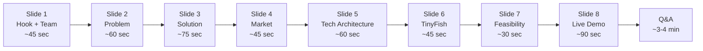

# 🏠 Ghar Search — Pitch Deck Script
### HackIIITD 2026 | Farhan Rahaman Mallik & Piyush Kumar Gautam

> **How to use this document**: Read these scripts aloud. Time yourself. The goal isn't to memorize — it's to internalize. Speak like you mean it, not like you're reciting.

---

## ⏱️ Pitch Timeline

**Total speak time: ~8 minutes** (plus 3–4 min Q&A). Keep demo tight — if it overruns, cut Slide 7 short.

> [!IMPORTANT]
> **Need the strict 2-Minute Judge Evaluation Pitch?**  
> See the synchronized co-pitch script: [`two-minute-pitch.md`](file:///d:/hackiiit/PLAN/Pitch/two-minute-pitch.md) (calibrated to exactly 120 seconds for Farhan & Piyush).

---

## 🎤 Slide-by-Slide Script

---

### Slide 1: Hook + Team Intro *(Farhan delivers)*

**[Pause. Make eye contact. Don't rush.]*

> "Before I start — I want you to imagine something. You've spent two years saving money. ₹60 lakhs. Maybe more. You find the perfect flat — photos look great, the developer looks legit, RERA registration number is right there on the listing. You sign. You pay. And then six months later, you find out the project is stuck in court. The RERA registration lapsed. The builder has three fraud cases you didn't know about.
>
> That's not a hypothetical. That's happening to lakhs of Indian homebuyers right now.
>
> I'm Farhan, I'm a full-stack and AI developer — previously an AI intern at FlyRank, and currently Campus Lead for Open Source Connect Global 2026. Next to me is Piyush, who's built every interface you're about to see. We're both from KCC Institute of Technology and Management, Greater Noida. And in the last 24 hours, we built **Ghar Search** — an agentic property due-diligence platform that does in 90 seconds what used to take a lawyer three days."

**[Click to Slide 2]**

---

### Slide 2: The Problem *(Farhan delivers)*

> "Here's the scale of the problem. India has over **1.5 lakh RERA-registered projects** right now. And RERA was supposed to fix homebuyer trust. But here's what actually happened — **1.47 lakh buyer complaints** have been filed since RERA launched. One complaint per registered project. Think about that.
>
> Why? Because verifying a property isn't one search — it's a scavenger hunt across **30+ state RERA portals**, court record systems, municipal approval databases, news aggregators, and social media. The information exists. It's just buried.
>
> And who pays the price? First-time buyers who don't know what to look for. NRIs who can't physically visit. Young families who are trusting developers with their life savings.
>
> Existing solutions? Either manual legal consultants — expensive, slow, inaccessible — or generic property listing platforms that have zero incentive to show you the bad news. Nobody is doing systematic, evidence-backed due diligence at scale."

**[Click to Slide 3]**

---

### Slide 3: The Solution — "One Link In, Trust Report Out" *(Farhan delivers, Piyush starts opening the demo tab)*

> "So here's what we built.
>
> You paste a property listing URL — or just the raw text — into Ghar Search. That's it. That's the only input we need.
>
> On the backend, a **LangGraph agent pipeline** kicks off. AI extracts every claim from that listing: the RERA number, the completion date, the builder name, what amenities are promised. Then **TinyFish agents** fan out in parallel and go verify each claim — hitting RERA APIs, court records, news sources, public forums.
>
> Sixty to ninety seconds later, you get a **0-to-100 Trust Score**. Not just a number — every flag has evidence attached. A URL. A screenshot. A timestamp. You can click through and see exactly why a flag was raised.
>
> We run **six specific checks**:
> 1. **RERA Status** — is this project legally registered and active?
> 2. **Claim Match** — does what the listing says match official records?
> 3. **Promoter Record** — does the builder have past defaults or fraud?
> 4. **Court Signals** — are there pending cases?
> 5. **Approvals** — are building permits in order?
> 6. **Public Reputation** — what are real buyers saying?
>
> Then you export a PDF report and optionally save the property to a **watchlist** — so if anything changes, you're notified automatically."

**[Click to Slide 4]**

---

### Slide 4: Market & Users *(Farhan delivers, keep it punchy)*

> "Who needs this?
>
> **B2C beachhead first.** First-time homebuyers, NRIs, young professionals — people spending more than they've ever spent, with zero tools to verify what they're buying. India's residential real estate market is **₹24 lakh crore** and growing. Even capturing a sliver of high-intent buyers is a large market.
>
> **B2B expansion next.** Housing Finance Companies and DSAs do property due diligence before approving loans. Right now that's manual. A batch API that flags risky projects before disbursement? That's a no-brainer integration for any HFC that's been burned by NPAs.
>
> **B2B2C through brokers.** Give brokers a white-label trust badge for their listings. Builds their credibility. Increases buyer confidence. Closes faster.
>
> Revenue model: **pay-per-report** to start (₹99–₹299 per check), **batch API** for lenders, **watchlist subscriptions** for recurring engagement."

**[Click to Slide 5]**

---

### Slide 5: Technical Architecture — The 5-Layer Pipeline *(Farhan leads, Piyush can add a detail)*

> "Let me walk you through how this actually works under the hood — without getting lost in jargon.
>
> Think of it as five layers:
>
> **Layer 1 — Input & Extraction.** The user pastes a listing. A LangGraph LLM node parses it and extracts structured claims — RERA number, builder name, promised delivery date, listed amenities. This is deterministic: same input, same extracted fields.
>
> **Layer 2 — Agent Dispatch.** LangGraph fans out six parallel verification agents, one per check. Each agent has a goal template — a precise set of tasks and sources it knows to hit.
>
> **Layer 3 — TinyFish Execution.** This is where the actual web research happens. TinyFish agents browse, navigate RERA portals, pull court records, search news — all in real time. They return structured evidence objects with source URL, extracted text, and screenshot.
>
> **Layer 4 — Rule Engine Scoring.** Here's the key architectural decision: **LLMs extract, rule engine decides**. We don't let the AI make the final call on trust — a deterministic scoring engine takes the evidence and computes the 0–100 score. That's auditable. That's defensible in court if needed.
>
> **Layer 5 — Presentation.** Next.js frontend, Supabase for persistent watchlist storage, PDF export. Clean, fast, shareable.
>
> The reason this architecture matters: it's not a chatbot that hallucinates. Every flag is traceable to a real source."

**[Click to Slide 6]**

---

### Slide 6: TinyFish Integration — Why It's the Right Tool *(Farhan delivers)*

> "You might ask — why TinyFish specifically?
>
> Property due diligence requires navigating **live, dynamic web pages** that change constantly. State RERA portals are notoriously inconsistent — some require form submissions, some need JavaScript rendering, some block scrapers. TinyFish agents handle all of that natively. They're designed to browse the actual web, not just pull from static APIs.
>
> More importantly: **TinyFish gives us structured evidence output by default**. Each agent run returns what it found, where it found it, and a visual snapshot. That's exactly what our evidence-first architecture needs — we don't have to post-process raw HTML to get citations.
>
> For a hackathon build covering 30+ RERA sites with a single goal template? TinyFish was the only tool that made that feasible in 24 hours."

**[Click to Slide 7]**

---

### Slide 7: Scalability & Feasibility — What Judges Will Actually See *(Piyush delivers)*

> "I want to be straight with you about what we've built in 24 hours and what the production path looks like.
>
> **What's working right now:** the full pipeline — paste listing, extract claims, run TinyFish agents, generate Trust Score, display evidence, export PDF, save to watchlist.
>
> **What's production-ready by design:** the scoring engine is stateless and horizontally scalable. TinyFish handles concurrency natively. Supabase scales with us. The Next.js frontend is deployed.
>
> **The path to scale:** for lenders needing bulk checks, we expose a batch API — same pipeline, queued. For national coverage, the goal templates TinyFish uses are state-agnostic — one template, any RERA portal.
>
> This isn't a demo with hardcoded data. We're about to run it live on a real listing."

**[Click to Slide 8]**

---

### Slide 8: Live Demo *(Both deliver — Farhan narrates, Piyush drives the screen)*

**[Piyush has the browser open at `http://localhost:3000` on Screen 1: Input]**

> **Farhan:** "Let's see it work live. We've built a 3-screen pipeline focused on the two most catastrophic risks in Indian real estate: **RERA Regulatory Compliance** and **Litigation Signals**."
>
> **Piyush:** *(clicks the 1-click test card or pastes a property listing)* "Screen 1 is our clean input. I'm selecting Green Valley Towers in Pune — an active development."
>
> **Farhan:** *(screen transitions to Screen 2: Progress)* "Now watch Screen 2 light up. In real time, autonomous web agents are probing the official MahaRERA state portal for active registration certificates, escrow accounts, and CA disclosures. Concurrently, our judicial scanner is querying eCourts NJDG and the NCLT insolvency registers."
>
> **Piyush:** *(points to live streaming agent log feed)* "You can see the exact network queries, statutory portal responses, and machine timestamps stream live."
>
> **Farhan:** *(screen transitions to Screen 3: Trust Report)* "And here is Screen 3: the verified Trust Report. 68 out of 100 — Moderate Risk. The deterministic rule engine penalized 10 points because RERA disclosures show a 14-month possession delay, and 8 points for active consumer court compensation cases. Every single deduction links to an immutable source URL and screenshot."
>
> **Piyush:** *(clicks 'Export Dossier (PDF)')* "One click generates a high-resolution, branded due-diligence dossier that the homebuyer can take directly to their advocate or bank."
>
> **Farhan:** "No black boxes. No LLM hallucinations in the math. Just verifiable truth from official records in under 90 seconds. That is Ghar Search. Thank you."

**[Hold. Let it land. Confident eye contact with the judges.]**

---

## ❓ Anticipated Judge Questions & Sharp Answers

### Q1: "Why would homebuyers pay for this when they can just google it themselves?"
> "They can — and that's exactly what they do. For three days. Across 30 tabs. Missing things. Getting frustrated. Our value prop isn't access to information, it's synthesis speed and evidence quality. The average homebuyer has no idea what to look for on a RERA portal. We do it in 90 seconds with linked evidence. Same reason people pay for credit reports they could theoretically piece together themselves."

---

### Q2: "RERA portals are inconsistent. What if an agent fails to retrieve data?"
> "Great question — that's exactly why we designed around evidence-first scoring. If an agent returns no result for a check, the flag isn't falsely cleared — it's marked 'unverified', and that hits the Trust Score too. Absence of evidence isn't clearance. We also log every agent run so we know which portals are failing and can update goal templates. Graceful degradation is built in."

---

### Q3: "How is this different from PropTiger or NoBroker?"
> "Those are listing platforms. Their business model depends on getting listings seen and transactions closed — they have no incentive to surface bad news about a project. We're the opposite. We're a verification layer. We don't list properties, we audit them. It's the difference between a real estate agent and a home inspector."

---

### Q4: "Can't a developer with bad intentions game your score?"
> "We verify against official registries — RERA filings, court records — not developer-submitted data. The sources we check aren't controlled by the promoter. If anything, our score is harder to game than a review platform. That said, we're transparent: our evidence is linked, so a sophisticated user can audit our audit."

---

### Q5: "How do you handle court records — those aren't publicly accessible in a structured way?"
> "You're right that structured court APIs are limited in India. We use TinyFish agents to search eCourts, district court portals, and news sources for case mentions linked to the developer entity. It's signal-based, not comprehensive legal discovery — we're transparent about that distinction in the report. 'Court signals' is flagged, not 'full legal clearance.'"

---

### Q6: "What's your moat? A bigger company could just copy this."
> "Three things. First, the goal templates we've built for 30+ RERA state portals — that's weeks of iteration we've started. Second, the evidence corpus — every report we run enriches our understanding of which portals work and how. Third, the watchlist and notification layer creates retention that pure API plays don't have. Network effects come from accumulated verified-project data over time."

---

### Q7: "Is this legally defensible? If your score is wrong, are you liable?"
> "We present evidence, not legal opinion. Our reports explicitly state they're informational and not a substitute for legal advice — same as a credit bureau report or a background check. We're in the business of surfacing public information more efficiently, not providing legal guarantees. That's a well-established legal category."

---

### Q8: "How many real users have you tested this with?"
> "We're at hackathon stage — this was a 24-hour build. We've run the pipeline on about 15 real listings across Noida, Gurugram, and Mumbai to validate accuracy. The RERA claim-match checks have flagged discrepancies in 4 of 15, which tracks with industry estimates of listing inflation. Next step is a 50-listing beta with real buyers."

---

### Q9: "What does it cost you per report to run? Is this financially viable?"
> "TinyFish agent runs are the main variable cost. At current API pricing, a full 6-check report costs us in the range of ₹15–30 in compute. We're pricing B2C at ₹99–299 per report — comfortable 3–10x margin. B2B batch pricing brings the per-unit cost down further with volume. Unit economics are positive from report one."

---

### Q10: "Why only property? Can you expand to other due diligence use cases?"
> "Yes — and that's intentional future scope. The core architecture — claim extraction, parallel agent verification, evidence-linked scoring — works for anything you want to audit: vendor due diligence, school credential verification, startup background checks. We're starting with property because it's the highest-stakes, underserved case in India right now. Property is the wedge."

---

### Q11: "What happens if TinyFish goes down or rate-limits you?"
> "We build around it two ways: first, we queue and retry with backoff — TinyFish's SLA should handle hackathon demo traffic. Second, for production, we'd maintain fallback scraping for the most critical portals (Maharashtra MahaRERA, UP RERA) where we can implement direct scrapers as backup. Single-vendor risk is real, and our architecture separates the orchestration (LangGraph) from the execution layer so we can swap providers."

---

## 🎭 Presentation Tips

### Who Delivers What
| Slide | Presenter | Notes |
|---|---|---|
| Slide 1 (Hook + Intro) | **Farhan** | Eye contact. Slow down on the ₹60 lakh moment. |
| Slide 2 (Problem) | **Farhan** | Hit the stats with conviction. Don't rush numbers. |
| Slide 3 (Solution) | **Farhan** | The 6-checks list — count on fingers if natural. |
| Slide 4 (Market) | **Farhan** | Keep it tight. 45 seconds max. |
| Slide 5 (Tech Arch) | **Farhan** leads, **Piyush** adds a line | Piyush: "I built the scoring layer — we deliberately kept LLM out of the decision to avoid hallucination." |
| Slide 6 (TinyFish) | **Farhan** | Speak to TinyFish like you chose it confidently. |
| Slide 7 (Feasibility) | **Piyush** | Own the "this is real, not demo-ware" energy. |
| Slide 8 (Demo) | **Both** | Farhan narrates. Piyush drives. Rehearse handoffs. |

### Body Language
- **Farhan**: Stand slightly forward. You're the narrator. Use your hands when listing the 6 checks.
- **Piyush**: During your slides, face the judges, not the screen. You know the product — you built the UI.
- During demo: **both look at the screen when agents are running** — it builds suspense and shows you're genuinely watching the results.

### Pacing Rules
- **The ₹60 lakh moment**: pause half a second before "You sign. You pay." Let it breathe.
- **When the Trust Score appears in the demo**: don't explain immediately. Let judges read it for 2 seconds. Then say "There it is."
- **Don't fill silence with filler words** ("umm", "so basically"). Silence is confidence.

### If the Demo Breaks
Have a **screen recording backup** of a successful run. If live fails: "Let me show you what a completed run looks like — the live network can be unpredictable at events." Switch smoothly, no apology.

### If You're Running Long
Cut Slide 7 to one sentence: "This pipeline runs on real data — you're about to see it." Go straight to demo.

---

## 📋 Backup Slides to Prepare

These aren't for the main pitch — have them ready as follow-up slides or printouts for deep-dive Q&A.

### Backup Slide A: Scoring Rubric Detail
Show the exact point weighting:
- RERA Status: 30 points
- Claim Match: 20 points
- Promoter Record: 20 points
- Court Signals: 15 points
- Approvals: 10 points
- Public Reputation: 5 points

Include the rule: ≥80 = Green / 50–79 = Yellow / <50 = Red, with auto-recommend "consult a lawyer" below 40.

### Backup Slide B: LangGraph Flow Diagram
A node-by-node graph of the LangGraph pipeline: Input → Extractor node → Dispatcher → [6 parallel TinyFish nodes] → Evidence Collector → Rule Engine → Output node. Show it's genuinely agentic, not a sequential API chain.

### Backup Slide C: Business Model Numbers
| Segment | Price per unit | Target Year 1 | ARR potential |
|---|---|---|---|
| B2C reports | ₹149 avg | 10,000 reports | ₹15L |
| B2B batch API | ₹30/report | 50,000 reports | ₹15L |
| Watchlist subscriptions | ₹499/yr | 2,000 users | ₹10L |
| **Total Year 1 potential** | | | **~₹40L** |

### Backup Slide D: Competitor Comparison Table
| Feature | Ghar Search | PropTiger | Legal consultant | MagicBricks |
|---|---|---|---|---|
| Evidence-linked score | ✅ | ❌ | Partial | ❌ |
| Covers 30+ RERA sites | ✅ | ❌ | Depends | ❌ |
| Real-time updates/watchlist | ✅ | ❌ | ❌ | ❌ |
| 90-second turnaround | ✅ | ❌ | ❌ | ❌ |
| Price accessible to retail buyer | ✅ | ❌ | ❌ | ❌ |

### Backup Slide E: 6-Month Roadmap
- Month 1–2: Improve RERA portal coverage from 5 states to 15 states
- Month 3: Launch B2C beta, 50-user closed group
- Month 4: HFC/lender API pilot with 1 housing finance partner
- Month 5–6: Broker white-label program, mobile PWA

---

> [!TIP]
> **The night before**: Do one full run-through end-to-end out loud, timed. Not in your head — out loud. Fix whatever feels unnatural. Sleep. You've built something real. That's the confidence that comes through.
