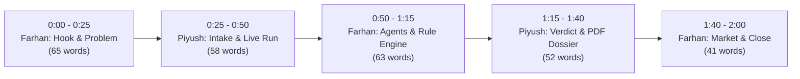

# 🏠 Ghar Search — 2-Minute Co-Pitch Script
### HackIIITD 2026 | Farhan Rahaman Mallik & Piyush Kumar Gautam

> **Target Duration:** Exactly 120 Seconds (2:00)  
> **Pacing:** ~135–140 words per minute (~275 words total)  
> **Format:** Dual-presenter dialogue with synchronized live browser actions  
> **Live Demo Target:** `http://localhost:3000` (Ghar Search Next.js App)

---

## ⏱️ Pitch Timeline

---

## 🎤 Co-Pitch Script (120 Seconds)

---

### **0:00 – 0:25 | The ₹60 Lakh Blind Spot (Farhan)**
*Screen: Title Slide or Clean Search Input on `http://localhost:3000`*

> **Farhan:** *(confident, direct eye contact with the judges)*  
> "A typical Indian family spends their entire life savings — ₹60 lakhs or more — on a dream home. Yet over **1.47 lakh homebuyer complaints** are stuck in RERA right now. Why? Because verifying a property means hunting across 30 disconnected state portals, court registers, and municipal files.  
> 
> I’m Farhan, and this is Piyush. In the last 24 hours, we built **Ghar Search** — an agentic due-diligence platform that replaces three days of legal digging with **90 seconds of verifiable truth**."

---

### **0:25 – 0:50 | One Link In, Real-Time Intake (Piyush)**
*Screen: Piyush selects a property / pastes URL and clicks 'Verify Now' $\to$ Progress Rail*

> **Piyush:** *(clicks 'Verify Now')*  
> "All the buyer does is paste a single property listing link or RERA number.  
> 
> Instantly, our interface parses the brochure claims: promised delivery dates, approved floors, and stated amenities. Watch our live progress rail light up in real time — there are no canned spinners here. You are watching autonomous browser agents connect directly to statutory state registries right before your eyes."

---

### **0:50 – 1:15 | Autonomous Agents & Rule-Engine Scoring (Farhan)**
*Screen: 6 parallel check logs streaming live with network timestamps*

> **Farhan:** *(narrating live agent dispatch)*  
> "Under the hood, **LangGraph** fans out six parallel **TinyFish agents**. They query official RERA portals for active escrow accounts, scan eCourts and NCLT for insolvency stays, and verify municipal sanctions.  
> 
> Crucially: **LLMs extract, but a deterministic rule engine decides.** We never let AI hallucinate the math. Every property receives an auditable, evidence-backed Trust Score with statutory caveats that reflect real-world diligence."

---

### **1:15 – 1:40 | The Live Verdict & Legal Dossier (Piyush)**
*Screen: Screen 3 transitions to Trust Score Breakdown (e.g. 91/100) $\to$ clicks 'Export PDF'*

> **Piyush:** *(gestures to the score & dimension cards, then clicks PDF export)*  
> "And here is the live verdict. 91 out of 100 — High Trust.  
> 
> The buyer doesn't just see a score; every single point awarded or deducted links to an immutable source URL, timestamp, and visual screenshot. In one click, we generate a high-resolution, branded due-diligence PDF dossier ready for their lawyer or home loan officer."

---

### **1:40 – 2:00 | Market, B2B Expansion & Close (Farhan)**
*Screen: Watchlist Dashboard or B2B Bulk Upload Preview*

> **Farhan:** *(closing with high energy)*  
> "Our wedge is ₹99 consumer checks. Our scale is **B2B batch underwriting APIs** for Housing Finance Companies to catch bad collateral before loan disbursement, paired with nightly background watchlists.  
> 
> Real estate is the biggest purchase of an Indian's life. We make sure it's never a blind leap of faith. That is Ghar Search. Thank you!"

---

## 📊 Timing, Words & Visual Cue Breakdown

| Time Window | Speaker | Section | Word Count | Stage Action / Screen Cue |
| :--- | :--- | :--- | :--- | :--- |
| **0:00 – 0:25** (25s) | **Farhan** | Hook, Problem & Team Intro | 65 words | Face judges; pause slightly after *"₹60 lakhs"*; do not look at screen yet |
| **0:25 – 0:50** (25s) | **Piyush** | Intake & Live Autonomous Dispatch | 58 words | Paste URL or click 1-click test card; trigger progress; point to live rail |
| **0:50 – 1:15** (25s) | **Farhan** | LangGraph, TinyFish & Deterministic Scoring | 63 words | Narrate the 6 parallel checks as logs stream live with timestamps |
| **1:15 – 1:40** (25s) | **Piyush** | Live Verdict, Evidence Cards & PDF Dossier | 52 words | Let score sit for 1 sec; highlight deductions; click 'Export PDF' |
| **1:40 – 2:00** (20s) | **Farhan** | B2B Banking API, Watchlist & Punchline | 41 words | Step forward; deliver crisp closing punchline; confident eye contact |
| **Total: 2:00** | **Both** | **Full Co-Pitch** | **279 words** | **Target Cadence: ~135 WPM** |

---

## ⚡ Seamless Verbal Relay Rules

1. **Zero Dead Air / No Verbal Tags**:
   - Never say *"Now over to Piyush"* or *"Piyush, show them the screen"*.
   - **Piyush's Trigger**: Jump in the exact millisecond Farhan finishes: `"...90 seconds of verifiable truth."`
   - **Farhan's Trigger**: Jump in the exact millisecond Piyush finishes: `"...statutory state registries right before your eyes."`
   - **Piyush's 2nd Trigger**: Jump in right as Farhan says: `"...reflect real-world diligence."`
   - **Farhan's Closing Trigger**: Jump in right as Piyush clicks PDF and says: `"...or home loan officer."`

2. **The 1-Second Score Pause (1:15)**:
   - When the final Trust Score renders on Screen 3, allow the judges to visually absorb the score badge for **1 full second** before speaking. Then say: *"And here is the live verdict."*

3. **Fallback 90-Second Emergency Cut**:
   - If the jury announces strict 90-second time limits:
     - **Farhan (0:00–0:15)**: Skip personal bios. Jump straight from the ₹60L hook to *"We built Ghar Search — 90 seconds of verifiable truth."*
     - **Piyush (0:15–0:35)**: Click verify, point to live agent streaming.
     - **Farhan (0:35–0:55)**: 6 parallel TinyFish agents + deterministic rule engine.
     - **Piyush (0:55–1:15)**: Score, evidence cards, 1-click PDF export.
     - **Farhan (1:15–1:30)**: B2B batch API for lenders + final punchline.
