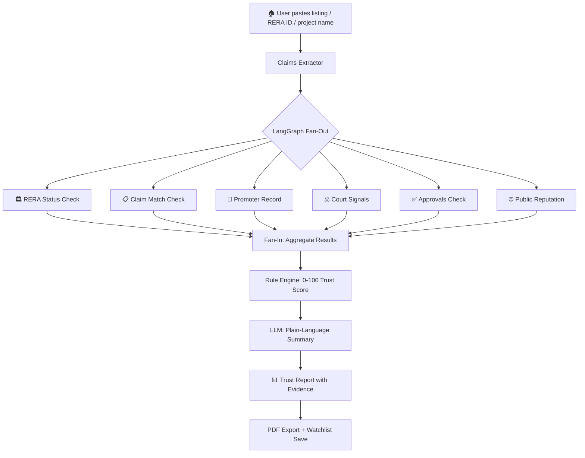
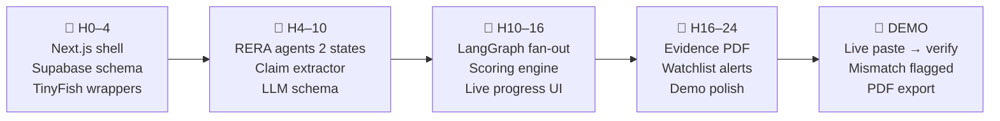
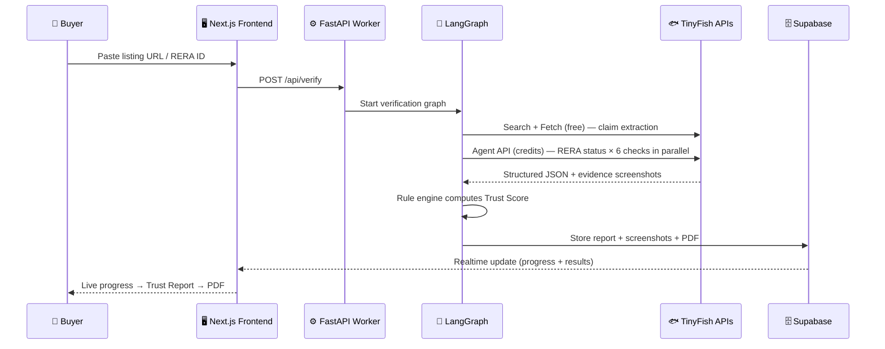

# 🏠 Ghar Search — HackIIITD 2026 Master Plan

> **"Paste a property listing. Get a verified trust report, backed by evidence from official records."**
> An agentic due-diligence layer for Indian homebuyers, powered by TinyFish web agent APIs.

---

## 🧑‍💻 Team

| Name | Role | Background |
|------|------|------------|
| **Farhan Rahaman Mallik** | Team Lead — AI Agents & Full-Stack | B.Tech CS/IT, KCC Institute of Technology and Management, Greater Noida. Ex-FlyRank AI Intern. Campus Lead, Open Source Connect Global 2026. |
| **Piyush Kumar Gautam** | UI / Frontend Developer | B.Tech, KCC Institute of Technology and Management, Greater Noida. |

---

## 🗂️ Plan Folder Structure

```
PLAN/
├── README.md                          ← You are here (Master Index)
│
├── System Design/
│   ├── prd.md                         ← Product Requirements Document
│   ├── trd.md                         ← Technical Requirements Document
│   ├── architecture.md                ← System Architecture (5-layer pipeline)
│   └── design.md                      ← UI/UX Design System & Wireframes
│
├── Sales and Marketing/
│   ├── go-to-market.md                ← GTM Strategy, Pricing, Market Size
│   └── marketing-plan.md              ← Content, Channels, Growth Hacks
│
├── Pitch/
│   ├── pitch-deck-script.md           ← Slide-by-slide script + Judge Q&A
│   └── elevator-pitch.md              ← 60s / 30s / Twitter pitch variants
│
├── Mentoring/
│   ├── mentoring-plan.md              ← Mentor strategy, questions, templates
│   └── team-dynamics.md              ← RACI, 24-hour plan, risk register
│
└── Technical Preparation/
    ├── technical-checklist.md          ← Pre-hack setup, gotchas, code templates
    └── api-integration-guide.md        ← TinyFish, LangGraph, Supabase guides
```

---

## 🏗️ What We're Building



---

## ⚡ 24-Hour Build Timeline



---

## 🏆 Competition Details

| Item | Details |
|------|---------|
| **Hackathon** | HackIIITD 2026 |
| **Round** | Round 1 completed (Idea Submission) |
| **Track** | PropTech · Consumer Protection · Web Agents |
| **Submission** | Ghar Search — Agentic Property Due-Diligence |
| **Status** | ✅ Round 1 submitted — Preparing for Build Round |

---

## 🎯 The Problem in 4 Numbers

| Stat | Source |
|------|--------|
| **1.5 lakh+** RERA-registered projects across 35 states & UTs | MoHUA |
| **1.47 lakh+** buyer complaints disposed by RERA authorities | MoHUA |
| **6 checks** needed per property (RERA, claim match, promoter, courts, approvals, reputation) | — |
| **Hours** of manual portal-hopping per property for diligence | User research |

---

## 💡 The Solution in 1 Diagram



---

## 🛠️ Tech Stack at a Glance

| Layer | Technology |
|-------|-----------|
| **Frontend** | Next.js 14 App Router · TypeScript · Tailwind CSS |
| **Orchestration** | LangGraph (Python) · FastAPI |
| **Web Agents** | TinyFish Search · Fetch · Agent · Browser APIs |
| **Intelligence** | LLM (claim extraction + summary) · Rule Engine (scoring) |
| **Database** | Supabase Postgres · RLS · Auth · Storage · pg_cron · Realtime |
| **Deployment** | Vercel (frontend) · Docker (Python worker) · Supabase Cloud |

---

## 📂 Quick Links to Key Documents

| Document | Purpose | Priority |
|----------|---------|----------|
| [System Design / prd.md](./System%20Design/prd.md) | What we're building & why | 🔴 High |
| [System Design / architecture.md](./System%20Design/architecture.md) | How the 5 layers connect | 🔴 High |
| [System Design / trd.md](./System%20Design/trd.md) | API specs, DB schema, algorithms | 🔴 High |
| [System Design / design.md](./System%20Design/design.md) | UI/UX components & wireframes | 🟡 Medium |
| [Technical Preparation / technical-checklist.md](./Technical%20Preparation/technical-checklist.md) | What to set up before hacking | 🔴 High |
| [Technical Preparation / api-integration-guide.md](./Technical%20Preparation/api-integration-guide.md) | TinyFish + LangGraph + Supabase code | 🔴 High |
| [Pitch / pitch-deck-script.md](./Pitch/pitch-deck-script.md) | What to say on stage | 🔴 High |
| [Pitch / elevator-pitch.md](./Pitch/elevator-pitch.md) | 60-second version | 🟡 Medium |
| [Mentoring / team-dynamics.md](./Mentoring/team-dynamics.md) | RACI + 24-hour work plan + risks | 🔴 High |
| [Mentoring / mentoring-plan.md](./Mentoring/mentoring-plan.md) | Questions for mentors | 🟡 Medium |
| [Sales and Marketing / go-to-market.md](./Sales%20and%20Marketing/go-to-market.md) | Market size + pricing + GTM | 🟡 Medium |
| [Sales and Marketing / marketing-plan.md](./Sales%20and%20Marketing/marketing-plan.md) | Content + channels + growth | 🟢 Low |

---

> **Remember**: Evidence first. No evidence, no flag. Every finding links to a source URL, a screenshot, and a timestamp.
> — *Ghar Search Design Principle*
