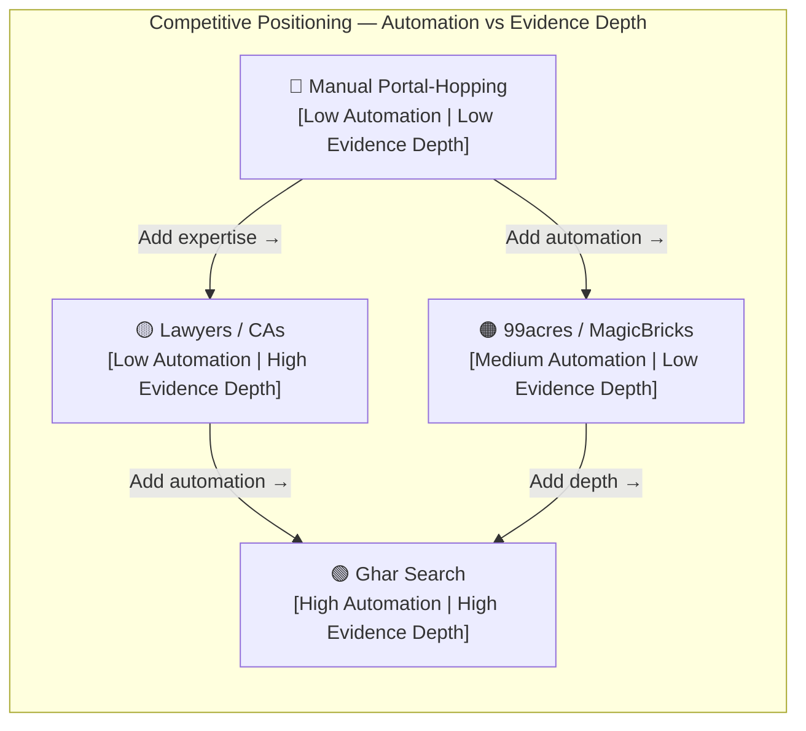
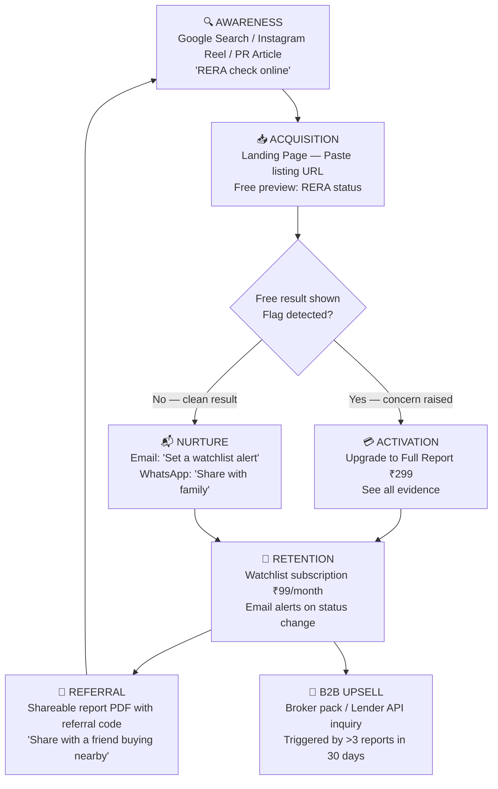

# 🏠 Ghar Search — Go-to-Market Strategy

> **Mission**: Make property due diligence accessible, instant, and evidence-backed for every Indian homebuyer.

---

## 1. GTM Strategy Overview — Beachhead Market Approach

Ghar Search will enter the market using a **focused beachhead strategy**: dominate one high-pain, high-density segment before expanding outward. Our beachhead is **urban, first-time homebuyers in Maharashtra (MahaRERA jurisdiction)** — the single largest RERA-registered state with 44,000+ registered projects and the highest volume of buyer complaints.

### Why Maharashtra First?

| Factor | Detail |
|---|---|
| Project density | 44,000+ MahaRERA-registered projects |
| Complaint volume | Highest RERA complaint filings in India |
| Digital maturity | High smartphone + fintech adoption in Mumbai/Pune |
| API accessibility | MahaRERA has the most structured public data of any state RERA |
| Media ecosystem | Strong PropTech and consumer press coverage |

Once Maharashtra proves unit economics, we expand in **concentric rings**: UP (UPRERA — 75,000+ projects), Karnataka (Bengaluru tech-buyer base), Delhi NCR, and Haryana (Gurugram luxury segment), ultimately covering all 30+ state RERA portals.

**GTM Phases at a glance:**

```
Beachhead (Maharashtra) → Expansion (UP, KA, DL, HR) → National Platform → B2B API Layer
```

---

## 2. Market Size Analysis — TAM / SAM / SOM

### Total Addressable Market (TAM)

India's residential real estate market transacts approximately **2.6 million+ units annually** (JLL India, Knight Frank India 2024 estimates). At an average selling price of ₹60 lakh per unit, the transaction value exceeds **₹156 lakh crore**. Due-diligence services globally capture 0.05–0.1% of transaction value as fees. This places the **TAM at ₹7,800–15,600 crore** annually for property verification services in India.

| Segment | Volume | Estimated Value |
|---|---|---|
| Annual residential transactions | ~2.6 million units | — |
| RERA-registered projects | 1,47,000+ | — |
| Buyer complaints filed (cumulative) | 1,47,000+ | — |
| Proptech digital services TAM | — | ~₹7,800 Cr/yr |

### Serviceable Addressable Market (SAM)

Focusing on **digitally accessible buyers considering RERA-registered projects**, primarily in Tier 1 & Tier 2 cities — approximately **600,000 transactions/year** (23% of total, digital-first segment). At ₹299 per report average, the **SAM ≈ ₹180 Crore/year**.

### Serviceable Obtainable Market (SOM) — Year 1–2

Targeting **30,000 reports** in Year 1 (Maharashtra + UP beachhead), growing to **120,000 reports** by Year 2 with B2B API activation:

| Year | Reports | Revenue Model | Est. Revenue |
|---|---|---|---|
| Y1 | 30,000 | Pay-per-report dominant | ₹72 L – ₹90 L |
| Y2 | 1,20,000 | Reports + API subscriptions | ₹4.5 Cr – ₹6 Cr |
| Y3 | 5,00,000 | Platform + API + watchlists | ₹25 Cr+ |

---

## 3. Competitive Landscape

### Positioning Map



> **Ghar Search occupies the uncontested top-right quadrant**: high automation AND deep evidence. No existing product competes here.

### Competitive Comparison Table

| Dimension | Ghar Search | Manual Portal-Hopping | Real Estate Lawyers | 99acres / MagicBricks | PropCheck (global) |
|---|---|---|---|---|---|
| **Automation level** | ✅ Fully automated | ❌ Manual | ❌ Manual | ⚠️ Partial listings | ⚠️ Partial |
| **Time to result** | ✅ ~90 seconds | ❌ 3–8 hours | ❌ 2–7 days | ⚠️ Instant but shallow | ⚠️ Hours |
| **Evidence provided** | ✅ Every flag sourced | ❌ User effort | ✅ Verbal advice | ❌ None | ⚠️ Partial |
| **RERA coverage** | ✅ 30+ states | ⚠️ State by state | ⚠️ Varies | ❌ None | ❌ India-specific |
| **Court records** | ✅ Yes | ❌ Very hard | ✅ Yes | ❌ No | ❌ No |
| **Cost** | ✅ ₹99–₹499 | ✅ Free (time cost) | ❌ ₹5,000–₹50,000 | ✅ Free | ❌ N/A for India |
| **Watchlist / alerts** | ✅ Yes | ❌ No | ❌ No | ❌ No | ❌ No |
| **Trust Score** | ✅ 0–100 scored | ❌ None | ⚠️ Opinion-based | ❌ None | ❌ None |

---

## 4. Target Segments (Prioritized)

### Segment 1 — B2C First-Time Homebuyers (Beachhead) 🎯
- **Size**: ~600K digitally-active buyers/year
- **Pain**: Afraid of being cheated; don't know how to read RERA filings
- **Willingness to pay**: ₹99–₹299 per report
- **Channel**: Google Search, WhatsApp groups, Instagram Reels
- **Message**: *"Paste the listing. Know the truth in 90 seconds."*

### Segment 2 — NRI Buyers (High LTV)
- **Size**: ~120K NRI transactions/year; buying remotely = higher anxiety
- **Pain**: Can't physically visit; rely on agents who have conflicts of interest
- **Willingness to pay**: ₹499–₹999 per report (premium tier)
- **Channel**: LinkedIn India groups, NRI Facebook communities, YouTube
- **Message**: *"Don't send ₹80 lakh across the ocean without a Ghar Search report."*

### Segment 3 — B2B Lenders / HFCs / NBFCs
- **Size**: 150+ Housing Finance Companies; ~15L home loan disbursals/year
- **Pain**: Collateral risk, fraudulent project documentation, RERA compliance gaps
- **Willingness to pay**: ₹500–₹2,000/report via API; ₹5L–₹50L/yr enterprise contracts
- **Channel**: Direct sales, fintech conferences, partnerships with LOS vendors
- **Message**: *"Automate collateral due diligence. API-ready. 30+ states."*

### Segment 4 — B2B2C Brokers / DSAs
- **Size**: 500,000+ registered real estate brokers in India
- **Pain**: Buyers demand transparency; brokers need to build trust
- **Willingness to pay**: Reseller discount on bulk report packs
- **Channel**: NAREDCO, NAR-India networks, broker WhatsApp communities
- **Message**: *"Close deals faster. Give buyers the proof they need."*

---

## 5. Positioning Statement & Taglines

### Core Positioning Statement
> **For Indian homebuyers and lenders who fear property fraud**, Ghar Search is **the only AI-powered due-diligence platform** that delivers a **0–100 Trust Score** with **cited evidence** from RERA records, court databases, and promoter history — **in under 90 seconds** — unlike expensive lawyers or manual portal research that takes days.

### Taglines

| Audience | Tagline |
|---|---|
| B2C buyers | **"Paste. Verify. Trust."** |
| NRI buyers | **"Your ₹80 lakh decision deserves 90 seconds of truth."** |
| Lenders | **"Automate collateral risk. Scale your HFC."** |
| Hindi audience | **"Ghar khareedne se pehle, sach jaano."** *(Know the truth before buying a home.)* |
| Brand tagline | **"Property Truth, Delivered."** |

---

## 6. Pricing Strategy

### Freemium Entry Model

```
Free Tier → Starter Report → Full Report → Professional → API / Enterprise
```

| Tier | Price | Includes | Target |
|---|---|---|---|
| **Free Preview** | ₹0 | RERA registration status + 1 flag summary | Acquisition / top-of-funnel |
| **Basic Report** | ₹99 | Trust Score + RERA details + promoter info | Price-sensitive B2C |
| **Full Report** | ₹299 | All flags, court records, document links, watchlist 30 days | Primary B2C tier |
| **NRI / Premium** | ₹599 | Full report + priority processing + 90-day watchlist | NRI segment |
| **Watchlist Only** | ₹99/month | Ongoing monitoring for 5 projects | Buyers still searching |
| **Broker Pack** | ₹4,999 | 25 full reports (₹200/report) | DSA / broker resellers |
| **API — Starter** | ₹25/report | Batch API access, 500 reports/month | Small HFCs, startups |
| **API — Growth** | ₹18/report | Up to 5,000 reports/month + SLA | Mid-size HFCs/lenders |
| **API — Enterprise** | Custom | Unlimited + custom integrations + white-label | Large banks, NBFCs |

**LTV Assumptions:**
- B2C buyer: ₹299 one-time → ₹99/month watchlist → LTV ₹600–₹1,200
- Lender API (mid-tier): ₹18 × 2,000 reports/month = ₹36,000/month = **₹4.3L/year**

---

## 7. Distribution Channels

### Organic (SEO-Led)
- Target high-intent queries: *"[Project Name] RERA status"*, *"Is [Builder] RERA registered"*, *"RERA complaint check online"*
- Landing pages for top 500 RERA-registered developers by complaint volume
- Blog content in English + Hindi: *"How to check RERA in Maharashtra"*, *"MahaRERA complaint kaise check karein"*
- Google My Business for local property search overlap

### Portal Partnerships
- Integrate Trust Score badge into listings on 99acres, Housing.com, MagicBricks (co-marketing)
- Affiliate revenue share: ₹50–₹150 per referred paid report
- Embed RERA quick-check widget into property listing pages

### HFC / Lender Direct Sales
- Target loan origination systems (LOS) vendors (Nucleus Software, Fincraft, C-Edge) for pre-integration
- Direct enterprise sales to HDFC Ltd, LIC Housing, PNB Housing Finance, Indiabulls Housing
- Pilot with 2–3 cooperative housing finance societies for case studies

### WhatsApp Business
- Ghar Search WhatsApp bot: paste a listing URL → receive Trust Score PDF
- Share-to-earn: referral links embedded in every report PDF
- Broker onboarding via WhatsApp-first flow

---

## 8. Marketing Funnel



---

## 9. Launch Plan

### Phase 1 — Hackathon Demo (November 2026)

- **Goal**: Demonstrate working AI pipeline end-to-end; win HackIIITD 2026
- **Deliverables**: Live demo with 5 real MahaRERA/UPRERA projects; Trust Score output; evidence panel UI
- **Success metric**: Judges and mentors can independently verify 3 flagged projects

### Phase 2 — Closed Beta with Real Buyers (December 2026 – February 2027)

- **Goal**: 500 real reports generated; NPS ≥ 40; <5% factual error rate
- **Channels**: Twitter/X launch thread, PropTech Slack communities, IIT alumni networks
- **Pricing**: Free beta for first 500 users; collect testimonials
- **Key milestone**: 3 media mentions (Inc42, Entrackr, YourStory)

### Phase 3 — B2B API & Revenue (March – June 2027)

- **Goal**: 3 paying API customers; MRR > ₹2L/month
- **Activity**: Fintech conference circuit (Fintech Festival India, NAR-India summit), enterprise sales pilots
- **Expansion**: Launch UP (UPRERA), Karnataka, Delhi NCR coverage

---

## 10. Key Metrics

| Metric | Year 1 Target | Year 2 Target | Notes |
|---|---|---|---|
| **CAC (B2C)** | ₹120 | ₹80 | Driven down by SEO + referral |
| **CAC (B2B API)** | ₹8,000 | ₹5,000 | Direct sales heavy initially |
| **LTV (B2C)** | ₹600 | ₹900 | 1 report + 3 months watchlist |
| **LTV (B2B)** | ₹4.3L/yr | ₹8L/yr | API volume growth |
| **LTV:CAC (B2C)** | 5:1 | 11:1 | Healthy SaaS benchmark |
| **Conversion (free → paid)** | 18% | 25% | Freemium industry avg: 4–7%; high intent audience |
| **Monthly Active Reports** | 2,500 | 10,000 | |
| **NPS** | ≥ 40 | ≥ 55 | World-class PropTech benchmark |
| **Report accuracy rate** | ≥ 95% | ≥ 98% | Agent pipeline quality |
| **Churn (watchlist subs)** | < 12%/month | < 8%/month | Monthly monitoring product |

---

*Document version: 1.0 | HackIIITD 2026 | Ghar Search — KCC Institute of Technology & Management*
