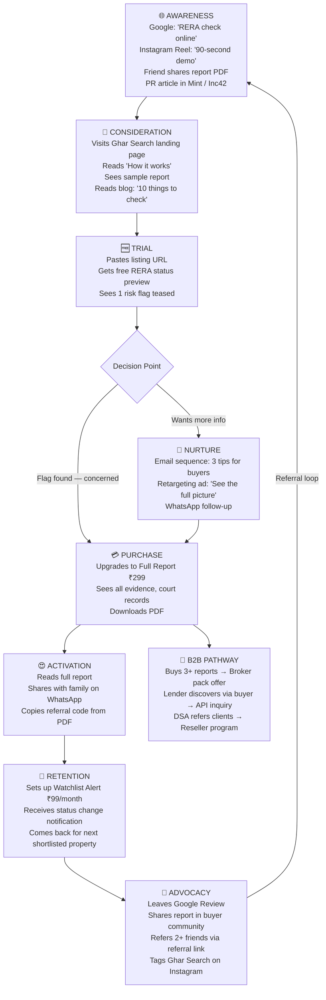
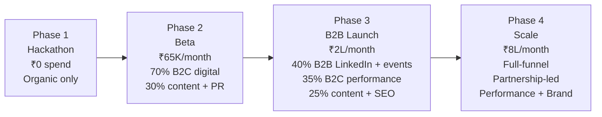

# 🏠 Ghar Search — Marketing Plan

> **North Star**: Every Indian homebuyer knows Ghar Search exists before they sign a booking form.

---

## 1. Brand Voice & Messaging

### Brand Personality

Ghar Search speaks like a **trusted elder sibling who happens to be a lawyer and a data analyst** — warm, protective, direct, and evidence-obsessed. We never fear-monger; we empower. We translate bureaucratic RERA jargon into plain Hindi and English that a first-time buyer's parents can understand.

| Attribute | In Practice |
|---|---|
| **Confident** | "We checked. Here's the evidence." — not "You might want to verify…" |
| **Protective** | Focus on what could go wrong and how we catch it early |
| **Transparent** | Every Trust Score flag cites its source document |
| **Approachable** | Hindi + English, never corporate-speak |
| **Evidence-first** | Never state a risk without proof |

### Persona-Specific Core Messages

| Persona | Core Fear | Our Message | Proof Point |
|---|---|---|---|
| First-time buyer | "What if the builder runs away?" | *"See the RERA status, court cases, and completion history — before you pay the booking amount."* | 1.47 lakh complaints filed against builders |
| NRI buyer | "I can't visit. I rely on agents who benefit from the sale." | *"Your 90-second due-diligence report works 10,000 km away."* | Ghar Search covers 30+ state RERA portals |
| HFC / Lender | "Fraudulent projects put our collateral at risk." | *"Automate RERA compliance checks at loan-file intake. API-ready."* | 90-second report, batch-processing capable |
| Broker / DSA | "Buyers ghost me when they get nervous about the project." | *"Give buyers a Ghar Search report. Build trust. Close faster."* | Shareability built into every report PDF |
| Parents (influencers) | "Humein kuch samajh nahin aata in kagazon mein." | *"Ek report. Sab kuch clear."* | Plain-language summary in every report |

---

## 2. Content Marketing Strategy

### Content Pillars

1. **Education** — How to read RERA filings, understand Trust Scores, interpret legal risk flags
2. **News & Alerts** — Builder defaults, RERA action, state-level enforcement updates
3. **Guides by State** — MahaRERA, UPRERA, RERA Karnataka step-by-step user guides
4. **Case Studies** — Anonymized real report examples (with buyer permission)
5. **Product Updates** — New state coverage, new agent capabilities

### SEO Keyword Strategy

**High-Intent English Keywords (Transactional)**

| Keyword | Monthly Volume (est.) | Difficulty | Content Type |
|---|---|---|---|
| `RERA registration check` | 12,000 | Medium | Tool + Blog |
| `MahaRERA project status` | 18,000 | Medium | Landing page |
| `UPRERA complaint check` | 8,000 | Low | Landing page |
| `builder RERA status` | 6,500 | Low | Tool |
| `is [builder name] RERA registered` | Long-tail | Very Low | Programmatic |
| `real estate due diligence India` | 2,200 | Medium | Blog |
| `property verification India` | 4,100 | Medium | Blog + Tool |

**Hindi / Hinglish Keywords**

| Keyword | Content Type |
|---|---|
| `RERA check kaise karein` | Blog (Hindi) |
| `builder fraud se bachao` | YouTube + Blog |
| `MahaRERA complaint status Hindi` | Landing page |
| `ghar khareedne se pehle kya check karein` | Long-form blog |
| `property ke kagazat kaise verify karein` | YouTube |

### Blog Content Calendar (First 90 Days)

| Week | Title | Target Persona | Keywords |
|---|---|---|---|
| 1 | *"10 Things to Check Before Paying Booking Amount"* | B2C buyer | real estate checklist India |
| 2 | *"What is MahaRERA? A Plain-English Guide for Buyers"* | B2C (Maharashtra) | MahaRERA guide |
| 3 | *"How NRIs Get Cheated in Indian Real Estate (and How to Avoid It)"* | NRI | NRI property India fraud |
| 4 | *"RERA Complaint Check Kaise Karein — Step by Step (Hindi)"* | Hindi-first buyer | RERA complaint Hindi |
| 5 | *"Why Trust Scores Are the Future of Property Due Diligence"* | Thought leadership | proptech India |
| 6 | *"5 Red Flags in a Property Listing That Ghar Search Catches Instantly"* | B2C | property listing fraud |
| 7 | *"Builder Defaulters in Maharashtra: RERA's 2024 Action List"* | News/SEO | builder defaulter Maharashtra |
| 8 | *"Home Loan Collateral Risk: A Guide for Housing Finance Companies"* | B2B lender | collateral due diligence HFC |

### YouTube Content Strategy

- **Format 1 — Explainers (2–5 min)**: *"What does a Ghar Search Trust Score mean?"*
- **Format 2 — Live Report Demos (3–7 min)**: Walk through a real report on camera
- **Format 3 — State RERA Guides (8–12 min)**: *"UPRERA se project check kaise karein"*
- **Format 4 — Horror Stories / Case Studies (5–8 min)**: *"Yeh buyer ₹40 lakh kho sakta tha — yeh unhone kya kiya"*
- Upload cadence: 2 videos/month in beta, 4/month post-launch
- SEO: Hindi + English titles, subtitles for both languages

---

## 3. Social Media Plan

### Platform Strategy

| Platform | Primary Audience | Content Type | Posting Frequency |
|---|---|---|---|
| **Instagram** | B2C buyers (25–40), couples, parents | Reels: "90-second report" demos; Carousels: "5 red flags" | 4–5 posts/week |
| **WhatsApp Business** | All B2C, brokers, parents | Bot for report queries; broadcast for alerts | Always-on bot + weekly broadcast |
| **LinkedIn** | HFCs, lenders, PropTech community, brokers | Thought leadership, product updates, data insights | 3 posts/week |
| **Twitter / X** | PropTech community, journalists, builders | RERA news alerts, product launches, data threads | 1–2 posts/day |
| **YouTube** | SEO-driven all audiences | Long-form guides, demos | 2–4/month |
| **Facebook** | NRI communities, 35–55 age group | Groups participation, targeted ads | 3 posts/week + ads |

### Content Calendar Outline (Monthly)

**Week 1 — Education Week**
- Instagram: *"3 things your builder hopes you never Google"* carousel
- LinkedIn: *"The collateral risk problem housing finance companies don't talk about"* long post
- Twitter: Daily RERA data thread — *"Did you know 47,000+ RERA complaints filed in UP alone?"*

**Week 2 — Product Demo Week**
- Instagram Reel: Screen-record of a 90-second report being generated
- YouTube: *"Live: Checking a Mumbai flat listing on Ghar Search"*
- LinkedIn: *"How Ghar Search generates a Trust Score — the agent pipeline explained"*

**Week 3 — Community Week**
- WhatsApp broadcast: *"New state covered — Karnataka RERA now live"*
- Facebook: Join 5 NRI property buyer groups; share helpful content (not ads)
- Twitter: Engage with PropTech journalists and real estate influencers

**Week 4 — Trust & Social Proof Week**
- Instagram: *"What buyers said after their first Ghar Search report"* (testimonial carousel)
- LinkedIn: *"Case Study: HFC reduced manual RERA verification time by 80%"*
- Twitter: Share media coverage; celebrate milestones

---

## 4. Community Building

### Homebuyer WhatsApp Communities
- **Tactic**: Create *"Ghar Search Buyer Circle"* city-specific WhatsApp groups (Mumbai, Pune, Noida, Bengaluru, Hyderabad)
- **Value offered**: Free weekly RERA alert digests; Q&A with property lawyers; group-exclusive report discounts
- **Growth mechanism**: Every report PDF includes *"Join our buyer community"* QR code

### NRI Communities
- Target Facebook groups: *NRIs Buying Property in India*, *Mumbai NRI Real Estate Community* (~200,000 combined members)
- Partner with NRI-focused YouTube channels (10K–100K subscribers) for sponsored content
- LinkedIn outreach to NRI professionals in UAE, US, UK, Canada — highest remittance corridors

### Real Estate Forums
- Active participation in MouthShut, Housing.com community, Magicbricks Q&A, Reddit r/IndiaInvestments
- Answer RERA queries genuinely; mention Ghar Search only when it directly solves the question
- Goal: 50+ helpful community posts per month by team

### Broker & DSA Networks
- Monthly *"Ghar Search Broker Webinar"* — free RERA training + product demo
- Partner with NAREDCO (National Real Estate Development Council) chapters for member discounts
- Telegram channel: *"RERA Updates for Brokers"* — daily RERA news + Ghar Search promo codes

---

## 5. PR Strategy

### Core Pitch Angles

**Angle 1 — Consumer Protection Story**
*"Indian homebuyers lose crores to builder fraud every year. This 22-year-old built an AI that can flag red flags in 90 seconds."*
- Targets: Times of India (Tech/Real Estate desk), NDTV Profit, Mint, Economic Times PropTech
- Hook: 1.47 lakh RERA complaints; real buyer testimonials

**Angle 2 — PropTech / AI Innovation Story**
*"How an agentic AI pipeline is democratizing property due diligence across 30 Indian states"*
- Targets: Inc42, YourStory, Entrackr, TechCrunch India
- Hook: TinyFish-powered multi-agent architecture; 90-second end-to-end pipeline

**Angle 3 — NRI Angle**
*"NRIs send ₹40,000 crore home for property investments annually. Most do zero due diligence."*
- Targets: NRI-focused publications (NRI Affairs, Times NRI), Gulf News, Indian Express NRI
- Hook: Remote buying vulnerability; Ghar Search as the solution

**Angle 4 — Hackathon / Student Innovation**
*"KCC Engineering students built a property AI that law firms charge ₹50,000 to replicate"*
- Targets: Education desks, startup media, Hindustan Times
- Hook: HackIIITD 2026 win; IIIT-Delhi recognition

### PR Execution Timeline

| Month | Activity |
|---|---|
| Nov 2026 | Hackathon win press release; pitch Inc42 and YourStory |
| Dec 2026 | Beta launch email blast to property journalists; 3 media interviews |
| Jan 2027 | Consumer protection pitch to NDTV Profit; PropTech India feature |
| Feb 2027 | NRI-focused press push ahead of March buying season |

---

## 6. Partnership Strategy

### RERA Bodies
- **Goal**: Official acknowledgement / data partnership endorsement
- **Approach**: Write to MahaRERA and UPRERA as student innovators; request public API access formalization
- **Value to RERA**: Amplify public awareness of RERA's transparency mandate; increase portal traffic

### NRI Associations
- Global Indian Technology Professionals Association (GITPA), Federation of Indian Chambers of Commerce (FICCI NRI cell)
- Offer discounted *NRI Homebuyer Report Packs* through association membership benefits

### DSA / Loan Agent Networks
- Partner with DSA aggregators (Andromeda Loans, Paisabazaar) to offer Ghar Search as a value-add to home loan applicants
- Revenue share: ₹30–₹50 per report purchased through DSA referral link

### Legal Tech Firms
- Integrate with online legal services (LegalKart, Vakil Search) — Ghar Search provides RERA/records layer; they provide legal opinion layer
- Bundle: *"Ghar Search Report + Legal Review"* upsell within both platforms

### Real Estate Portals
- Approach 99acres, Housing.com, and Square Yards for Trust Score badge widget integration
- Business model: Affiliate (₹50–₹150 per paid report) or white-label API

---

## 7. Growth Hacks

### Viral Loop — Shareable Report PDFs
- Every paid report PDF includes:
  - A *"Share this report"* link (tracks referrer)
  - A unique referral code: *"Your friend gets ₹50 off; you earn ₹50 credits"*
  - QR code linking to Ghar Search landing page
- When a buyer shares a report in a family WhatsApp group, each click is a tracked acquisition event

### Group Buying Mechanic
- *"Buy 3 reports together and get 40% off"* — designed for couples discussing multiple shortlisted properties
- One person pays; others in the group chat get a discount code

### RERA Alert Virality
- Free weekly email: *"RERA enforcement actions this week in Maharashtra"* — highly shareable among homebuyer communities
- Each email footer: *"Check your property now — free RERA status"* CTA

### Broker Leaderboard
- Top 10 brokers by report volume get a *"Verified Trust Partner"* badge for their listings
- Creates competitive motivation within broker network; free marketing when they display the badge

### SEO Programmatic Pages
- Auto-generate landing pages for top 1,000 builders: *"[Builder Name] Trust Score — Ghar Search"*
- Each page: RERA status, complaint count, project list — plus CTA to buy full report
- Estimated: 100,000+ organic impressions/month within 6 months

---

## 8. Event Marketing

### PropTech Conferences

| Event | When | Goal | Action |
|---|---|---|---|
| PropTech India Summit | Q1 2027 | B2B visibility; lender contacts | Demo booth; speaker pitch |
| NAR-India Annual Convention | Q2 2027 | Broker network partnership | Sponsor happy hour; distribute broker packs |
| Fintech Festival India | Q2 2027 | HFC/NBFC API pipeline | Speaking slot on *"AI in collateral risk"* |
| NRI Property Expo (Dubai) | Q3 2027 | NRI segment activation | Partner with organizer; run report giveaway |
| YourStory TechSparks | Q3 2027 | Media + investor visibility | Startup showcase; press coverage |

### Hackathons & Developer Events
- Sponsor university hackathons (IIT, NIT, IIIT circuit) — builds developer community and potential engineering hires
- Open-source lightweight RERA data tools; drive GitHub stars and community goodwill

### Webinar Series — *"Ghar Khareedne Ki Sach Baat"* (The Real Truth About Buying a Home)
- Monthly free webinar: RERA expert + Ghar Search team + buyer Q&A
- Guest speakers: RERA officials, property lawyers, HFC underwriters
- Distribution: YouTube Live, LinkedIn Live, WhatsApp registration link
- Target: 200–500 attendees/session by Month 6

---

## 9. Customer Journey Diagram

---

## 10. Budget Allocation Table

> **Estimated Monthly Marketing Budget — Phase 2 Beta (₹50,000–₹75,000/month)**

| Channel | Monthly Spend | Expected Outcome | CAC Estimate |
|---|---|---|---|
| **Google Search Ads** (RERA keywords) | ₹15,000 | 150–200 paid report conversions | ₹75–₹100 |
| **Instagram Reels Ads** | ₹10,000 | 3,000–5,000 reach; 80–120 signups | ₹85–₹125 |
| **Content / SEO** (tools, writer) | ₹8,000 | Organic: 500–800 monthly visitors by Month 3 | ₹40–₹60 (long-term) |
| **WhatsApp Business API** | ₹2,500 | Bot operations + broadcast to 500 subscribers | Near-zero marginal |
| **PR Outreach** (pitch writing) | ₹5,000 | 2–3 media mentions/quarter | Shared attribution |
| **Webinar Hosting + Zoom Pro** | ₹3,000 | 200 attendees/session → 20–30 conversions | ₹150 |
| **Facebook / NRI Community Ads** | ₹8,000 | NRI segment: 1,000 reach; 30–50 reports | ₹160–₹270 |
| **Referral Program Credits** | ₹5,000 | Viral loop activation; 20–40 referred users | ₹125 (shared) |
| **Events / Conferences** | ₹5,000 | 1 local PropTech meetup / webinar sponsorship | Variable |
| **Miscellaneous / Tools** | ₹3,500 | Analytics (Mixpanel), email (Mailchimp), design | Overhead |
| **TOTAL** | **₹65,000/month** | **~400–600 paid reports + organic pipeline** | **Blended ~₹108–₹162** |

> **Phase 3 B2B Marketing Budget** (Q2 2027, ₹1.5L–₹3L/month): Shift toward LinkedIn ads, conference presence, enterprise content, and direct sales enablement materials.

### Budget Split by Stage

---

## Appendix: Key Tracking Metrics for Marketing

| KPI | Tool | Target (Month 6) |
|---|---|---|
| Organic search sessions | Google Search Console | 5,000/month |
| Paid CAC (blended) | Google Analytics + CRM | < ₹150 |
| Email list size | Mailchimp | 2,000 subscribers |
| WhatsApp bot active users | WhatsApp Business API | 500/month |
| Report-to-referral rate | Custom UTM tracking | 15% of paid users share |
| NPS (post-report survey) | Typeform | ≥ 40 |
| Social followers (combined) | Native analytics | LinkedIn 500+, Instagram 1,000+ |
| Media mentions | Google Alerts | 6/quarter |
| Webinar attendance | Zoom | 150+/session |

---

*Document version: 1.0 | HackIIITD 2026 | Ghar Search — KCC Institute of Technology & Management*
*Team: Farhan Rahaman Mallik (Team Lead) · Piyush Kumar Gautam (UI/Frontend)*
