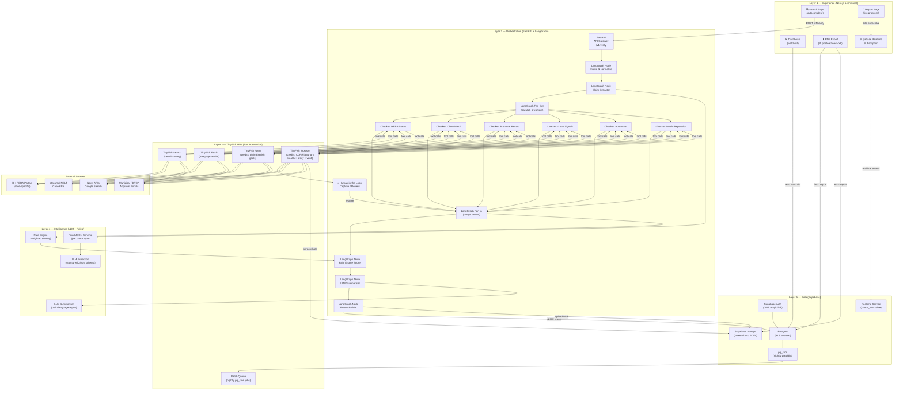
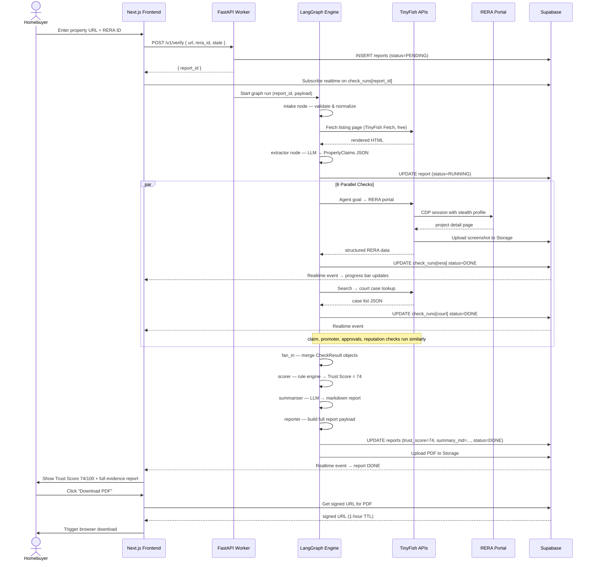

# Ghar Search — System Architecture Document

> **HackIIITD 2026** | Agentic Property Due-Diligence Platform for Indian Homebuyers  
> **Team:** Farhan Rahaman Mallik (Team Lead, AI/Full-Stack · KCC Institute) · Piyush Kumar Gautam (UI/Frontend)  
> **Version:** 1.0.0 · Last Updated: October 2026

---

## Table of Contents

1. [Architecture Philosophy](#1-architecture-philosophy)
2. [System Architecture Overview](#2-system-architecture-overview)
3. [Layer 1 — Experience Layer](#3-layer-1--experience-layer)
4. [Layer 2 — Orchestration Layer](#4-layer-2--orchestration-layer)
5. [Layer 3 — TinyFish Layer](#5-layer-3--tinyfish-layer)
6. [Layer 4 — Intelligence Layer](#6-layer-4--intelligence-layer)
7. [Layer 5 — Data Layer](#7-layer-5--data-layer)
8. [Cross-Cutting Concerns](#8-cross-cutting-concerns)
9. [Scalability Plan](#9-scalability-plan)
10. [Data Flow Diagram](#10-data-flow-diagram)
11. [Component Dependency Map](#11-component-dependency-map)
12. [Deployment Architecture](#12-deployment-architecture)
13. [Decision Log](#13-decision-log)

---

## 1. Architecture Philosophy

Ghar Search is built around three immutable architectural principles that drive every design decision:

### 1.1 Evidence-First Verification

The platform never flags a property issue without attaching **concrete, machine-captured evidence**. Every check result — whether RERA non-compliance, adverse court signals, or a mismatched brochure claim — must carry:

- A **canonical source URL** (RERA portal, court website, news source)
- A **screenshot or page snapshot** stored immutably in Supabase Storage
- A **UTC timestamp** of capture for legal defensibility
- The **raw extracted text** that led to the conclusion

This principle eliminates hallucination as a systemic risk: the LLM cannot fabricate a finding because the rule engine only scores structured data extracted from real pages. LLM output is advisory text, never the ground truth.

### 1.2 Deterministic, Auditable Scoring

Trust Scores are computed by a **pure rule engine** — a deterministic Python function with no probabilistic elements. Given the same evidence payload, the same score is always produced. This means:

- Homebuyers can understand *why* a property scored 68 vs 82
- Lawyers and journalists can reproduce the score independently
- The system is regulatorily defensible — no black-box ML bias
- Score weights are versioned alongside code; changing a weight is a pull request

The LLM's role is restricted to **natural-language summarisation** of the deterministic output — not scoring.

### 1.3 Human-in-the-Loop for Ambiguity

Automated pipelines fail gracefully when they encounter ambiguity:

- **Captcha / bot-detection walls** → pause the LangGraph run, surface a human task in the UI (highlighted yellow banner), resume on completion
- **Low-confidence extraction** (LLM confidence < 0.7) → flag the field as `NEEDS_REVIEW` rather than asserting a value
- **Conflicting evidence** (two RERA pages disagree on registration status) → surface both sources and abstain from a binary verdict

Human oversight is a first-class citizen, not an afterthought.

---

## 2. System Architecture Overview



---

## 3. Layer 1 — Experience Layer

**Technology Stack:** Next.js 14 App Router · TypeScript · Tailwind CSS · Supabase JS Client · @react-pdf/renderer

### 3.1 Core Pages & Components

| Route | Component | Responsibility |
|---|---|---|
| `/` | `SearchPage` | Address autocomplete, property URL input, trigger verification |
| `/report/[id]` | `ReportPage` | Live progress tracker, tabbed evidence viewer |
| `/dashboard` | `DashboardPage` | Watchlist cards, batch status, historical reports |
| `/report/[id]/pdf` | `PdfExportPage` | Server-side PDF generation trigger |

### 3.2 Supabase Realtime Live Progress

The `ReportPage` opens a Supabase Realtime channel subscribed to the `check_runs` table filtered by `report_id`:

```typescript
const channel = supabase
  .channel(`report:${reportId}`)
  .on(
    'postgres_changes',
    { event: 'UPDATE', schema: 'public', table: 'check_runs', filter: `report_id=eq.${reportId}` },
    (payload) => dispatch(updateCheckRun(payload.new))
  )
  .subscribe();
```

Each of the 6 checker nodes emits `status` transitions: `PENDING → RUNNING → DONE | FAILED | NEEDS_REVIEW`. The UI renders a progress rail with animated spinners, green checkmarks, and red/yellow badges — giving homebuyers real-time visibility into what the agents are doing.

### 3.3 Human-in-the-Loop UI

When TinyFish Browser encounters a captcha, the orchestration layer writes a `HITL_REQUIRED` event to `check_runs`. The UI surfaces a highlighted yellow banner:

> ⚠ **Manual step required** — Open the RERA portal link and solve the captcha. The verification will resume automatically.

### 3.4 PDF Export

Reports are exportable as branded PDFs using `@react-pdf/renderer`. The export includes the Trust Score gauge, per-check evidence tables, embedded screenshot thumbnails (from Supabase Storage signed URLs), and a legal disclaimer.

---

## 4. Layer 2 — Orchestration Layer

**Technology Stack:** Python 3.12 · LangGraph 0.2 · FastAPI · asyncio · Docker

### 4.1 LangGraph Graph Structure

```
START → intake → extractor → fan_out →┬→ rera_checker ──────┐
                                       ├→ claim_checker ─────┤
                                       ├→ promoter_checker ──┤
                                       ├→ court_checker ─────┤
                                       ├→ approval_checker ──┤
                                       └→ reputation_checker ┘
                                                              ↓
                                                         fan_in
                                                              ↓
                                                         scorer
                                                              ↓
                                                        summariser
                                                              ↓
                                                         reporter → END
```

### 4.2 Node Descriptions

| Node | Type | Purpose |
|---|---|---|
| `intake` | Sync | Validate input, normalise property address, look up existing cache |
| `extractor` | Async LLM | Parse listing page/brochure PDF into `PropertyClaims` schema |
| `fan_out` | Router | Dispatch 6 checker coroutines in parallel using `asyncio.gather` |
| `rera_checker` | Async Tool | Verify RERA registration, expiry, complaints |
| `claim_checker` | Async Tool | Match brochure claims vs extracted RERA details |
| `promoter_checker` | Async Tool | Background check on developer/builder |
| `court_checker` | Async Tool | eCourts, NCLT, NCLAT case search |
| `approval_checker` | Async Tool | Municipal/DTCP/TNRERA plan sanction status |
| `reputation_checker` | Async Tool | News sentiment, consumer forum complaints |
| `fan_in` | Sync | Merge `CheckResult` objects, surface HITL blocks |
| `scorer` | Sync Rule Engine | Compute 0-100 Trust Score deterministically |
| `summariser` | Async LLM | Write plain-English report sections |
| `reporter` | Async | Persist report to Supabase, upload PDF |

### 4.3 Retry and Timeout Policy

Every checker node wraps its tool calls in an exponential-backoff retry decorator:

```python
@retry(stop=stop_after_attempt(3), wait=wait_exponential(min=1, max=10))
async def rera_checker(state: GraphState) -> CheckResult:
    ...
```

Each node has a **60-second wall-clock timeout**. If a check times out, its result is marked `TIMEOUT` and scored as neutral (does not penalise the property, but is disclosed in the report).

### 4.4 Cost Budget

A `CostTracker` singleton accumulates TinyFish credit spend per `report_id`. When spend exceeds the configured `MAX_CREDITS_PER_REPORT` (default: 50 credits), remaining tool calls fall back to free tiers (Search / Fetch). This prevents runaway cost on adversarial inputs.

---

## 5. Layer 3 — TinyFish Layer

**Technology Stack:** TinyFish Python SDK · Playwright (via Browser tier) · Residential proxy pool · Vault credential store

### 5.1 Tool Selection Logic (Cheapest-First Escalation)

```
Goal received by checker node
        │
        ▼
Can TinyFish Search (free) find the answer?
        │ YES → use result, attach URL evidence
        │ NO ↓
Can TinyFish Fetch (free) render the page?
        │ YES → extract from rendered HTML
        │ NO ↓
Can TinyFish Agent (credits) achieve the goal?
        │ YES → run plain-English goal, extract structured output
        │ NO ↓
TinyFish Browser (credits) — full CDP/Playwright run
    → stealth profile, residential proxy, vault credentials
    → capture evidence screenshot to Supabase Storage
```

This escalation guarantees the lowest possible credit spend per verification.

### 5.2 TinyFish Agent — RERA Goal Templates

Each of India's 30+ RERA portals is mapped in a YAML config file:

```yaml
states:
  maharashtra:
    portal_url: "https://maharerait.mahaonline.gov.in"
    agent_goal: "Search for project registration number {rera_id}. Extract: project_name, promoter_name, registration_status, expiry_date, complaint_count. Return JSON."
    extraction_schema: "rera_maharashtra_v1"
  karnataka:
    portal_url: "https://rera.karnataka.gov.in"
    agent_goal: "Find project '{project_name}' registered by '{promoter}'. Extract registration details and complaint history. Return JSON."
    extraction_schema: "rera_karnataka_v1"
```

Adding a new state requires **only a YAML entry** — no code changes.

### 5.3 Stealth Browser Profile

TinyFish Browser runs are configured with:

- **User-Agent rotation** — realistic desktop Chrome UA strings
- **Residential proxy routing** — per-state IP geolocation matching (Maharashtra IP for MahaRERA, Karnataka IP for Karnataka RERA)
- **Vault credentials** — portal login credentials stored in TinyFish Vault, never in application code or environment variables
- **Human-like delays** — random 800ms–2500ms between interactions

### 5.4 Nightly Batch Queue

`pg_cron` triggers a nightly job at 02:00 IST that enqueues all watched properties into the TinyFish batch queue. The batch runner uses the same LangGraph template but runs at lower priority and with extended timeouts.

---

## 6. Layer 4 — Intelligence Layer

**Technology Stack:** OpenAI GPT-4o / Gemini 1.5 Pro · Python rule engine · Pydantic schemas

### 6.1 Claim Extraction Schema

The LLM `extractor` node outputs a validated `PropertyClaims` Pydantic model:

```python
class PropertyClaims(BaseModel):
    rera_id: str | None
    project_name: str
    promoter_name: str
    claimed_completion_date: date | None
    total_units: int | None
    approved_floors: int | None
    amenities: list[str]
    price_per_sqft: float | None
    land_area_sqft: float | None
    approvals_claimed: list[str]   # e.g. ["RERA", "BBMP", "BDA"]
    confidence: float              # 0.0–1.0 self-assessed by LLM
```

Fields with `confidence < 0.7` are passed through as `NEEDS_REVIEW`.

### 6.2 Trust Score Rule Engine — Weight Table

| Check | Max Points | Weight Rationale |
|---|---|---|
| RERA registration valid & unexpired | 30 | Legally mandatory; binary risk |
| Brochure claims match RERA record | 20 | Direct fraud indicator |
| No active court injunctions | 20 | Project stall risk |
| Promoter has no prior defaults | 10 | Reputation risk |
| Municipal approvals verified | 10 | Structural legality |
| Public reputation neutral/positive | 10 | Early warning signal |
| **Total** | **100** | |

Score bands: `80–100 = LOW RISK` · `60–79 = MODERATE` · `40–59 = HIGH RISK` · `0–39 = CRITICAL`

### 6.3 LLM Summariser Prompt Design

The summariser receives the structured `ReportPayload` (not raw web content) and is instructed:

```
You are a property due-diligence analyst writing for a first-time Indian homebuyer.

Given the structured verification results below, write:
1. A 2-sentence "headline verdict" in plain Hindi/English
2. A bullet list of key risks found (if any), citing the source URL for each
3. A bullet list of positive signals found
4. A 1-sentence recommendation

Rules:
- Never invent facts. Only reference data in the payload.
- If a check was TIMEOUT or NEEDS_REVIEW, say so explicitly.
- Use simple language (Class 8 reading level).
- Do not use legal jargon without explanation.
```

---

## 7. Layer 5 — Data Layer

**Technology Stack:** Supabase (Postgres 15 · pgvector · pg_cron) · Supabase Storage · Supabase Auth · Supabase Realtime

### 7.1 Database Schema

```sql
-- Core tables
CREATE TABLE reports (
    id          UUID PRIMARY KEY DEFAULT gen_random_uuid(),
    user_id     UUID REFERENCES auth.users(id),
    property_url TEXT NOT NULL,
    property_name TEXT,
    rera_id     TEXT,
    state       TEXT,                         -- e.g. 'maharashtra'
    trust_score INTEGER CHECK (trust_score BETWEEN 0 AND 100),
    score_band  TEXT,                         -- 'LOW_RISK' | 'MODERATE' | etc.
    summary_md  TEXT,                         -- LLM-generated markdown
    pdf_url     TEXT,                         -- Supabase Storage signed URL
    status      TEXT DEFAULT 'PENDING',       -- PENDING | RUNNING | DONE | FAILED
    created_at  TIMESTAMPTZ DEFAULT NOW(),
    updated_at  TIMESTAMPTZ DEFAULT NOW()
);

CREATE TABLE check_runs (
    id          UUID PRIMARY KEY DEFAULT gen_random_uuid(),
    report_id   UUID REFERENCES reports(id) ON DELETE CASCADE,
    check_type  TEXT NOT NULL,                -- 'rera' | 'claim' | 'promoter' | etc.
    status      TEXT DEFAULT 'PENDING',       -- PENDING|RUNNING|DONE|FAILED|NEEDS_REVIEW|TIMEOUT
    score       INTEGER,                      -- points earned for this check
    evidence    JSONB,                        -- { url, screenshot_path, raw_text, timestamp }
    flags       JSONB,                        -- array of { severity, message, source_url }
    created_at  TIMESTAMPTZ DEFAULT NOW(),
    updated_at  TIMESTAMPTZ DEFAULT NOW()
);

CREATE TABLE watchlist (
    id          UUID PRIMARY KEY DEFAULT gen_random_uuid(),
    user_id     UUID REFERENCES auth.users(id),
    report_id   UUID REFERENCES reports(id),
    notify_on_change BOOLEAN DEFAULT TRUE,
    created_at  TIMESTAMPTZ DEFAULT NOW()
);

CREATE TABLE hitl_tasks (
    id          UUID PRIMARY KEY DEFAULT gen_random_uuid(),
    check_run_id UUID REFERENCES check_runs(id),
    task_type   TEXT,                         -- 'CAPTCHA' | 'REVIEW'
    instructions TEXT,
    portal_url  TEXT,
    resolved_at TIMESTAMPTZ,
    created_at  TIMESTAMPTZ DEFAULT NOW()
);
```

### 7.2 Row-Level Security (RLS)

```sql
-- Users can only read their own reports
ALTER TABLE reports ENABLE ROW LEVEL SECURITY;
CREATE POLICY "own_reports" ON reports
    FOR ALL USING (auth.uid() = user_id);

-- check_runs inherit report ownership
CREATE POLICY "own_check_runs" ON check_runs
    FOR ALL USING (
        report_id IN (SELECT id FROM reports WHERE user_id = auth.uid())
    );
```

### 7.3 pg_cron Nightly Schedule

```sql
-- Run watchlist refresh every night at 02:00 IST (20:30 UTC)
SELECT cron.schedule(
    'nightly-watchlist-refresh',
    '30 20 * * *',
    $$SELECT enqueue_watchlist_batch()$$
);
```

### 7.4 Supabase Storage Buckets

| Bucket | Access | Contents |
|---|---|---|
| `screenshots` | Private (RLS) | Evidence screenshots per check_run |
| `pdfs` | Private (RLS) | Generated PDF reports per report_id |
| `brochures` | Private (RLS) | User-uploaded property brochures |

---

## 8. Cross-Cutting Concerns

### 8.1 Authentication

- **Frontend:** Supabase Auth with email magic-link and Google OAuth. JWT stored in httpOnly cookie.
- **Backend Worker:** Service-role Supabase key used only inside the Docker container. Never exposed to frontend.
- **TinyFish:** API key stored as environment variable in Docker secrets; portal credentials in TinyFish Vault.

### 8.2 Error Handling Strategy

```
Tool failure → retry (3x exponential backoff)
              → fallback to lower TinyFish tier
              → mark check FAILED with reason
              → continue fan-in (partial report is better than no report)
LLM timeout  → retry once → use fallback extraction prompt
              → mark field NEEDS_REVIEW
Supabase down → queue report write to Redis (not yet built, planned v1.1)
```

### 8.3 Observability & Logging

All LangGraph nodes emit structured JSON logs:

```json
{
  "ts": "2026-10-24T07:12:38Z",
  "report_id": "abc-123",
  "node": "rera_checker",
  "state": "maharashtra",
  "tool_used": "tinyfish_agent",
  "credits_spent": 3,
  "duration_ms": 4821,
  "outcome": "DONE",
  "flags_raised": 1
}
```

Logs are shipped to Supabase Postgres (`agent_logs` table) for the hackathon demo. Production would use OpenTelemetry → Grafana.

### 8.4 Cost Control

- `CostTracker` caps credits per report (configurable, default 50)
- TinyFish Search and Fetch are always tried first (free)
- Batch nightly runs use off-peak rate limits
- LLM calls use streaming to fail fast on timeout

---

## 9. Scalability Plan

### 9.1 Adding New Indian States

Adding Maharashtra → Telangana RERA coverage requires **only** editing `config/rera_states.yaml`:

```yaml
telangana:
  portal_url: "https://rera.telangana.gov.in"
  agent_goal: "Search project by RERA ID {rera_id}. Extract: ..."
  extraction_schema: "rera_generic_v1"
```

No Python, no LangGraph changes. The same graph template instantiates the goal at runtime.

### 9.2 Extension to Land Records

A `land_records_checker` node can be added to the LangGraph fan-out with:

- New YAML config for state land record portals (e.g., Kaveri Online for Karnataka)
- New Pydantic schema `LandRecordClaims`
- New rule-engine weight row (land title encumbrance = 25 points)

### 9.3 Rentals & Vendor KYB

The same pipeline generalises to:

- **Rental verification** — tenant background, landlord disputes, society NOC
- **Vendor KYB** — contractor GST verification, PAN check, blacklist screening

Each domain gets its own YAML config, schema, and weight table while reusing the entire orchestration and data stack.

### 9.4 Batch API for Lenders

Banks and NBFCs can call `POST /v1/batch-verify` with an array of properties. The orchestration layer fans out across multiple LangGraph runs concurrently (bounded by a semaphore). Results are delivered via webhook.

---

## 10. Data Flow Diagram



---

## 11. Component Dependency Map

```mermaid
classDiagram
    class NextjsApp {
        +SearchPage
        +ReportPage
        +DashboardPage
        +useLiveReport()
        +useSupabaseRealtime()
    }

    class FastAPIWorker {
        +POST /v1/verify
        +POST /v1/batch-verify
        +GET /v1/report/{id}
        +CostTracker
        +AuthMiddleware
    }

    class LangGraphEngine {
        +GraphState
        +intake_node()
        +extractor_node()
        +fan_out_node()
        +fan_in_node()
        +scorer_node()
        +summariser_node()
        +reporter_node()
    }

    class CheckerNodes {
        +rera_checker()
        +claim_checker()
        +promoter_checker()
        +court_checker()
        +approval_checker()
        +reputation_checker()
    }

    class TinyFishTools {
        +search(query) free
        +fetch(url) free
        +agent(goal, schema) credits
        +browser(steps, vault) credits
    }

    class IntelligenceLayer {
        +PropertyClaims schema
        +CheckResult schema
        +RuleEngine.score()
        +LLMExtractor.extract()
        +LLMSummariser.summarise()
    }

    class SupabaseClient {
        +db: PostgresClient
        +storage: StorageClient
        +auth: AuthClient
        +realtime: RealtimeClient
    }

    class RERAConfig {
        +states: dict
        +get_goal(state, rera_id)
        +get_schema(state)
    }

    NextjsApp --> SupabaseClient : realtime + auth
    NextjsApp --> FastAPIWorker : REST calls
    FastAPIWorker --> LangGraphEngine : invoke graph
    LangGraphEngine --> CheckerNodes : parallel dispatch
    CheckerNodes --> TinyFishTools : tool calls
    CheckerNodes --> IntelligenceLayer : extract + score
    TinyFishTools --> RERAConfig : goal templates
    LangGraphEngine --> SupabaseClient : persist state
    TinyFishTools --> SupabaseClient : upload screenshots
    IntelligenceLayer --> RERAConfig : schema lookup
```

---

## 12. Deployment Architecture

```mermaid
flowchart TD
    subgraph VERCEL["Vercel Edge Network"]
        NX["Next.js 14\nApp (SSR/RSC)"]
        EDGE_FN["Edge Functions\n(auth middleware)"]
    end

    subgraph DOCKER["Docker Container (Cloud Run / Railway)"]
        FA["FastAPI\n:8000"]
        LGW["LangGraph Worker\n(asyncio event loop)"]
        COST["CostTracker\nSingleton"]
        LOG["Structured Logger\n→ Supabase"]
    end

    subgraph SUPABASE_CLOUD["Supabase Cloud (ap-south-1)"]
        SBDB["Postgres 15\n+ pg_cron + pgvector"]
        SBST["Storage\n(screenshots, PDFs)"]
        SBAUTH["Auth\n(JWT + OAuth)"]
        SBRT["Realtime\n(WebSocket)"]
    end

    subgraph TINYFISH_CLOUD["TinyFish Cloud"]
        TFSEARCH["Search API"]
        TFFETCH["Fetch API"]
        TFAGENT["Agent API"]
        TFBROWSER["Browser API\n(CDP + Stealth)"]
        TFVAULT["Credential Vault"]
        TFPROXY["Proxy Pool\n(residential IPs)"]
    end

    subgraph EXTERNAL["External Data Sources"]
        RERA_MH["MahaRERA"]
        RERA_KA["Karnataka RERA"]
        RERA_DL["Delhi RERA"]
        RERA_N["...30+ more"]
        ECOURTS["eCourts India"]
        NCLT["NCLT Portal"]
        DTCP["Municipal Portals"]
        NEWS_API["News / Search APIs"]
    end

    USER["🏠 Homebuyer\n(Browser)"] --> VERCEL
    NX --> FA : "REST API calls\n(service token)"
    NX --> SBAUTH : "JWT validation"
    NX --> SBRT : "Realtime WebSocket"
    FA --> LGW
    LGW --> SUPABASE_CLOUD
    LGW --> TINYFISH_CLOUD
    TFFETCH & TFSEARCH & TFAGENT & TFBROWSER --> EXTERNAL
    TFBROWSER --> TFVAULT & TFPROXY
    VERCEL -->|"CDN"| USER
    SBRT -->|"push events"| NX
```

---

## 13. Decision Log

| # | Decision | Options Considered | Choice & Rationale |
|---|---|---|---|
| 1 | **Orchestration framework** | Celery + Redis, Prefect, LangGraph | **LangGraph** — native support for stateful agent graphs, parallel fan-out, human-in-the-loop, and first-class retry/interrupt semantics. Celery lacks agent primitives. |
| 2 | **Scoring approach** | Pure ML model, LLM judge, rule engine | **Rule engine** — deterministic, auditable, reproducible. ML models require labelled training data we don't have; LLM judges are non-deterministic and expensive per call. |
| 3 | **Browser automation** | Self-hosted Playwright, Browserless, TinyFish Browser | **TinyFish Browser** — managed stealth profiles, built-in proxy rotation, vault credentials, no infra overhead at hackathon scale. |
| 4 | **Database** | Firebase, PlanetScale, Supabase | **Supabase** — Postgres RLS for security, built-in Realtime for live progress, Storage for screenshots, Auth, pg_cron for watchlist, all in one platform. |
| 5 | **LLM for extraction** | GPT-4o, Gemini 1.5 Pro, Claude 3.5 | **GPT-4o (primary) / Gemini fallback** — GPT-4o has best structured JSON output reliability. Gemini used as cost fallback. |
| 6 | **Frontend framework** | React SPA, Next.js, Remix | **Next.js 14 App Router** — SSR for SEO (property pages indexable), RSC for performance, native Vercel deployment, TypeScript support. |
| 7 | **RERA coverage extensibility** | Hardcode per-state parsers, selector maps, YAML goals | **YAML goal templates** — one config entry per state, no code changes. TinyFish Agent handles site-specific navigation autonomously. |
| 8 | **Evidence storage** | Inline DB blobs, S3, Supabase Storage | **Supabase Storage** — co-located with DB, RLS policies automatically scope access, signed URLs for PDF export, no separate AWS account needed. |
| 9 | **Cost budget enforcement** | Per-user quotas only, per-report cap, none | **Per-report credit cap** — prevents single adversarial input (complex JS-heavy sites) from draining the account. User quotas are a v1.1 concern. |
| 10 | **Deployment target** | AWS Lambda, GCP Cloud Run, Railway, Vercel | **Vercel (FE) + Docker on Cloud Run (worker)** — Vercel for zero-config Next.js, Cloud Run for containerised Python worker with longer timeouts than Lambda (15-min max). |

---

> **Document Status:** ✅ Complete  
> **Next Steps:** See `PLAN/System Design/api_contracts.md` for REST and WebSocket endpoint specifications, and `PLAN/System Design/database_schema.sql` for the full migration file.
