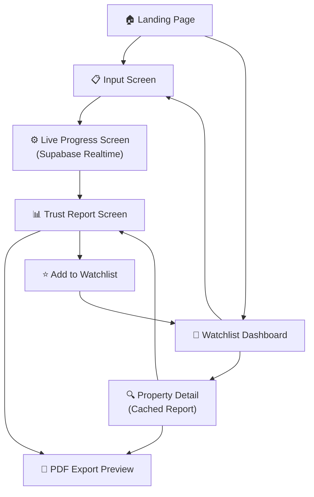
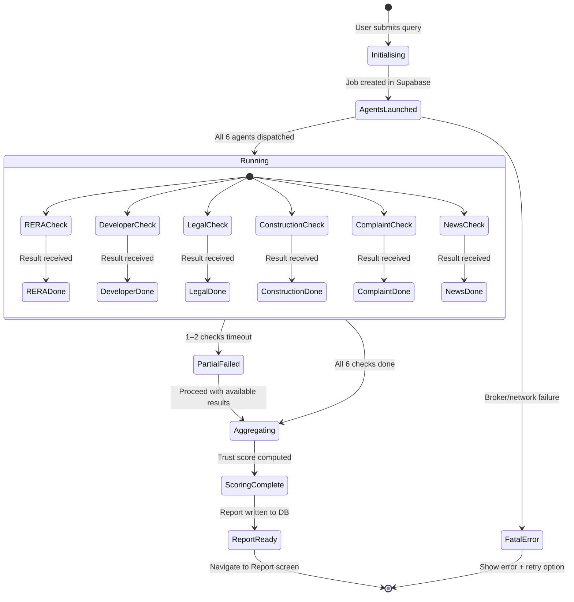
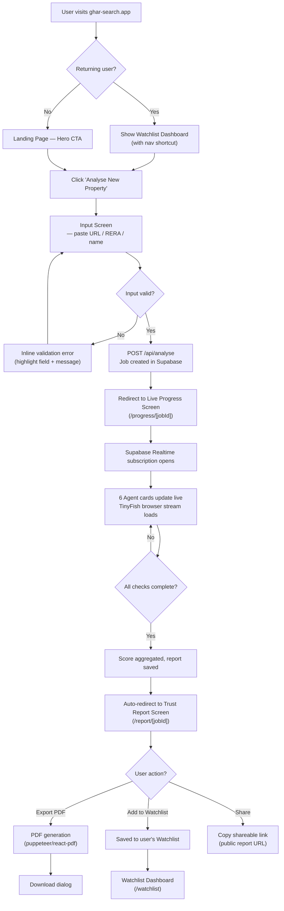

# Ghar Search — System Design Document
### Agentic Property Due-Diligence Platform for Indian Homebuyers
**HackIIITD 2026 | Team: Farhan Rahaman Mallik (Lead, AI/Full-Stack) · Piyush Kumar Gautam (UI/Frontend)**

---

## 1. Design Philosophy

Ghar Search is built on three interlocking principles that govern every UI decision:

### 1.1 Evidence-First
Every flag, every score deduction, every claim verification — must be traceable to a concrete source. No assertion without a citation. Each piece of evidence surfaces as a card carrying: the source URL, a screenshot thumbnail captured by the live browser agent, and the exact timestamp of capture. This gives the homebuyer the ability to independently verify any finding; the report is a dossier, not an opinion.

### 1.2 Trust Through Transparency
The score is not a black box. The Trust Score ring (0–100) is decomposed into explicit weighted statutory sub-scores (Stage 1 MVP focuses on the two catastrophic risks: 60 pts RERA Registration & Disclosures + 40 pts Litigation Signals, with full 6-dimension expansion in Stage 2). The weighting breakdown is displayed inline on the report screen so users understand why a project scored 68 and not 92. Progress indicators during live analysis show the literal agent activity — what statutory portal the agent is querying, what disclosures it is validating — not just a generic spinner.

### 1.3 Progressive Disclosure
Complexity is hidden until requested. The landing page exposes only the input. The input screen shows only one action. The live progress screen shows high-level status with a toggle to reveal the raw browser view. The report screen leads with the score and a summary, with each check result collapsed by default and expandable. Full evidence panels appear on demand. This respects first-time buyers (who want a verdict) and power users / lenders (who want every detail).

---

## 2. Brand Identity

### 2.1 Brand Voice
Confident, precise, empathetic. Ghar Search speaks like a trusted lawyer who happens to be your friend — authoritative but not intimidating, technical but plain-spoken.

### 2.2 Logo Concept
A stylised shield containing a minimalist house outline. The house icon uses a single stroke weight; the shield represents protection and due diligence. Wordmark: **Ghar Search** in Inter ExtraBold, with "Ghar" in `#1A365D` (Navy) and "Search" in `#0EA5E9` (Sky Blue). A subtle gradient dot mark sits above the shield — a nod to the real-time data pulse.

### 2.3 Color Palette

| Token | Name | Hex | Usage |
|---|---|---|---|
| `--color-trust-green` | Trust Green | `#16A34A` | Score > 70, pass badges |
| `--color-trust-amber` | Trust Amber | `#D97706` | Score 40–70, warn badges |
| `--color-trust-red` | Trust Red | `#DC2626` | Score < 40, fail badges |
| `--color-primary` | Navy | `#1A365D` | Primary CTA, headers |
| `--color-primary-light` | Sky Blue | `#0EA5E9` | Accent, links, highlights |
| `--color-surface` | Off-White | `#F8FAFC` | Page background (light) |
| `--color-surface-card` | White | `#FFFFFF` | Card surfaces |
| `--color-surface-dark` | Graphite | `#0F172A` | Page background (dark) |
| `--color-surface-card-dark` | Dark Card | `#1E293B` | Card surfaces (dark) |
| `--color-muted` | Slate 400 | `#94A3B8` | Placeholder text, dividers |
| `--color-text-primary` | Slate 900 | `#0F172A` | Body text (light) |
| `--color-text-primary-dark` | Slate 50 | `#F8FAFC` | Body text (dark) |
| `--color-border` | Slate 200 | `#E2E8F0` | Card borders, dividers |
| `--color-overlay` | Indigo 50 | `#EEF2FF` | Highlight rows, hover states |

### 2.4 Typography

| Role | Font | Weight | Size |
|---|---|---|---|
| Display / Score | Inter | 800 ExtraBold | 72px (ring), 48px (h1) |
| Heading | Inter | 700 Bold | 32px / 24px / 20px |
| Body | Inter | 400 Regular | 16px |
| Caption / Meta | Inter | 400 Regular | 13px |
| Monospace / Evidence | JetBrains Mono | 400 | 13px |
| Badge / Chip | Inter | 600 SemiBold | 12px uppercase |

Fallback stack: `'Inter', 'Segoe UI', system-ui, sans-serif`.

---

## 3. Design System — Component Library

### 3.1 Buttons

| Variant | Style | Usage |
|---|---|---|
| Primary | `bg-[#1A365D] text-white rounded-xl px-6 py-3` | Main CTA (Analyse, Export PDF) |
| Secondary | `border border-[#1A365D] text-[#1A365D] rounded-xl px-6 py-3` | Add to Watchlist |
| Ghost | `text-[#0EA5E9] underline` | View Evidence, Source Link |
| Danger | `bg-[#DC2626] text-white` | Remove from watchlist |

All buttons: `transition-all duration-200 hover:opacity-90 focus:ring-2 focus:ring-offset-2 focus:ring-[#0EA5E9]`.

### 3.2 Cards

- **Surface Card**: `bg-white dark:bg-[#1E293B] rounded-2xl shadow-sm border border-[#E2E8F0] dark:border-[#334155] p-6`
- **Flag Card** (Evidence): same surface + left border `4px solid` in trust color
- **Check Card**: collapsible, header row with status icon + title + expand chevron

### 3.3 Status Badges / Chips

```
PASS    →  bg-green-100  text-green-700  border-green-200   rounded-full px-3 py-0.5 text-xs font-semibold uppercase
WARN    →  bg-amber-100  text-amber-700  border-amber-200
FAIL    →  bg-red-100    text-red-700    border-red-200
PENDING →  bg-slate-100  text-slate-500  border-slate-200
RUNNING →  bg-blue-100   text-blue-600   border-blue-200   + pulse animation
```

### 3.4 Trust Score Ring (SVG)

- 120px diameter SVG circle, `stroke-width: 10`
- Background track: `stroke: #E2E8F0`
- Progress arc: `stroke-dasharray` animated from 0 → computed value over 1.2s cubic-ease-out
- Center: large score numeral (Inter 800) + `/100` subscript
- Ring color: dynamically set to trust-green / trust-amber / trust-red based on score
- Outer glow: `drop-shadow` filter in the corresponding trust color at 30% opacity

### 3.5 Progress Indicators

- **Agent Status Row**: icon (spinner/check/cross) + agent name + current action label + elapsed time
- **Live Browser Panel**: `<iframe>` or `` refreshing from TinyFish session, bordered with `border-2 border-[#0EA5E9]`, labelled "Live Agent View"
- **Overall Pipeline Progress Bar**: `h-2 bg-gradient-to-r from-[#0EA5E9] to-[#16A34A]`, `transition-width 300ms ease`

---

## 4. Screen Inventory

| # | Screen | Purpose |
|---|---|---|
| 1 | **Landing** | Value proposition, single CTA to start |
| 2 | **Input** | Paste URL / RERA number / project name |
| 3 | **Live Progress** | Real-time agent status + browser view |
| 4 | **Trust Report** | Score, flags, evidence, full check results |
| 5 | **PDF Export Preview** | Paginated print layout of report |
| 6 | **Watchlist Dashboard** | Saved properties with summary scores |
| 7 | **Property Detail (Watchlist)** | Stored report for a watchlisted property |

---

## 5. Information Architecture



---

## 6. Wireframe Descriptions

### 6.1 Landing Page
**Layout**: Full-viewport hero, vertically centered, max-width 800px centered. No navigation bar initially — just logo top-left and a ghost "Sign In" link top-right.

- **Hero Headline**: 48px "Stop Trusting. Start Verifying." — two lines, heavy weight.
- **Sub-headline**: 20px muted text explaining the product in one sentence.
- **Primary CTA button**: "Analyse a Property →" centered, large, navy fill.
- **Social proof strip**: 3 stat chips below button — "12 checks automated", "Evidence-backed scores", "RERA verified".
- **Scroll section**: 3 feature cards explaining Evidence-First, Live Agent View, PDF Report.
- **Footer**: minimal — logo, GitHub link, HackIIITD 2026 badge.

### 6.2 Input Screen
**Layout**: Card-centered layout, 640px max-width, vertically centered.

- **Step indicator**: "Step 1 of 3 — Enter Property Details"
- **Input field**: Large textarea with placeholder `"Paste MagicBricks / 99acres URL, RERA number, or project name…"`. Auto-resize. `rounded-2xl border-2 focus:border-[#0EA5E9]`.
- **Examples row**: 3 clickable example pills (MagicBricks URL, RERA no., Project name) to prefill the field.
- **Analyse Button**: full-width on mobile, fixed-width on desktop.
- **Trust guarantee note**: Small italic text — "Your query is never stored. Reports are ephemeral unless you save them."

### 6.3 Live Progress Screen
**Layout**: Two-column on desktop (60% status panel | 40% browser panel). Single column on mobile (status stacked above browser).

- **Top bar**: Property name/query (truncated) + elapsed timer ("Analysing… 0:42").
- **Left / Top panel — 6 Agent Check Cards**:
  - RERA Verification, Developer Track Record, Legal Encumbrance, Construction Progress, Complaint History, News & Sentiment
  - Each card: status badge (PENDING → RUNNING → PASS/WARN/FAIL) + current action text that updates live.
- **Right / Bottom panel — Live Browser View**:
  - Labelled "Agent Browser (Live)" with a pulsing blue dot indicator.
  - Iframe / image stream from TinyFish session.
  - Toggle button: "Show / Hide Browser".
- **Supabase Realtime**: Cards update via subscription to `analysis_runs` table channel.
- **Cancel button**: ghost, bottom left.

### 6.4 Trust Report Screen
**Layout**: Single column, max-width 900px, sectioned with clear dividers.

- **Report Header**: Property name + address | "Analysed at HH:MM, DD MMM YYYY" | Share icon + PDF export button.
- **Trust Score Ring**: 120px ring, centered or left-aligned with score breakdown legend to the right.
- **Score Breakdown**: horizontal bar chart (6 bars, each labeled with check name and sub-score).
- **Flag Summary Strip**: horizontally scrollable row of colored chips — "3 FAIL · 2 WARN · 1 PASS".
- **Claims Extraction Table**: 3-column — Claim | Agent Verdict | Evidence Link. Rows alternating `bg-[#F8FAFC]`.
- **6 Check Result Accordions**: Each collapsed by default. Header shows check name + badge. Expand reveals: detailed finding paragraph + evidence cards.
- **Evidence Cards**: Left-colored border, source URL (monospace, truncated with tooltip), screenshot thumbnail (click to enlarge lightbox), timestamp.
- **Add to Watchlist / Export PDF**: sticky footer bar on mobile; floating action group on desktop.

### 6.5 Watchlist Dashboard
**Layout**: Grid of property cards, 3-column desktop / 2-column tablet / 1-column mobile.

- **Header**: "My Watchlist (7 properties)" + "Analyse New Property" button.
- **Property Card**: address thumbnail (Google Maps static or placeholder), trust score ring (small 60px), top-3 flags as chips, last analysed date, "View Report" CTA.
- **Sort/Filter bar**: Sort by score (asc/desc), filter by status (PASS/WARN/FAIL dominant).

---

## 7. Component Specifications

### 7.1 Trust Score Ring

```
Component: <TrustScoreRing score={number} size="lg|md|sm" animated={boolean} />

Props:
  score     0–100 integer
  size      lg = 120px | md = 80px | sm = 60px (watchlist cards)
  animated  boolean — enables dasharray transition on mount

Color logic:
  score > 70  → stroke: #16A34A (green)
  score 40-70 → stroke: #D97706 (amber)
  score < 40  → stroke: #DC2626 (red)

SVG anatomy:
  <circle r="52" cx="60" cy="60" stroke="#E2E8F0" stroke-width="10" fill="none" />
  <circle r="52" cx="60" cy="60" stroke={color} stroke-width="10" fill="none"
          stroke-dasharray={`${(score/100)*326.7} 326.7`}
          stroke-dashoffset="81.675"   /* rotates start to 12 o'clock */
          transform="rotate(-90 60 60)"
          style="transition: stroke-dasharray 1.2s cubic-bezier(0.34,1.56,0.64,1)" />
  <text x="60" y="58" text-anchor="middle" font-size="28" font-weight="800">{score}</text>
  <text x="60" y="74" text-anchor="middle" font-size="12" fill="#94A3B8">/100</text>
```

### 7.2 Check Status Card

```
Component: <CheckCard check={CheckResult} live={boolean} />

States:  PENDING | RUNNING | PASS | WARN | FAIL

Structure:
  ┌─────────────────────────────────────────────┐
  │  [Icon]  Check Name           [Status Badge] │
  │          Current action label (live text)    │
  │          ▸ expand for details                │
  └─────────────────────────────────────────────┘

RUNNING state: Icon = animated spinner (Tailwind `animate-spin`), badge pulses.
Expanded state: Finding paragraph + evidence card list.
```

### 7.3 Evidence Card

```
Component: <EvidenceCard flag={Flag} />

Structure:
  ┌── [left border: trust color] ─────────────────────────┐
  │  🚩 Flag Title                          [FAIL badge]   │
  │  Finding description — one paragraph.                  │
  │  ─────────────────────────────────────────────────     │
  │  [Screenshot thumbnail 160×90]  Source: magicbricks... │
  │  Captured: 24 Oct 2026, 12:34:17 IST      [View →]    │
  └────────────────────────────────────────────────────────┘

Thumbnail: click opens <dialog> lightbox with full screenshot + download button.
Source URL: monospace, max 48 chars, truncated with title tooltip showing full URL.
```

### 7.4 Claims Extraction Table

```
Columns:
  1. Developer's Claim  (from listing text, italic)
  2. Agent Verdict      (VERIFIED / DISPUTED / UNVERIFIABLE badge)
  3. Evidence           (URL chip → opens evidence card)

Rows: zebra striped, hover highlight `bg-[#EEF2FF]`.
Empty state: "No claims could be extracted from this listing."
```

### 7.5 Live Browser View Panel

```
Component: <LiveBrowserPanel sessionUrl={string} visible={boolean} />

Container: aspect-ratio 16/9, border-2 border-[#0EA5E9], rounded-xl, overflow-hidden.
Header bar: "Agent Browser (Live)" + pulsing dot + toggle button.
Content: <iframe src={sessionUrl} sandbox="allow-scripts allow-same-origin" />
Fallback: if sessionUrl null → placeholder with browser icon + "Agent is initialising…"
Mobile: collapsible section, collapsed by default to prioritize status cards.
```

---

## 8. Responsive Design

| Breakpoint | Name | Width | Layout Changes |
|---|---|---|---|
| `sm` | Mobile | < 640px | Single column, stacked sections, score ring sm |
| `md` | Tablet | 640–1024px | 2-column watchlist grid, browser panel below status |
| `lg` | Desktop | 1024–1280px | 2-column progress (60/40), 3-col watchlist |
| `xl` | Wide | > 1280px | Max-width capped at 1280px, centered |

**Mobile-specific adaptations**:
- Sticky bottom bar for primary actions (Analyse / Export PDF / Save)
- Claims table becomes a scrollable horizontal table with frozen first column
- Evidence card thumbnails hidden on < 375px (text-only mode)
- Live browser panel collapses behind a "Show Agent Browser" tap-to-reveal

---

## 9. Accessibility — WCAG 2.1 AA

| Requirement | Implementation |
|---|---|
| Colour contrast ≥ 4.5:1 | Navy `#1A365D` on white → 12.6:1 ✓ |
| Focus indicators | `focus:ring-2 focus:ring-[#0EA5E9] focus:ring-offset-2` on all interactive elements |
| Screen reader labels | `aria-label` on icon-only buttons, `aria-live="polite"` on status update regions |
| Skip navigation | `<a href="#main" className="sr-only focus:not-sr-only">Skip to content</a>` |
| Score ring alt text | `role="img" aria-label="Trust Score: 67 out of 100, Amber"` |
| Accordion state | `aria-expanded`, `aria-controls` on check result accordions |
| Colour not sole indicator | Badges always include text label alongside colour |
| Motion reduction | `prefers-reduced-motion` media query disables score ring animation and transitions |
| Keyboard navigation | All interactive elements reachable via Tab; accordions toggle on Enter/Space |
| Error messages | Linked to inputs via `aria-describedby`; never colour-only |

---

## 10. Interaction Design

### 10.1 Page Transitions
Route changes use a **fade + subtle slide-up** (Y: 8px → 0, opacity 0 → 1, 200ms ease-out). Implemented via Framer Motion `<AnimatePresence>` wrapping Next.js page layouts.

### 10.2 Trust Score Ring Animation
On report screen mount: ring animates from 0 → final score over 1.2s with `cubic-bezier(0.34, 1.56, 0.64, 1)` (slight overshoot gives life to the animation). Score numeral counts up in sync using a `useCountUp` hook.

### 10.3 Check Card Status Transitions
State changes (PENDING → RUNNING → PASS) animate: badge cross-fades (opacity), action label slides in from bottom (translateY: 4px → 0, 150ms). RUNNING state includes a CSS-only `animate-pulse` on the border.

### 10.4 Accordion Expand/Collapse
Content panel: `max-height: 0 → auto` via Framer Motion `AnimatePresence` with `height` animation. Chevron rotates 0° → 180° on expand (CSS transform, 200ms).

### 10.5 Evidence Thumbnail Lightbox
Click on thumbnail: backdrop fades in (opacity 0 → 1, 200ms), image scales up from thumbnail position (Framer Motion `layoutId` shared layout animation). Closes on Escape key or backdrop click.

### 10.6 Micro-interactions
- Copy-to-clipboard on source URL click: brief "Copied!" tooltip (300ms, then fades).
- Watchlist Add button: heart icon fills + bounces on click (scale 1 → 1.3 → 1, 300ms).
- PDF export button: loading state replaces icon with spinner during generation.

---

## 11. Live Progress Screen — State Diagram



---

## 12. User Interaction Flow — Landing to Report



---

## 13. Dark / Light Mode

Ghar Search ships with system-preference detection (`prefers-color-scheme`) and a manual toggle persisted in `localStorage`.

| Element | Light Mode | Dark Mode |
|---|---|---|
| Page background | `#F8FAFC` | `#0F172A` |
| Card surface | `#FFFFFF` | `#1E293B` |
| Card border | `#E2E8F0` | `#334155` |
| Primary text | `#0F172A` | `#F8FAFC` |
| Muted text | `#94A3B8` | `#64748B` |
| Score ring track | `#E2E8F0` | `#334155` |
| Live browser border | `#0EA5E9` | `#38BDF8` |
| Badge backgrounds | Desaturated pastels | Darker tinted backgrounds |

**Implementation**: Tailwind `dark:` class variants. A `<ThemeProvider>` wraps the app, applies `dark` class to `<html>`. Toggle button in navbar top-right (sun/moon icon).

> [!NOTE]
> Trust colors (green/amber/red) are intentionally identical in both modes — they carry semantic meaning that must remain consistent and unambiguous regardless of theme.

---

## 14. Design Tokens — CSS Variables & Tailwind Config

### CSS Custom Properties (`globals.css`)

```css
:root {
  /* Trust Colors */
  --color-trust-green:       #16A34A;
  --color-trust-amber:       #D97706;
  --color-trust-red:         #DC2626;

  /* Brand */
  --color-primary:           #1A365D;
  --color-primary-light:     #0EA5E9;
  --color-primary-hover:     #152E52;

  /* Surfaces */
  --color-surface:           #F8FAFC;
  --color-surface-card:      #FFFFFF;
  --color-surface-overlay:   #EEF2FF;

  /* Text */
  --color-text-primary:      #0F172A;
  --color-text-secondary:    #475569;
  --color-text-muted:        #94A3B8;

  /* Borders */
  --color-border:            #E2E8F0;
  --color-border-focus:      #0EA5E9;

  /* Spacing */
  --radius-card:             16px;
  --radius-badge:            9999px;
  --radius-input:            12px;

  /* Shadows */
  --shadow-card:             0 1px 3px rgba(0,0,0,0.08), 0 1px 2px rgba(0,0,0,0.06);
  --shadow-card-hover:       0 4px 12px rgba(0,0,0,0.12);
  --shadow-score-green:      0 0 20px rgba(22,163,74,0.30);
  --shadow-score-amber:      0 0 20px rgba(217,119,6,0.30);
  --shadow-score-red:        0 0 20px rgba(220,38,38,0.30);

  /* Transitions */
  --transition-fast:         150ms ease;
  --transition-normal:       200ms ease;
  --transition-slow:         300ms ease;
  --transition-spring:       cubic-bezier(0.34, 1.56, 0.64, 1);
}

.dark {
  --color-surface:           #0F172A;
  --color-surface-card:      #1E293B;
  --color-surface-overlay:   #1E293B;
  --color-text-primary:      #F8FAFC;
  --color-text-secondary:    #94A3B8;
  --color-text-muted:        #64748B;
  --color-border:            #334155;
}
```

### Tailwind `tailwind.config.ts` Extension

```typescript
import type { Config } from 'tailwindcss'

const config: Config = {
  darkMode: 'class',
  content: ['./src/**/*.{ts,tsx}'],
  theme: {
    extend: {
      colors: {
        trust: {
          green: '#16A34A',
          amber: '#D97706',
          red:   '#DC2626',
        },
        brand: {
          navy:  '#1A365D',
          sky:   '#0EA5E9',
        },
        surface: {
          DEFAULT:  'var(--color-surface)',
          card:     'var(--color-surface-card)',
          overlay:  'var(--color-surface-overlay)',
        },
      },
      borderRadius: {
        card:  '16px',
        badge: '9999px',
        input: '12px',
      },
      boxShadow: {
        card:         'var(--shadow-card)',
        'card-hover': 'var(--shadow-card-hover)',
        'score-green':'var(--shadow-score-green)',
        'score-amber':'var(--shadow-score-amber)',
        'score-red':  'var(--shadow-score-red)',
      },
      fontFamily: {
        sans: ['Inter', 'Segoe UI', 'system-ui', 'sans-serif'],
        mono: ['JetBrains Mono', 'Fira Code', 'monospace'],
      },
      animation: {
        'pulse-border': 'pulse 1.5s cubic-bezier(0.4,0,0.6,1) infinite',
        'count-up':     'countUp 1.2s cubic-bezier(0.34,1.56,0.64,1) forwards',
        'fade-slide-up':'fadeslideup 0.2s ease-out forwards',
      },
      keyframes: {
        countUp: {
          '0%':   { opacity: '0', transform: 'translateY(8px)' },
          '100%': { opacity: '1', transform: 'translateY(0)' },
        },
        fadeslideup: {
          '0%':   { opacity: '0', transform: 'translateY(8px)' },
          '100%': { opacity: '1', transform: 'translateY(0)' },
        },
      },
    },
  },
  plugins: [],
}

export default config
```

---

## 15. Design Checklist — Pre-Launch

- [ ] All interactive elements have `focus-visible` rings
- [ ] Colour contrast verified for all text/bg combinations
- [ ] `aria-live` regions wired to Supabase Realtime updates
- [ ] `prefers-reduced-motion` tested — ring and page animations disabled
- [ ] Dark mode verified on all 7 screens
- [ ] Mobile viewport tested at 375px (iPhone SE)
- [ ] PDF export layout verified — no clipped content
- [ ] Evidence lightbox closes on Escape key
- [ ] All external links open `target="_blank" rel="noopener noreferrer"`
- [ ] Loading skeletons shown for async data (no layout shift)

---

*Document version 1.0 — HackIIITD 2026 submission build. Maintained by Farhan Rahaman Mallik & Piyush Kumar Gautam.*
