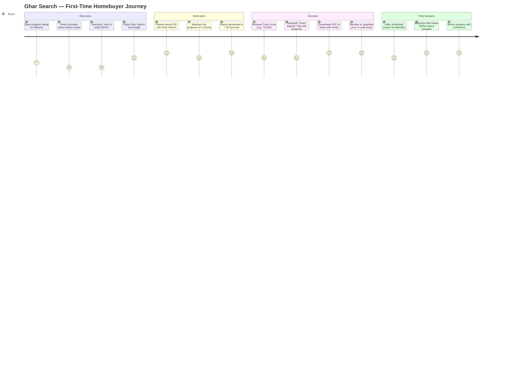
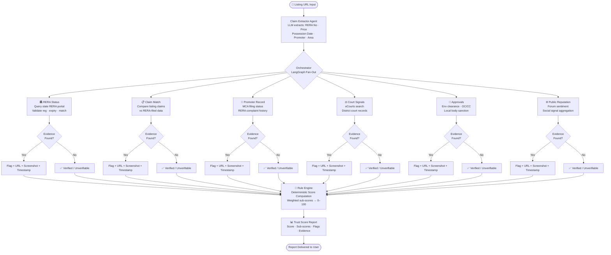
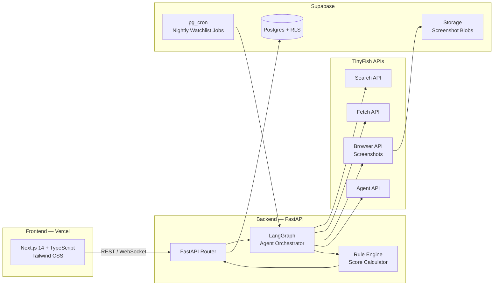
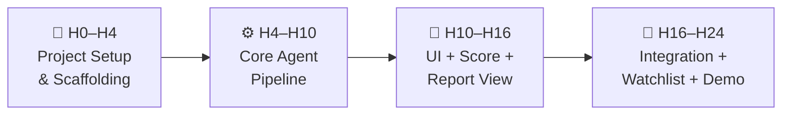

# 📋 Product Requirements Document — Ghar Search

> **Version**: 1.0 · **Date**: October 2026 · **Event**: HackIIITD 2026  
> **Team**: Farhan Rahaman Mallik (Team Lead · AI / Full-Stack) · Piyush Kumar Gautam (UI / Frontend)  
> **Status**: APPROVED FOR HACKATHON BUILD

---

## 1. Executive Summary

**Ghar Search** is an agentic property due-diligence platform that empowers Indian homebuyers to verify any property listing in under 90 seconds — with court-grade evidence attached to every finding.

A buyer pastes a listing URL. Ghar Search's AI agents extract every factual claim made in that listing (price, RERA number, amenities, possession date, approvals). Six verification workers then fan out in parallel, cross-referencing those claims against 30+ authoritative sources — state RERA portals, court databases, MCA filings, municipal approval records, and public reputation signals. The result is a **0–100 Trust Score** backed by timestamped URLs and screenshots for every flag raised.

No black-box AI verdicts. No un-evidenced warnings. Every claim is either verified, disputed, or marked *unverifiable* with an explicit reason.

Ghar Search is built for HackIIITD 2026 using a modern, production-grade stack: **Next.js 14 + TypeScript + Tailwind CSS** on the frontend, **FastAPI + LangGraph** orchestrating multi-agent workflows, **TinyFish APIs** for search/fetch/browser automation, and **Supabase Postgres** as the persistent data layer.

---

## 2. Problem Statement

India's residential real estate market is opaque by design. Nearly **1.5 lakh+ RERA-registered projects** are spread across **30+ state-level portals**, each with its own search UX, data schema, and availability SLA. Court records are siloed. Municipal approvals live in PDFs behind bureaucratic paywalls. Promoter track records require MCA portal queries most buyers have never heard of.

The result: a first-time homebuyer making the largest financial decision of their life does so with less information than they'd have when buying a used motorcycle.

### Numbered Pain Points

1. **Verification is manual and expert-gated.** Lawyers charge ₹15,000–₹50,000 for a title search that takes 2–4 weeks. Most buyers skip it entirely.
2. **RERA information is fragmented.** No unified pan-India search exists. Each state portal has different fields, different availability, different update cadences.
3. **Listings make unverifiable claims.** "RERA approved", "OC received", "zero litigation" — there is no quick way to fact-check any of these without navigating bureaucratic portals.
4. **NRIs and out-of-city buyers are especially vulnerable.** They cannot visit sites, rely entirely on broker claims, and face amplified fraud risk.
5. **Post-purchase recourse is slow.** RERA grievances can take 12–18 months. Discovery of fraud happens long after money has moved.
6. **Court signals go unnoticed.** An ongoing writ petition or consumer-court case against a promoter is public information — but no tool surfaces it to buyers before they sign.
7. **No watchlist / alerts infrastructure.** Even buyers who conduct initial due-diligence receive no alert if a project's RERA status lapses or a new case is filed post-booking.

---

## 3. Vision & Goals

### Vision
> *"Every Indian homebuyer should have access to the same quality of property intelligence that institutional investors take for granted — instant, evidence-first, and always up to date."*

### Strategic Goals

| # | Goal | Measure of Success |
|---|------|--------------------|
| G1 | Reduce time-to-due-diligence from weeks to seconds | Median report generation < 90 s |
| G2 | Make every finding auditable | 100% of flags carry ≥ 1 evidence URL + timestamp |
| G3 | Scale to all 30+ state RERA portals | Coverage map ≥ 28 states at launch |
| G4 | Enable passive watchlist protection | Nightly re-check cron for all bookmarked properties |
| G5 | Serve B2B channels (lenders, DSAs) via API | API v1 available at launch with auth + rate limiting |

---

## 4. User Personas

| Attribute | 🏠 First-Time Homebuyer | 🌏 NRI Buyer | 🏦 Lender / HFC Underwriter | 🤝 Broker / DSA |
|-----------|------------------------|--------------|------------------------------|-----------------|
| **Age** | 28–40 | 30–45 | 25–35 | 28–50 |
| **Tech Comfort** | Medium | High | High | Medium |
| **Decision Timeline** | 3–12 months | 6–18 months | 2–5 business days | Ongoing |
| **Primary Pain Point** | Doesn't know what to verify or how | Can't visit physically; trusts broker by default | Manual legal + RERA checks take days, delay disbursements | Wants trust-signal to close deals faster |
| **Secondary Pain Point** | Fears hidden litigation or RERA lapse | Timezone + language barrier with Indian portals | Regulatory liability if a project turns fraudulent | Reputation risk if they recommend a bad project |
| **Goal** | Buy a safe home with confidence | Invest remotely without fear | Approve loans faster with lower risk | Differentiate service; reduce post-sale complaints |
| **Success Metric** | Received a green-scored report before booking | Got an alert when a watchlisted project's status changed | Cut legal due-diligence time by 60% | Clients close faster; fewer disputes |
| **Willingness to Pay** | ₹199–₹499 per report | \$10–\$25 per report | ₹2,000–₹5,000/month API subscription | ₹999/month white-label plan |

---

## 5. User Stories (Given / When / Then)

| # | Persona | User Story |
|---|---------|------------|
| US-01 | First-time buyer | **Given** I found a listing on 99acres, **When** I paste the URL into Ghar Search, **Then** I receive a Trust Score and evidence report within 90 seconds. |
| US-02 | First-time buyer | **Given** a report is generated, **When** the RERA registration is found invalid, **Then** the flag includes a direct link to the RERA portal page and a screenshot timestamped to the moment of check. |
| US-03 | NRI buyer | **Given** I am based in the UAE and cannot visit, **When** I share a project link, **Then** I receive a court-signals summary in English with source URLs I can share with my Indian lawyer. |
| US-04 | NRI buyer | **Given** I have bookmarked a project, **When** its RERA registration lapses overnight, **Then** I receive an email/push notification by 7 AM IST the next morning. |
| US-05 | Lender | **Given** a loan application references a project, **When** I query the Ghar Search API with the RERA number, **Then** I receive a structured JSON report with a Trust Score, sub-scores, and evidence references. |
| US-06 | Lender | **Given** a batch of 50 loan applications, **When** I submit them via the bulk API endpoint, **Then** all 50 reports are returned within 10 minutes. |
| US-07 | Broker / DSA | **Given** I want to build trust with a client, **When** I generate a Ghar Search report for a project I am recommending, **Then** I can share a branded PDF or shareable link of the report. |
| US-08 | Broker / DSA | **Given** a project I listed previously receives a court filing, **When** the nightly watchlist job detects it, **Then** I am notified so I can proactively update clients. |
| US-09 | Any user | **Given** I open the platform, **When** I view a report, **Then** I can click any flag to expand the raw evidence (URL, screenshot, timestamp, extraction method). |
| US-10 | Any user | **Given** a property cannot be verified due to a portal being down, **When** the report is generated, **Then** that check is explicitly marked "Unverifiable – source unavailable" rather than silently omitted. |
| US-11 | First-time buyer | **Given** I want to compare two projects, **When** I generate reports for both, **Then** I can view a side-by-side comparison of Trust Scores and sub-scores. |
| US-12 | Product team | **Given** a user views a report, **When** I query analytics, **Then** I can see which specific checks drove the most score changes to prioritize accuracy improvements. |

---

## 6. Functional Requirements

### 6.1 Core Platform

| ID | Requirement | Priority |
|----|-------------|----------|
| FR-C01 | Accept listing URLs from 99acres, MagicBricks, Housing.com, NoBroker, and raw text input | P0 |
| FR-C02 | Extract all verifiable claims from the listing (RERA number, price, possession date, amenities, promoter name) | P0 |
| FR-C03 | Display a 0–100 Trust Score with sub-scores for each of the 6 verification dimensions | P0 |
| FR-C04 | Present a report within 90 seconds for standard listings | P0 |
| FR-C05 | Allow users to create an account and save reports | P1 |
| FR-C06 | Enable shareable report links (public, expiring 30 days) | P1 |
| FR-C07 | Side-by-side project comparison view | P2 |

### 6.2 Verification Engine

| ID | Requirement | Priority |
|----|-------------|----------|
| FR-V01 | **RERA Status Check** — query relevant state RERA portal, verify registration validity, expiry date, and registered details vs. listing claims | P0 |
| FR-V02 | **Claim Match Check** — compare extracted listing claims (possession date, price, carpet area) against RERA-filed data | P0 |
| FR-V03 | **Promoter Record Check** — fetch promoter's RERA complaint history and MCA company registration status | P0 |
| FR-V04 | **Court Signals Check** — search eCourts / district court databases for cases naming the promoter or project | P0 |
| FR-V05 | **Approvals Check** — verify environmental, CMDA/local body, and OC/CC approvals where publicly available | P0 |
| FR-V06 | **Public Reputation Check** — aggregate sentiment from forums (Housing.com reviews, MouthShut, social signals) | P1 |
| FR-V07 | All 6 checks MUST run in parallel; no sequential blocking | P0 |
| FR-V08 | Every flag MUST include: source URL, screenshot blob URL, ISO timestamp, extraction method label | P0 |
| FR-V09 | If a source is unavailable, the check is marked "Unverifiable" with reason; score for that dimension is held neutral | P0 |
| FR-V10 | Score computation is rule-based (not LLM-based); LLM only performs extraction and summarization | P0 |

### 6.3 Reporting

| ID | Requirement | Priority |
|----|-------------|----------|
| FR-R01 | Generate a human-readable summary in plain English per check | P0 |
| FR-R02 | Export report as PDF (branded) | P1 |
| FR-R03 | Export report as JSON (for API consumers) | P0 |
| FR-R04 | Audit trail: every report is immutable once generated; new checks create new report versions | P1 |

### 6.4 Watchlist & Alerts

| ID | Requirement | Priority |
|----|-------------|----------|
| FR-W01 | Users can add any property to a personal watchlist | P1 |
| FR-W02 | Nightly pg_cron job re-runs RERA and court checks for all watchlisted properties | P1 |
| FR-W03 | Trigger email/push alert if Trust Score changes by ≥ 5 points or a new flag is raised | P1 |
| FR-W04 | Watchlist dashboard shows delta between last two checks with highlighted changes | P1 |

### 6.5 API (B2B)

| ID | Requirement | Priority |
|----|-------------|----------|
| FR-A01 | REST API: `POST /v1/reports` — submit a URL or RERA number, receive async report | P1 |
| FR-A02 | REST API: `GET /v1/reports/{id}` — retrieve report by ID | P1 |
| FR-A03 | Webhook callback when async report is ready | P1 |
| FR-A04 | API key auth with per-key rate limiting | P1 |
| FR-A05 | Bulk endpoint: `POST /v1/reports/bulk` (up to 100 properties) | P2 |

---

## 7. Non-Functional Requirements

| Category | Requirement | Target |
|----------|-------------|--------|
| **Performance** | End-to-end report generation (P95) | < 90 seconds |
| **Performance** | UI Time-to-Interactive | < 2 seconds |
| **Availability** | Platform uptime | 99.9% (< 8.7 h/year downtime) |
| **Scalability** | Concurrent report requests at launch | ≥ 50 simultaneous |
| **Scalability** | Database rows (reports + evidence) | Horizontally scalable via Supabase |
| **Security** | All API endpoints | HTTPS/TLS 1.3 only |
| **Security** | User data | Supabase Row-Level Security enforced on all tables |
| **Security** | Evidence screenshots | Stored in private Supabase Storage bucket, served via signed URLs |
| **Privacy** | PII handling | No buyer PII stored in report payloads; only property identifiers |
| **Compliance** | RERA data usage | Read-only scraping of public portals; no redistribution of raw RERA data |
| **Observability** | Error tracking | Sentry integration on both frontend and backend |
| **Observability** | Agent trace logging | Full LangGraph trace stored per report for debugging |
| **Reliability** | Failed agent steps | Automatic retry with exponential backoff (max 3 attempts) |
| **Accessibility** | WCAG 2.1 Level AA | Keyboard navigable; screen-reader friendly report output |

---

## 8. Out of Scope (MVP)

The following are explicitly deferred beyond the hackathon build:

- **Title chain / encumbrance certificate verification** — requires paid API integrations or state sub-registrar access
- **Physical site visit scheduling** — marketplace feature, post-MVP
- **Legal document upload and AI review** — complex liability surface, Phase 2
- **Payment / subscription billing UI** — Stripe integration deferred; MVP uses unlimited free credits for hackathon demo
- **Mobile native apps** (iOS / Android) — responsive web only for MVP
- **Multi-language support** (Hindi, regional languages) — English only at launch
- **Litigation outcome prediction** — research-grade ML, not production-ready
- **Integration with banking systems** — B2B API exists but not pre-integrated with any specific HFC

---

## 9. Success Metrics / KPIs

### Hackathon Demo KPIs (24-hour window)

| KPI | Target |
|-----|--------|
| End-to-end demo flow working live | ✅ Must pass |
| Reports generated successfully in demo | ≥ 3 distinct properties |
| Trust Score variance across properties | Demonstrates scoring sensitivity |
| Evidence links all opening correctly | 100% |
| Judge Q&A: explain any flag | Able to trace to source within 30 s |

### Post-Launch Product KPIs (3-month targets)

| KPI | Target |
|-----|--------|
| Monthly Active Users | 1,000 |
| Reports Generated | 5,000 / month |
| Median Report Time | < 75 s |
| Flag Accuracy (user dispute rate) | < 5% |
| Watchlist Subscriptions | 500 active |
| B2B API Customers | 3 pilots |
| NPS Score | ≥ 45 |

---

## 10. User Journey — Primary B2C Flow

---

## 11. Verification Engine — 6 Parallel Checks Flowchart

---

## 12. System Architecture Overview

---

## 13. Scoring Model

The Trust Score is computed deterministically by the rule engine — not by an LLM. The LLM's sole role is information extraction and summarization.

| Dimension | Weight | Score Source |
|-----------|--------|-------------|
| RERA Status | 30% | Valid & active = full; expired/missing = 0 |
| Claim Match | 25% | Each matched claim adds points; each mismatch deducts |
| Promoter Record | 20% | No complaints = full; each upheld complaint = deduction |
| Court Signals | 15% | No cases = full; pending cases = partial; adverse orders = 0 |
| Approvals | 7% | Each verified approval adds; missing mandatory approvals deduct |
| Public Reputation | 3% | Sentiment score binned into 5 tiers |

> **Principle**: If a source is unavailable, the dimension score is held at 50% (neutral) rather than penalizing or rewarding. This prevents false confidence and false alarm.

---

## 14. Hackathon Timeline — 24-Hour Build Plan

### H0–H4: Foundation

- [ ] Initialize Next.js + FastAPI + Supabase project structure
- [ ] Configure TinyFish API keys and test connectivity
- [ ] Set up Supabase schema: `reports`, `findings`, `evidence`, `watchlist`, `users`
- [ ] Deploy skeleton frontend to Vercel (CI/CD pipeline active)
- [ ] Establish LangGraph agent skeleton with node definitions

### H4–H10: Core Agent Pipeline

- [ ] Build Claim Extractor agent (LLM + TinyFish Fetch)
- [ ] Implement RERA Status worker (state portal scrapers via TinyFish Browser)
- [ ] Implement Claim Match worker (compare extracted vs. RERA-filed)
- [ ] Implement Promoter Record worker (MCA + RERA complaints)
- [ ] Implement Court Signals worker (eCourts search)
- [ ] Implement Approvals worker
- [ ] Implement Public Reputation worker
- [ ] Wire Rule Engine scoring logic
- [ ] End-to-end pipeline test on 3 real properties

### H10–H16: Frontend & Reporting

- [ ] Build URL input + loading state UI (live progress per check)
- [ ] Build Trust Score display component with sub-score breakdown
- [ ] Build evidence expansion panel (flag → URL + screenshot + timestamp)
- [ ] Build report page (shareable link generation)
- [ ] PDF export via Puppeteer/react-pdf
- [ ] Mobile responsive pass

### H16–H24: Integration, Watchlist & Demo Prep

- [ ] Watchlist UI and backend (add/remove, status dashboard)
- [ ] pg_cron nightly job configuration and alert email
- [ ] API key auth and `/v1/reports` endpoint documentation
- [ ] Performance tuning: target P95 < 90 s with real data
- [ ] Demo script preparation (3 properties: green, amber, red score)
- [ ] Final Vercel deploy, smoke test, judge presentation polish

---

## 15. Tech Stack Summary

| Layer | Technology | Rationale |
|-------|------------|-----------|
| Frontend | Next.js 14 + TypeScript | SSR + App Router; type-safe; Vercel-native |
| Styling | Tailwind CSS | Rapid UI development; utility-first |
| Backend | FastAPI (Python) | Async-first; OpenAPI auto-docs; easy agent integration |
| Agent Orchestration | LangGraph | State-machine agent graphs; parallel node execution; trace logging |
| Web Intelligence | TinyFish Search / Fetch / Browser / Agent APIs | Unified interface to search, scrape, screenshot, and reason over web sources |
| Database | Supabase Postgres | RLS out of the box; realtime subscriptions; pg_cron for watchlist |
| File Storage | Supabase Storage | Screenshot blobs with signed URL access |
| Deployment | Vercel (frontend) + Railway / Fly.io (backend) | Zero-config CI/CD; scalable |
| Monitoring | Sentry + LangSmith | Error tracking + agent trace observability |

---

## 16. Risks & Mitigations

| Risk | Likelihood | Impact | Mitigation |
|------|-----------|--------|------------|
| State RERA portal goes down during demo | Medium | High | Cache last-known result; mark check "Unverifiable"; demo on pre-cached data |
| TinyFish rate limits hit during concurrent checks | Low | High | Queue with token-bucket; pre-generate demo reports |
| LLM hallucination in claim extraction | Medium | High | Rule engine never trusts LLM output directly; all LLM claims re-verified against source |
| 90-second SLA breach on slow portals | Medium | Medium | Per-check timeout (20 s); partial report returned; async completion webhook |
| RERA portal ToS violation | Low | Medium | Read-only scraping of public data; no redistribution of raw data |

---

## Appendix A — Glossary

| Term | Definition |
|------|-----------|
| **RERA** | Real Estate Regulatory Authority — statutory body under RERA Act 2016 |
| **OC / CC** | Occupancy Certificate / Completion Certificate — municipal approvals for habitation |
| **HFC** | Housing Finance Company — lenders specializing in home loans |
| **DSA** | Direct Selling Agent — loan / property sales intermediary |
| **Trust Score** | Ghar Search's 0–100 property health score; higher = more evidence of legitimacy |
| **pg_cron** | PostgreSQL extension for running cron jobs within the database |
| **LangGraph** | Python framework for building stateful multi-agent workflows as directed graphs |
| **TinyFish** | AI-native web intelligence API suite (Search, Fetch, Browser, Agent) |

---

*This document is the single source of truth for the Ghar Search MVP built at HackIIITD 2026. All implementation decisions not covered here should be resolved by the team lead and logged as addenda.*
