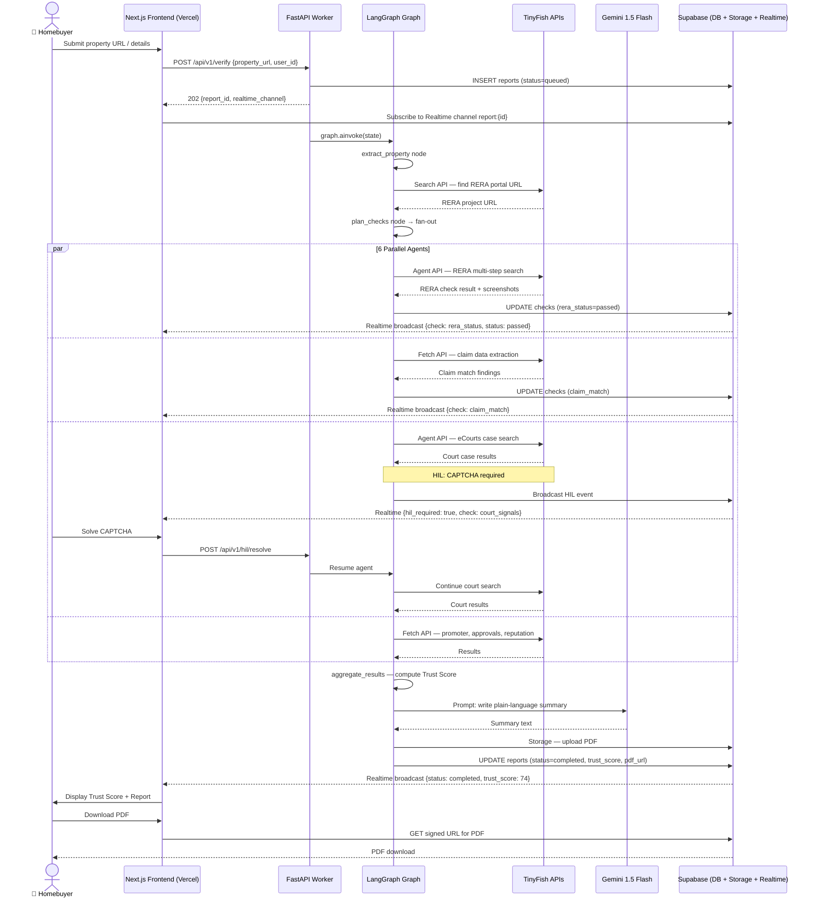
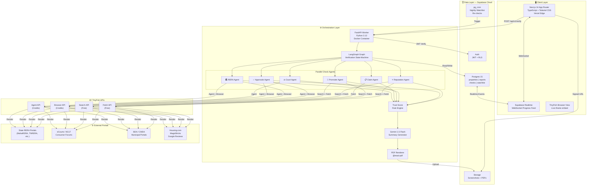

# Technical Requirements Document (TRD)
## Ghar Search — Agentic Property Due-Diligence Platform
### HackIIITD 2026

---

**Document Version:** 1.0.0  
**Date:** 2026-10-24  
**Team:**
- Farhan Rahaman Mallik — Team Lead, AI/Full-Stack
- Piyush Kumar Gautam — UI/Frontend

---

## Table of Contents

1. [System Overview](#1-system-overview)
2. [Technology Stack](#2-technology-stack)
3. [API Specifications](#3-api-specifications)
4. [TinyFish Integration Details](#4-tinyfish-integration-details)
5. [Database Schema](#5-database-schema)
6. [LangGraph Orchestration Flow](#6-langgraph-orchestration-flow)
7. [Trust Score Algorithm](#7-trust-score-algorithm)
8. [Security Requirements](#8-security-requirements)
9. [Infrastructure & Deployment](#9-infrastructure--deployment)
10. [Performance Requirements](#10-performance-requirements)
11. [Error Handling](#11-error-handling)
12. [System Diagrams](#12-system-diagrams)

---

## 1. System Overview

**Ghar Search** is an agentic, AI-powered property due-diligence platform designed specifically for Indian homebuyers. The platform automates the tedious, error-prone process of manually verifying real-estate claims against government portals, court databases, and public records — condensing hours of research into a sub-90-second automated report.

### Problem Statement

Indian homebuyers face systemic fraud risks: unregistered RERA projects, false approval claims, promoters with criminal records, and litigated land titles. Manual verification across 30+ portals is impractical for individuals. Ghar Search bridges this gap by running six categories of checks in parallel using autonomous browser agents, structuring extracted evidence into a machine-readable schema, and synthesizing everything into a plain-language trust report with cited evidence.

### Core Capabilities

| Capability | Description |
|---|---|
| **RERA Status Check** | Verify project registration, completion certificate, and QR validity on state RERA portals |
| **Claim Match Verification** | Cross-reference brochure/ad claims (area, amenities, completion date) against registered data |
| **Promoter Record Scan** | Check promoter/builder history for past violations, defaulted projects, and blacklists |
| **Court Signal Detection** | Search eCourts, NCLT, and consumer forums for cases involving the property/promoter |
| **Approvals Verification** | Validate occupancy certificate, CMDA/BDA/BDA approvals, fire NOC, and environmental clearance |
| **Public Reputation Scan** | Aggregate complaints from Housing.com, MagicBricks, consumer forums, and social media |

### User Flows

1. **Buyer Flow**: Enter property URL or manual details → trigger verification → view live progress → receive Trust Score + report → download PDF / save to watchlist.
2. **Lender Flow**: Batch-upload property list → receive structured JSON reports via webhook → integrate into LOS (Loan Origination System).
3. **Watchlist Flow**: Saved properties are re-checked nightly via `pg_cron`; buyers receive email alerts on score changes > 10 points.

### Human-in-the-Loop

When a RERA portal demands a CAPTCHA, OTP, or login, the orchestrator pauses the relevant sub-agent and surfaces a **HIL (Human-in-the-Loop) prompt** via Supabase Realtime. The frontend renders the challenge inline. On resolution, the agent resumes. Maximum HIL wait: 5 minutes before graceful degradation.

---

## 2. Technology Stack

| Component | Technology | Version | Rationale |
|---|---|---|---|
| **Web Framework** | Next.js (App Router) | 14.x | Server Components, streaming SSR, built-in API routes |
| **Language (Frontend)** | TypeScript | 5.x | Type safety for complex report schemas |
| **Styling** | Tailwind CSS | 3.x | Utility-first; rapid hackathon iteration |
| **Realtime Updates** | Supabase Realtime | 2.x | WebSocket broadcast for live check progress |
| **PDF Export** | @react-pdf/renderer | 3.x | Client-side PDF generation without server roundtrip |
| **Orchestration Language** | Python | 3.12 | LangGraph, LangChain, and TinyFish SDKs are Python-native |
| **Orchestration Framework** | LangGraph | 0.2.x | Stateful graph execution, built-in checkpointing, parallel fan-out |
| **API Gateway (Worker)** | FastAPI | 0.115.x | Async, OpenAPI auto-docs, pydantic v2 validation |
| **LLM Provider** | Google Gemini 1.5 Flash | latest | Fast inference, long context for multi-page PDFs, affordable |
| **Browser Automation** | TinyFish APIs | v1 | Search, Fetch, Agent, Browser — cloud-based, no infra overhead |
| **Database** | Supabase Postgres | 15.x | RLS, realtime, storage, auth — single integrated platform |
| **Auth** | Supabase Auth | 2.x | JWT, magic links, org-level lender accounts |
| **File Storage** | Supabase Storage | — | Screenshots (evidence), generated PDFs |
| **Job Scheduling** | pg_cron (Postgres extension) | 1.6 | Nightly watchlist re-checks inside the DB |
| **Containerization** | Docker + Docker Compose | 26.x | Reproducible Python worker deployment |
| **Frontend Hosting** | Vercel | — | Zero-config Next.js deploy, edge functions |
| **Worker Hosting** | Cloud Run / Railway | — | Containerized FastAPI; autoscale to zero |
| **Secret Management** | Vercel Env / Railway Secrets | — | Never stored in source; injected at runtime |
| **Monitoring** | Sentry + Vercel Analytics | — | Error tracking, performance, Core Web Vitals |

---

## 3. API Specifications

All endpoints are prefixed with `/api/v1`. The Next.js API routes proxy to the FastAPI worker for orchestration endpoints; direct read endpoints query Supabase directly via the JS client.

### 3.1 `POST /api/v1/verify`

Initiates a full 6-check verification pipeline for a property.

**Request**

```json
{
  "property_url": "https://example.com/project/abc",
  "manual_details": {
    "project_name": "Sunshine Heights",
    "promoter_name": "ABC Developers Pvt Ltd",
    "rera_number": "P52100012345",
    "state": "Maharashtra",
    "city": "Pune"
  },
  "user_id": "uuid",
  "priority": "normal"
}
```

> `property_url` and `manual_details` are mutually exclusive; at least one is required. `manual_details` overrides extracted URL data when both provided.

**Response `202 Accepted`**

```json
{
  "report_id": "rpt_7f3a2b9c",
  "status": "queued",
  "estimated_completion_seconds": 90,
  "realtime_channel": "report:rpt_7f3a2b9c",
  "credits_estimated": 12
}
```

**Error Responses**

| Status | Code | Reason |
|---|---|---|
| `400` | `INVALID_INPUT` | Neither URL nor manual_details provided |
| `402` | `INSUFFICIENT_CREDITS` | User credit balance < estimated cost |
| `429` | `RATE_LIMITED` | >5 concurrent reports per user |

---

### 3.2 `GET /api/v1/report/{report_id}`

Returns the full structured report including all check results and Trust Score.

**Response `200 OK`**

```json
{
  "report_id": "rpt_7f3a2b9c",
  "status": "completed",
  "created_at": "2026-10-24T07:00:00Z",
  "completed_at": "2026-10-24T07:01:27Z",
  "property": {
    "name": "Sunshine Heights",
    "promoter": "ABC Developers Pvt Ltd",
    "rera_number": "P52100012345",
    "state": "Maharashtra"
  },
  "trust_score": 74,
  "trust_label": "Moderate Risk",
  "summary": "The project is RERA-registered and active. However, 2 consumer court cases were found against the promoter and the promised completion date was missed by 14 months.",
  "checks": [
    {
      "check_id": "chk_rera",
      "check_type": "rera_status",
      "status": "passed",
      "score_contribution": 30,
      "findings": [...],
      "evidence": [
        {
          "url": "https://maharera.mahaonline.gov.in/...",
          "screenshot_url": "https://storage.supabase.co/...",
          "timestamp": "2026-10-24T07:00:45Z"
        }
      ]
    }
  ],
  "pdf_url": "https://storage.supabase.co/reports/rpt_7f3a2b9c.pdf",
  "credits_consumed": 11
}
```

**Error Responses**

| Status | Reason |
|---|---|
| `404` | Report not found or not owned by requesting user |
| `202` | Report still in progress (use Realtime channel) |

---

### 3.3 `POST /api/v1/watchlist`

Adds a verified property report to the user's watchlist for nightly re-checks.

**Request**

```json
{
  "report_id": "rpt_7f3a2b9c",
  "alert_threshold": 10,
  "notify_email": true,
  "notify_webhook": "https://user-webhook.example.com/alerts"
}
```

**Response `201 Created`**

```json
{
  "watchlist_id": "wl_4a8d1e2f",
  "next_check_at": "2026-10-25T02:00:00Z",
  "status": "active"
}
```

---

### 3.4 `GET /api/v1/watchlist`

Returns all watchlist entries for the authenticated user.

**Response `200 OK`**

```json
{
  "items": [
    {
      "watchlist_id": "wl_4a8d1e2f",
      "property_name": "Sunshine Heights",
      "current_trust_score": 74,
      "last_checked_at": "2026-10-24T02:00:00Z",
      "score_delta_7d": -3,
      "status": "active",
      "latest_report_id": "rpt_9b2c3d4e"
    }
  ],
  "total": 1
}
```

---

### 3.5 `POST /api/v1/hil/resolve`

Frontend posts the resolved HIL challenge (CAPTCHA token or OTP) back to the orchestrator.

**Request**

```json
{
  "report_id": "rpt_7f3a2b9c",
  "check_type": "rera_status",
  "challenge_type": "captcha",
  "resolution": "03AGdBq25..."
}
```

**Response `200 OK`**

```json
{ "status": "resumed", "agent_node": "rera_agent" }
```

---

## 4. TinyFish Integration Details

TinyFish provides four distinct APIs consumed at different stages of the pipeline based on cost and complexity.

### 4.1 Search API (Free)
Used for **discovery** — finding the right URLs before expensive agent runs.

```python
# Goal template
goal = f"""
Search for the RERA registration page for project "{project_name}" 
by promoter "{promoter}" in {state}.
Return the direct URL to the project detail page on the state RERA portal.
"""
result = tinyfish.search(goal=goal, max_results=5)
# Returns ranked list of URLs with confidence scores
```

**Use cases:** Locate state RERA portal project URL, find eCourts case search page, discover promoter profile on Housing.com.

### 4.2 Fetch API (Free)
Used for **lightweight structured extraction** from known URLs — the workhorse for simple, single-page reads.

```python
# Goal template
goal = f"""
Fetch {rera_project_url} and extract:
- registration_number, promoter_name, project_status, 
  completion_date, qr_code_valid (bool), certificate_of_completion (bool)
Return as structured JSON.
"""
result = tinyfish.fetch(url=rera_project_url, goal=goal)
```

**Use cases:** Extract RERA project details, parse court case listing pages, scrape approval PDFs, read builder review aggregates.

### 4.3 Agent API (Credits — budget: 8 credits/check)
Used for **multi-step autonomous flows** where navigation, form submission, or pagination is required.

```python
# Goal template for RERA multi-step search
goal = f"""
1. Navigate to {state_rera_portal}.
2. Click "Project Search".
3. Enter RERA number "{rera_number}" in the search field.
4. Submit and wait for results.
5. Click the matching project row.
6. Extract: registration_status, promoter_details, quarterly_progress_reports[].
7. Return all extracted data as JSON.
Take a screenshot after each major step.
"""
result = tinyfish.agent(goal=goal, max_steps=12, screenshot_each_step=True)
```

**Use cases:** Multi-step RERA portal search, eCourts case search with form fills, NCLT party search, consumer forum complaint lookup.

### 4.4 Browser API (Credits — budget: 4 credits/check)
Used for **deterministic step sequences** where exact actions and evidence screenshots are required.

```python
# Goal template for screenshot evidence capture
steps = [
    {"action": "navigate", "url": rera_project_url},
    {"action": "screenshot", "label": "rera_project_page"},
    {"action": "extract", "selector": "#project-status", "as": "status"},
    {"action": "screenshot", "label": "rera_status_closeup", "selector": "#project-details"}
]
result = tinyfish.browser(steps=steps, return_screenshots=True)
# Returns {data: {...}, screenshots: [{label, url, timestamp}]}
```

**Use cases:** Timestamped evidence captures for PDF report, exact field extraction for claim matching, court order document downloads.

### Credit Budget Table

| Check | Search | Fetch | Agent | Browser | Max Credits |
|---|---|---|---|---|---|
| RERA Status | 1 call | 2 calls | 1 run | 1 run | 5 |
| Claim Match | 0 | 3 calls | 0 | 1 run | 4 |
| Promoter Record | 2 calls | 2 calls | 1 run | 0 | 3 |
| Court Signals | 2 calls | 1 call | 2 runs | 0 | 4 |
| Approvals | 1 call | 2 calls | 1 run | 1 run | 5 |
| Public Reputation | 3 calls | 3 calls | 0 | 0 | 0 |
| **Total** | | | | | **≤ 21** |

Results are cached per `(property_hash, check_type)` in Supabase for 24 hours to prevent redundant credit consumption.

---

## 5. Database Schema

### 5.1 `users`
Managed by Supabase Auth. Extended with:
```sql
CREATE TABLE public.user_profiles (
  id UUID PRIMARY KEY REFERENCES auth.users(id) ON DELETE CASCADE,
  full_name TEXT,
  org_id UUID REFERENCES organizations(id),
  role TEXT CHECK (role IN ('buyer', 'lender', 'admin')) DEFAULT 'buyer',
  credit_balance INTEGER NOT NULL DEFAULT 50,
  created_at TIMESTAMPTZ DEFAULT now()
);
```

### 5.2 `properties`
```sql
CREATE TABLE public.properties (
  id UUID PRIMARY KEY DEFAULT gen_random_uuid(),
  user_id UUID REFERENCES auth.users(id) ON DELETE SET NULL,
  source_url TEXT,
  project_name TEXT NOT NULL,
  promoter_name TEXT,
  rera_number TEXT,
  state TEXT NOT NULL,
  city TEXT,
  property_hash TEXT GENERATED ALWAYS AS (
    md5(coalesce(rera_number, '') || coalesce(project_name, '') || state)
  ) STORED,
  raw_metadata JSONB,
  created_at TIMESTAMPTZ DEFAULT now()
);
CREATE INDEX idx_properties_hash ON properties(property_hash);
```

### 5.3 `reports`
```sql
CREATE TABLE public.reports (
  id TEXT PRIMARY KEY,  -- rpt_xxxxx
  property_id UUID NOT NULL REFERENCES properties(id),
  user_id UUID NOT NULL REFERENCES auth.users(id),
  status TEXT CHECK (status IN ('queued','running','completed','failed','partial')) DEFAULT 'queued',
  trust_score INTEGER CHECK (trust_score BETWEEN 0 AND 100),
  trust_label TEXT,
  summary TEXT,
  credits_consumed INTEGER DEFAULT 0,
  pdf_url TEXT,
  langgraph_run_id TEXT,
  started_at TIMESTAMPTZ,
  completed_at TIMESTAMPTZ,
  created_at TIMESTAMPTZ DEFAULT now()
);
```

### 5.4 `checks`
```sql
CREATE TABLE public.checks (
  id UUID PRIMARY KEY DEFAULT gen_random_uuid(),
  report_id TEXT NOT NULL REFERENCES reports(id) ON DELETE CASCADE,
  check_type TEXT NOT NULL CHECK (check_type IN (
    'rera_status','claim_match','promoter_record',
    'court_signals','approvals','public_reputation'
  )),
  status TEXT CHECK (status IN ('pending','running','passed','warning','failed','skipped')),
  score_contribution INTEGER,
  raw_findings JSONB,
  structured_findings JSONB,
  evidence JSONB,  -- [{url, screenshot_url, timestamp, label}]
  credits_used INTEGER DEFAULT 0,
  hil_required BOOLEAN DEFAULT FALSE,
  hil_resolved_at TIMESTAMPTZ,
  started_at TIMESTAMPTZ,
  completed_at TIMESTAMPTZ
);
CREATE INDEX idx_checks_report ON checks(report_id);
```

### 5.5 `watchlist`
```sql
CREATE TABLE public.watchlist (
  id UUID PRIMARY KEY DEFAULT gen_random_uuid(),
  user_id UUID NOT NULL REFERENCES auth.users(id) ON DELETE CASCADE,
  property_id UUID NOT NULL REFERENCES properties(id),
  latest_report_id TEXT REFERENCES reports(id),
  alert_threshold INTEGER DEFAULT 10,
  notify_email BOOLEAN DEFAULT TRUE,
  notify_webhook TEXT,
  status TEXT CHECK (status IN ('active','paused','archived')) DEFAULT 'active',
  next_check_at TIMESTAMPTZ DEFAULT (now() + INTERVAL '1 day'),
  created_at TIMESTAMPTZ DEFAULT now(),
  UNIQUE(user_id, property_id)
);

-- pg_cron job for nightly re-checks (registered in migrations)
SELECT cron.schedule(
  'nightly-watchlist-recheck',
  '0 2 * * *',
  $$ SELECT trigger_watchlist_rechecks(); $$
);
```

### 5.6 Row-Level Security Summary

| Table | Policy | Condition |
|---|---|---|
| `reports` | SELECT | `user_id = auth.uid()` |
| `reports` | INSERT | `user_id = auth.uid()` |
| `checks` | SELECT | Via `reports.user_id = auth.uid()` join |
| `watchlist` | ALL | `user_id = auth.uid()` |
| `properties` | SELECT | Public (property data is not PII) |

---

## 6. LangGraph Orchestration Flow

The LangGraph graph is defined in `worker/graph/verification_graph.py`. It implements a parallel fan-out / fan-in pattern.

### Graph Nodes

| Node | Type | Description |
|---|---|---|
| `extract_property` | Sequential | Parse source URL or manual details; resolve RERA number if missing |
| `plan_checks` | Sequential | Determine which checks to run; estimate credits; write initial DB rows |
| `rera_agent` | Parallel | Full RERA status and certificate verification |
| `claim_agent` | Parallel | Match brochure claims against RERA registered data |
| `promoter_agent` | Parallel | Promoter blacklist, past projects, and violations |
| `court_agent` | Parallel | eCourts, NCLT, consumer forum case search |
| `approvals_agent` | Parallel | OC, fire NOC, environment clearance, BDA/CMDA |
| `reputation_agent` | Parallel | Public reviews, complaint aggregation |
| `hil_gate` | Conditional | If any agent raises `HIL_REQUIRED`, pause and emit Realtime event |
| `aggregate_results` | Fan-in | Collect all check outputs; compute Trust Score |
| `llm_summarize` | Sequential | Gemini Flash call to write plain-language summary |
| `generate_pdf` | Sequential | Render PDF with evidence; upload to Supabase Storage |
| `finalize` | Sequential | Update `reports` table; emit completion via Realtime |

### Parallel Fan-Out Implementation

```python
from langgraph.graph import StateGraph, END
from langgraph.prebuilt import ToolNode

def build_graph():
    graph = StateGraph(VerificationState)
    
    graph.add_node("extract_property", extract_property_node)
    graph.add_node("plan_checks", plan_checks_node)
    
    # Parallel check nodes
    for check in ["rera", "claim", "promoter", "court", "approvals", "reputation"]:
        graph.add_node(f"{check}_agent", get_agent_node(check))
    
    graph.add_node("hil_gate", hil_gate_node)
    graph.add_node("aggregate_results", aggregate_results_node)
    graph.add_node("llm_summarize", llm_summarize_node)
    graph.add_node("generate_pdf", generate_pdf_node)
    graph.add_node("finalize", finalize_node)
    
    # Sequential start
    graph.set_entry_point("extract_property")
    graph.add_edge("extract_property", "plan_checks")
    
    # Fan-out: plan_checks → all 6 parallel agents
    graph.add_conditional_edges("plan_checks", route_to_agents, {
        "rera_agent": "rera_agent",
        "claim_agent": "claim_agent",
        "promoter_agent": "promoter_agent",
        "court_agent": "court_agent",
        "approvals_agent": "approvals_agent",
        "reputation_agent": "reputation_agent",
    })
    
    # Each agent → hil_gate (which is a pass-through if no HIL needed)
    for check in ["rera", "claim", "promoter", "court", "approvals", "reputation"]:
        graph.add_edge(f"{check}_agent", "hil_gate")
    
    # Fan-in: all agents must complete before aggregation
    graph.add_edge("hil_gate", "aggregate_results")  # LangGraph handles join automatically
    graph.add_edge("aggregate_results", "llm_summarize")
    graph.add_edge("llm_summarize", "generate_pdf")
    graph.add_edge("generate_pdf", "finalize")
    graph.add_edge("finalize", END)
    
    return graph.compile(checkpointer=SupabaseCheckpointer())
```

### State Schema

```python
class VerificationState(TypedDict):
    property: PropertyDetails
    report_id: str
    check_results: dict[str, CheckResult]  # keyed by check_type
    hil_pending: list[str]  # check_types awaiting human input
    trust_score: int
    summary: str
    credits_used: int
    errors: list[str]
```

---

## 7. Trust Score Algorithm

The Trust Score is a deterministic, rule-based integer from 0 to 100. LLM is **not** involved in scoring — only in summarisation. This ensures reproducibility and auditability.

### Weight Distribution

| Check | Max Points | Weight |
|---|---|---|
| RERA Status | 30 | 30% |
| Claim Match | 15 | 15% |
| Promoter Record | 15 | 15% |
| Court Signals | 20 | 20% |
| Approvals | 15 | 15% |
| Public Reputation | 5 | 5% |
| **Total** | **100** | **100%** |

### Per-Check Scoring Rules

**RERA Status (max 30)**
- Active registration: +30
- Registration found but expired: +10
- Project not found on RERA: 0
- Bonus: Valid QR code verified: +0 (required for full 30)
- Penalty: Completion date overdue > 6 months: −5
- Penalty: Completion date overdue > 24 months: −10 (cumulative with above)

**Claim Match (max 15)**
- All claims within ±5% of RERA data: +15
- 1–2 discrepancies: +10
- 3+ discrepancies: +5
- Any claim is demonstrably false (>25% deviation): 0

**Promoter Record (max 15)**
- No violations found: +15
- RERA violations on past projects: +8
- Blacklisted by any state authority: 0

**Court Signals (max 20)**
- No cases found: +20
- Consumer forum complaints only (< 3): +15
- Active NCLT/civil case: +5
- Criminal cases against promoter directors: 0

**Approvals (max 15)**
- OC issued + all NOCs valid: +15
- OC pending (project under construction): +12
- OC not issued (project claiming completion): +3
- No fire NOC: −3 penalty applied to sub-score

**Public Reputation (max 5)**
- Aggregate rating ≥ 4.0: +5
- Aggregate rating 3.0–3.9: +3
- Aggregate rating < 3.0 or > 50 complaints: +1

### Trust Label Mapping

| Score | Label | Color |
|---|---|---|
| 85–100 | Low Risk ✅ | Green |
| 65–84 | Moderate Risk 🟡 | Yellow |
| 40–64 | High Risk 🟠 | Orange |
| 0–39 | Critical Risk 🔴 | Red |

### Penalty Cap

Total penalties cannot reduce a check's score below 0. Unattempted checks (timeout/skip) contribute 0 points but are labelled `skipped` rather than `failed`, preserving an honest audit trail.

---

## 8. Security Requirements

### Authentication Flow
1. Users authenticate via Supabase Auth (email magic link or OAuth).
2. JWT is validated on every API request — FastAPI worker uses Supabase JWT secret for offline verification (no DB roundtrip).
3. Lender org accounts use shared JWT with `org_id` claim; RLS policies enforce org-level isolation.

### Row-Level Security Policies

```sql
-- Users can only see their own reports
ALTER TABLE reports ENABLE ROW LEVEL SECURITY;
CREATE POLICY "reports_owner_access" ON reports
  FOR ALL USING (user_id = auth.uid());

-- Lender orgs can see all reports within their org
CREATE POLICY "reports_org_access" ON reports
  FOR SELECT USING (
    EXISTS (
      SELECT 1 FROM user_profiles
      WHERE id = auth.uid() AND org_id = (
        SELECT org_id FROM user_profiles WHERE id = reports.user_id
      )
    )
  );
```

### Secrets Management
- TinyFish API key, Gemini API key, Supabase service role key — stored in environment variables only; never in source code or database.
- Vercel: Environment variables in project settings (encrypted at rest).
- Docker worker: Injected via Railway/Cloud Run secret manager; passed as env vars at container start.
- `.env.local` is `.gitignore`d; `.env.example` documents required keys without values.

### Additional Security Controls
- **SSRF prevention**: All URLs passed to TinyFish are validated against an allowlist of known Indian government and real-estate domains.
- **Rate limiting**: `/api/v1/verify` limited to 5 concurrent reports per user using a Redis counter (or Supabase KV).
- **Input sanitization**: All text inputs validated with Pydantic v2 before LLM or TinyFish consumption.
- **Storage access**: Supabase Storage buckets are private; PDFs and screenshots served via signed URLs with 1-hour expiry.

---

## 9. Infrastructure & Deployment

### Architecture Overview

```
Vercel Edge (Next.js 14)
  └── /api/v1/* → FastAPI Worker (Cloud Run / Railway)
                      └── LangGraph Graph
                              ├── TinyFish APIs (external)
                              ├── Gemini 1.5 Flash (external)
                              └── Supabase Postgres + Storage + Realtime
```

### Environment Variables

| Variable | Component | Description |
|---|---|---|
| `NEXT_PUBLIC_SUPABASE_URL` | Frontend | Supabase project URL |
| `NEXT_PUBLIC_SUPABASE_ANON_KEY` | Frontend | Public anon key for client SDK |
| `SUPABASE_SERVICE_ROLE_KEY` | Worker | Admin key for server-side operations |
| `TINYFISH_API_KEY` | Worker | TinyFish API authentication |
| `GEMINI_API_KEY` | Worker | Google Gemini API key |
| `FASTAPI_WORKER_URL` | Frontend | Internal URL of the Python worker |
| `FASTAPI_WORKER_SECRET` | Both | Shared secret for frontend→worker auth |
| `SUPABASE_JWT_SECRET` | Worker | For offline JWT verification |

### Docker Worker

```dockerfile
FROM python:3.12-slim
WORKDIR /app
COPY requirements.txt .
RUN pip install --no-cache-dir -r requirements.txt
COPY worker/ ./worker/
EXPOSE 8000
CMD ["uvicorn", "worker.main:app", "--host", "0.0.0.0", "--port", "8000", "--workers", "4"]
```

### Deployment Pipeline
1. `git push main` → Vercel auto-deploys Next.js frontend.
2. `git push main` → GitHub Actions builds Docker image → pushes to GHCR → deploys to Railway/Cloud Run.
3. Database migrations run via `supabase db push` in CI.

---

## 10. Performance Requirements

### SLA Targets

| Metric | Target |
|---|---|
| Full 6-check report | ≤ 90 seconds (P90) |
| RERA-only fast check | ≤ 25 seconds |
| PDF generation | ≤ 5 seconds |
| Realtime update latency | ≤ 500ms |
| API response (non-orchestration) | ≤ 200ms |

### Parallelism Strategy
- All 6 check agents are launched concurrently using `asyncio.gather` within LangGraph's parallel fan-out.
- Each agent has an independent timeout: **60 seconds** for Agent API calls, **20 seconds** for Fetch calls.
- The critical path is the slowest agent; typical RERA Agent runs take 25–40 seconds.

### Caching Strategy

| Cache Layer | Key | TTL | Storage |
|---|---|---|---|
| Property extraction | `md5(url)` | 1 hour | Supabase KV / Redis |
| Check results | `(property_hash, check_type, date)` | 24 hours | `checks` table |
| RERA portal fetch | `(rera_number, state)` | 12 hours | `checks` table |
| PDF report | `report_id` | Permanent | Supabase Storage |

### Credit Optimization
- **Search and Fetch calls are always preferred** over Agent/Browser when the target page structure is known.
- Agent API is only invoked when multi-step navigation is required (RERA portals with search forms).
- Browser API is reserved for evidence screenshot capture only.
- If a check result is cached, 0 credits are consumed for that check on subsequent runs.

---

## 11. Error Handling

### Retry Policy

| Error Type | Retry Count | Backoff | Fallback |
|---|---|---|---|
| TinyFish 5xx | 3 | Exponential (1s, 2s, 4s) | Mark check `skipped` |
| TinyFish timeout | 2 | Linear (10s) | Mark check `skipped` |
| Gemini API error | 3 | Exponential | Use template summary |
| Supabase write error | 5 | Exponential (0.5s..8s) | Log and alert |
| CAPTCHA / HIL required | 0 (no retry) | — | Pause, emit HIL event |

### Graceful Degradation
- A report can be marked `partial` if ≥ 3 of 6 checks complete successfully.
- Trust Score is computed only on completed checks; skipped checks are noted in the report.
- If RERA check fails (most critical), the report is flagged with a `⚠️ RERA UNVERIFIED` banner.
- The PDF is generated regardless of partial results — incomplete sections show "Unable to verify."

### Timeout Cascade
```
Report-level timeout: 120s
  └── Each check timeout: 75s
        └── TinyFish Agent call timeout: 60s
              └── TinyFish Fetch call timeout: 20s
```

If the report-level timeout fires, LangGraph's checkpointer saves state and the `finalize` node is triggered with whatever results are available.

### HIL (Human-in-the-Loop) Timeout
- HIL challenge surfaced to user via Supabase Realtime broadcast.
- If unresolved within **5 minutes**, the blocked check is marked `skipped` and the agent continues with remaining checks.
- HIL events are logged to `checks.raw_findings` for audit purposes.

---

## 12. System Diagrams

### 12.1 Full Verification Pipeline (Sequence Diagram)



---

### 12.2 System Architecture Diagram



---

*Document maintained by Farhan Rahaman Mallik. Last updated: 2026-10-24.*
