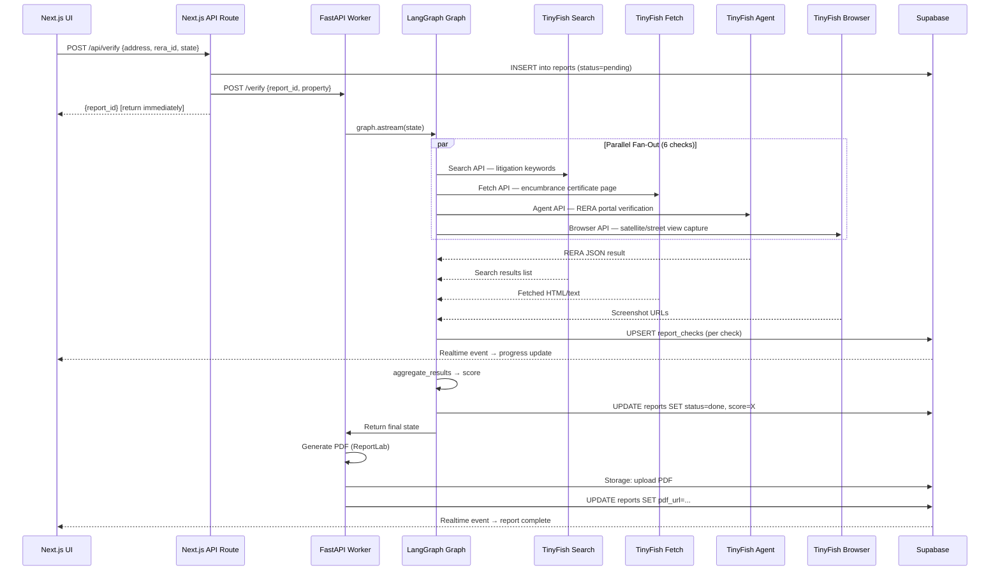

# 🔌 API Integration Guide — Ghar Search (HackIIITD 2026)

> **Stack:** TinyFish APIs · LangGraph · Supabase · Next.js 14  
> **Team:** Farhan (AI/full-stack) · Piyush (UI/Frontend)

---

## TinyFish API Call Flow



---

## 1. TinyFish API Complete Guide

### 1.1 Authentication Setup

```python
# worker/tools/tinyfish.py
import os, httpx
from typing import Any

TINYFISH_BASE = "https://api.tinyfish.io/v1"

def _headers() -> dict:
    return {
        "Authorization": f"Bearer {os.environ['TINYFISH_API_KEY']}",
        "Content-Type": "application/json",
    }

# Async client (use inside FastAPI async endpoints)
async def _post(path: str, body: dict) -> dict:
    async with httpx.AsyncClient(timeout=60.0) as client:
        resp = await client.post(f"{TINYFISH_BASE}{path}", headers=_headers(), json=body)
        resp.raise_for_status()
        return resp.json()
```

### 1.2 Search API

> **Use for:** litigation history, news sentiment, public records lookup  
> **Cost:** Low (typically 1–2 credits per call)  
> **Free first:** Check local cache / Supabase before calling

```python
# Endpoint: POST /search
# Params:
#   query (str): search string
#   num_results (int): 1–20, default 10
#   country (str, optional): "IN" for India

async def tinyfish_search(query: str, num_results: int = 10) -> list[dict]:
    data = await _post("/search", {
        "query": query,
        "num_results": num_results,
        "country": "IN"
    })
    return data.get("results", [])

# Example request:
# POST /v1/search
# {"query": "Prestige Lakeside Habitat RERA fraud litigation", "num_results": 5, "country": "IN"}

# Example response:
# {
#   "results": [
#     {"title": "...", "url": "https://...", "snippet": "...", "date": "2025-01-15"},
#     ...
#   ],
#   "credits_used": 1
# }
```

### 1.3 Fetch API

> **Use for:** fetching known URLs — encumbrance certificate pages, RERA status pages with direct links  
> **Cost:** 1–3 credits per call  
> **When NOT to use:** JS-rendered pages (use Browser API instead)

```python
# Endpoint: POST /fetch
# Params:
#   url (str): target URL
#   extract_text (bool): true to return clean text (no HTML noise)
#   screenshot (bool): true to capture screenshot

async def tinyfish_fetch(url: str, extract_text: bool = True) -> dict:
    data = await _post("/fetch", {
        "url": url,
        "extract_text": extract_text,
        "screenshot": False,  # save credits; use Browser for screenshots
    })
    return data

# Example request:
# POST /v1/fetch
# {"url": "https://rera.maharashtra.gov.in/Site/Registration/SearchProject?..."}

# Example response:
# {
#   "url": "https://...",
#   "text": "Project Name: Lakeside Habitat | Status: Registered | Expiry: 2027-03-31...",
#   "status_code": 200,
#   "credits_used": 2
# }
```

### 1.4 Agent API

> **Use for:** multi-step navigation tasks, form-filling, complex portal interactions  
> **Cost:** 5–20 credits per task (varies with `max_steps`)  
> **Strategy:** Poll until `status == "completed"` or `"failed"`

```python
import asyncio
from pydantic import BaseModel
from typing import Optional

class RERAResult(BaseModel):
    rera_status: str           # registered | expired | revoked | not_found
    promoter_name: Optional[str]
    project_name: Optional[str]
    registration_expiry: Optional[str]
    approved_units: Optional[int]
    screenshot_url: Optional[str]

RERA_GOAL_TEMPLATE = """
You are a property due-diligence agent for India. Verify RERA registration.

Property Address: {address}
RERA Registration Number: {rera_id}
State: {state}

Steps:
1. Go to the official RERA portal for {state} (e.g., MahaRERA for Maharashtra, RERA Karnataka, etc.)
2. Search using the RERA registration number.
3. Extract: registration status, promoter name, project name, expiry date, approved units.
4. Capture a screenshot of the result page.

Return ONLY valid JSON. No commentary. Schema:
{{"rera_status": "registered|expired|revoked|not_found", "promoter_name": "...",
  "project_name": "...", "registration_expiry": "YYYY-MM-DD", "approved_units": 0,
  "screenshot_url": "url_from_tool_output"}}
"""

async def run_rera_agent(address: str, rera_id: str, state: str) -> RERAResult:
    goal = RERA_GOAL_TEMPLATE.format(address=address, rera_id=rera_id, state=state)

    # Launch agent task
    launch_resp = await _post("/agent/run", {
        "goal": goal,
        "use_browser": True,
        "stealth": True,         # bypass bot detection
        "max_steps": 12,
        "output_schema": {
            "type": "object",
            "properties": {
                "rera_status": {"type": "string"},
                "promoter_name": {"type": "string"},
                "project_name": {"type": "string"},
                "registration_expiry": {"type": "string"},
                "approved_units": {"type": "integer"},
                "screenshot_url": {"type": "string"}
            },
            "required": ["rera_status"]
        }
    })
    task_id = launch_resp["task_id"]

    # Poll for completion
    for _ in range(30):   # max 150s wait
        await asyncio.sleep(5)
        status_resp = await _get(f"/agent/task/{task_id}")
        if status_resp["status"] == "completed":
            raw = status_resp["output"]
            return RERAResult(**raw)
        if status_resp["status"] == "failed":
            return RERAResult(rera_status="not_found")
    return RERAResult(rera_status="not_found")

async def _get(path: str) -> dict:
    async with httpx.AsyncClient(timeout=30.0) as client:
        resp = await client.get(f"{TINYFISH_BASE}{path}", headers=_headers())
        resp.raise_for_status()
        return resp.json()
```

### 1.5 Browser API

> **Use for:** screenshot capture as legal evidence, CAPTCHA-heavy sites, Playwright-level control  
> **Cost:** 5–15 credits per session  
> **vs Agent API:** Browser gives low-level CDP control; Agent gives goal-directed autonomy

```python
# Use Browser API when you need precise control (screenshot at exact element)
async def capture_evidence_screenshot(url: str, selector: str = "body") -> str:
    data = await _post("/browser/screenshot", {
        "url": url,
        "selector": selector,        # CSS selector to capture
        "full_page": False,
        "stealth": True,
        "wait_for": "networkidle",   # wait until page fully loads
    })
    # Returns a URL to the stored screenshot
    return data["screenshot_url"]
```

### 1.6 Cost Management & Budget

| Check Type | API Used | Est. Credits | Free Alternative |
|---|---|---|---|
| RERA verification | Agent API | 8–15 | Cache result in `report_checks` |
| Litigation news | Search API | 1–2 | Google News RSS (free) |
| Encumbrance cert page | Fetch API | 2–3 | Cache 24h in Supabase |
| Satellite screenshot | Browser API | 5–10 | Google Maps Static API |
| Valuation data | Search + Fetch | 3–5 | 99acres scrape via Fetch |
| News sentiment | Search API | 1–2 | Cache results |
| **Total per report** | | **~20–45 credits** | |

**Caching Strategy:**

```python
async def get_cached_or_fetch(report_check_id: str, fetch_fn) -> dict:
    """Check Supabase cache before calling TinyFish."""
    from supabase import create_client
    sb = create_client(os.environ["SUPABASE_URL"], os.environ["SUPABASE_SERVICE_KEY"])
    row = sb.table("report_checks").select("result").eq("id", report_check_id).single().execute()
    if row.data and row.data.get("result"):
        return row.data["result"]   # cache hit — 0 credits used!
    result = await fetch_fn()
    sb.table("report_checks").update({"result": result}).eq("id", report_check_id).execute()
    return result
```

---

## 2. LangGraph Integration Guide

### 2.1 Full Verification StateGraph

```python
# worker/graphs/verification_graph.py
from langgraph.graph import StateGraph, END
from langgraph.types import Send
from typing import TypedDict, Annotated, Optional
import operator, asyncio

class CheckResult(TypedDict):
    check_name: str
    status: str       # pass | fail | warning | error
    score: int        # 0-100
    evidence: list[str]
    raw_data: dict

class VerificationState(TypedDict):
    # Input
    report_id: str
    property_id: str
    address: str
    rera_id: str
    state: str
    # Accumulated by parallel branches
    check_results: Annotated[list[CheckResult], operator.add]
    # Fan-out routing
    check_name: Optional[str]    # set per-branch by Send
    # Output
    final_score: Optional[int]
    status: str
```

### 2.2 Parallel Node Execution (Fan-Out Pattern)

```python
# worker/graphs/verification_graph.py (continued)
from worker.tools.tinyfish import run_rera_agent, tinyfish_search, tinyfish_fetch
from worker.tools.supabase_client import update_check_status

CHECK_HANDLERS = {
    "rera":         run_rera_check,
    "encumbrance":  run_encumbrance_check,
    "litigation":   run_litigation_check,
    "valuation":    run_valuation_check,
    "satellite":    run_satellite_check,
    "news":         run_news_check,
}

def route_to_checks(state: VerificationState):
    """Fan-out: create a Send() per check so they run in parallel."""
    return [
        Send("run_check", {**state, "check_name": name})
        for name in CHECK_HANDLERS.keys()
    ]

async def run_check(state: VerificationState) -> dict:
    check = state["check_name"]
    # Update Supabase immediately → UI shows "running"
    await update_check_status(state["report_id"], check, "running")
    try:
        handler = CHECK_HANDLERS[check]
        result: CheckResult = await handler(state)
        await update_check_status(state["report_id"], check, result["status"], result)
        return {"check_results": [result]}
    except Exception as e:
        err_result: CheckResult = {"check_name": check, "status": "error", "score": 0,
                                    "evidence": [], "raw_data": {"error": str(e)}}
        await update_check_status(state["report_id"], check, "error", err_result)
        return {"check_results": [err_result]}

def aggregate_results(state: VerificationState) -> dict:
    results = state["check_results"]
    weights = {"rera": 0.30, "encumbrance": 0.25, "litigation": 0.20,
               "valuation": 0.10, "satellite": 0.05, "news": 0.10}
    weighted_score = sum(
        r["score"] * weights.get(r["check_name"], 0.1)
        for r in results
    )
    return {"final_score": round(weighted_score), "status": "done"}

# Build the graph
builder = StateGraph(VerificationState)
builder.add_node("run_check", run_check)
builder.add_node("aggregate", aggregate_results)
builder.set_conditional_entry_point(route_to_checks, {"run_check": "run_check"})
builder.add_edge("run_check", "aggregate")
builder.add_edge("aggregate", END)

verification_graph = builder.compile()
```

### 2.3 Human-in-the-Loop Node (CAPTCHA/OTP)

```python
from langgraph.graph import interrupt

async def captcha_interrupt_node(state: VerificationState) -> dict:
    """Pause graph and surface CAPTCHA to UI via Supabase Realtime."""
    # Update Supabase → UI shows CAPTCHA widget
    await update_report_status(state["report_id"], "awaiting_human",
                                {"message": "CAPTCHA required", "check": state["check_name"]})
    # LangGraph interrupt — graph pauses until resume() called
    human_input = interrupt({"reason": "captcha", "url": state.get("captcha_url")})
    return {"captcha_solution": human_input}
```

### 2.4 State Persistence with SqliteSaver

```python
from langgraph.checkpoint.sqlite.aio import AsyncSqliteSaver

async def run_verification(state: VerificationState) -> dict:
    async with AsyncSqliteSaver.from_conn_string("checkpoints.db") as checkpointer:
        graph = builder.compile(checkpointer=checkpointer)
        config = {"configurable": {"thread_id": state["report_id"]}}
        result = await graph.ainvoke(state, config=config)
        return result
```

---

## 3. Supabase Integration Guide

### 3.1 Complete Schema with RLS

```sql
-- migrations/001_schema_and_rls.sql

-- ═══════════════════════════════════
-- TABLES
-- ═══════════════════════════════════
CREATE TABLE properties (
  id         uuid PRIMARY KEY DEFAULT uuid_generate_v4(),
  user_id    uuid REFERENCES auth.users NOT NULL,
  address    text NOT NULL,
  rera_id    text,
  state      text,
  metadata   jsonb DEFAULT '{}',
  created_at timestamptz DEFAULT now()
);

CREATE TABLE reports (
  id          uuid PRIMARY KEY DEFAULT uuid_generate_v4(),
  property_id uuid REFERENCES properties NOT NULL,
  user_id     uuid REFERENCES auth.users NOT NULL,
  status      text DEFAULT 'pending',
  score       int,
  summary     jsonb DEFAULT '{}',
  pdf_url     text,
  created_at  timestamptz DEFAULT now(),
  updated_at  timestamptz DEFAULT now()
);

CREATE TABLE report_checks (
  id           uuid PRIMARY KEY DEFAULT uuid_generate_v4(),
  report_id    uuid REFERENCES reports NOT NULL,
  check_name   text NOT NULL,
  status       text DEFAULT 'pending',
  result       jsonb DEFAULT '{}',
  evidence     text[],
  credits_used int DEFAULT 0,
  created_at   timestamptz DEFAULT now()
);

CREATE TABLE watchlist (
  id          uuid PRIMARY KEY DEFAULT uuid_generate_v4(),
  user_id     uuid REFERENCES auth.users NOT NULL,
  property_id uuid REFERENCES properties NOT NULL,
  alert_email text,
  last_run    timestamptz,
  is_active   boolean DEFAULT true,
  UNIQUE(user_id, property_id)
);

-- ═══════════════════════════════════
-- RLS POLICIES
-- ═══════════════════════════════════
ALTER TABLE properties    ENABLE ROW LEVEL SECURITY;
ALTER TABLE reports       ENABLE ROW LEVEL SECURITY;
ALTER TABLE report_checks ENABLE ROW LEVEL SECURITY;
ALTER TABLE watchlist     ENABLE ROW LEVEL SECURITY;

-- Properties: users see only their own
CREATE POLICY "user_owns_property" ON properties
  FOR ALL USING (auth.uid() = user_id)
  WITH CHECK (auth.uid() = user_id);

-- Reports: users see only their own
CREATE POLICY "user_owns_report" ON reports
  FOR ALL USING (auth.uid() = user_id)
  WITH CHECK (auth.uid() = user_id);

-- Report checks: accessible if user owns the parent report
CREATE POLICY "user_sees_checks" ON report_checks
  FOR SELECT USING (
    EXISTS (
      SELECT 1 FROM reports r WHERE r.id = report_id AND r.user_id = auth.uid()
    )
  );

-- Service role can write checks (worker uses service key)
CREATE POLICY "service_writes_checks" ON report_checks
  FOR ALL TO service_role USING (true) WITH CHECK (true);

-- Watchlist: users manage their own entries
CREATE POLICY "user_owns_watchlist" ON watchlist
  FOR ALL USING (auth.uid() = user_id)
  WITH CHECK (auth.uid() = user_id);

-- ═══════════════════════════════════
-- REALTIME PUBLICATION
-- ═══════════════════════════════════
ALTER PUBLICATION supabase_realtime ADD TABLE report_checks;
ALTER PUBLICATION supabase_realtime ADD TABLE reports;
```

### 3.2 Realtime Subscription in Next.js (TypeScript)

```typescript
// frontend/src/hooks/useReportProgress.ts
"use client";
import { useEffect, useState, useCallback } from "react";
import { createClient } from "@/lib/supabase/client";
import type { RealtimePostgresChangesPayload } from "@supabase/supabase-js";

export type CheckStatus = {
  id: string;
  check_name: string;
  status: "pending" | "running" | "pass" | "fail" | "warning" | "error";
  result: Record<string, unknown>;
  credits_used: number;
};

export type ReportStatus = {
  status: "pending" | "running" | "done" | "failed" | "awaiting_human";
  score: number | null;
  pdf_url: string | null;
};

export function useReportProgress(reportId: string) {
  const supabase = createClient();
  const [checks, setChecks] = useState<CheckStatus[]>([]);
  const [report, setReport] = useState<ReportStatus | null>(null);

  const upsertCheck = useCallback((row: CheckStatus) => {
    setChecks(prev => {
      const idx = prev.findIndex(c => c.check_name === row.check_name);
      if (idx >= 0) { const n = [...prev]; n[idx] = row; return n; }
      return [...prev, row];
    });
  }, []);

  useEffect(() => {
    if (!reportId) return;

    // Subscribe to report_checks changes
    const checksChannel = supabase
      .channel(`checks-${reportId}`)
      .on<CheckStatus>(
        "postgres_changes",
        { event: "*", schema: "public", table: "report_checks",
          filter: `report_id=eq.${reportId}` },
        (payload: RealtimePostgresChangesPayload<CheckStatus>) => {
          if (payload.new) upsertCheck(payload.new as CheckStatus);
        }
      )
      .subscribe();

    // Subscribe to report status changes
    const reportChannel = supabase
      .channel(`report-${reportId}`)
      .on<ReportStatus>(
        "postgres_changes",
        { event: "UPDATE", schema: "public", table: "reports",
          filter: `id=eq.${reportId}` },
        (payload) => { if (payload.new) setReport(payload.new as ReportStatus); }
      )
      .subscribe();

    return () => {
      supabase.removeChannel(checksChannel);
      supabase.removeChannel(reportChannel);
    };
  }, [reportId, supabase, upsertCheck]);

  return { checks, report };
}
```

### 3.3 Storage Bucket Setup

```sql
-- Run in Supabase SQL Editor
INSERT INTO storage.buckets (id, name, public) VALUES
  ('screenshots', 'screenshots', false),
  ('reports',     'reports',     false);

-- Allow authenticated users to upload to their own folder
CREATE POLICY "user_uploads_screenshot" ON storage.objects
  FOR INSERT TO authenticated
  WITH CHECK (bucket_id = 'screenshots' AND (storage.foldername(name))[1] = auth.uid()::text);

CREATE POLICY "user_reads_screenshot" ON storage.objects
  FOR SELECT TO authenticated
  USING (bucket_id = 'screenshots' AND (storage.foldername(name))[1] = auth.uid()::text);

CREATE POLICY "service_manages_storage" ON storage.objects
  FOR ALL TO service_role USING (true) WITH CHECK (true);
```

```python
# worker/tools/storage.py
from supabase import create_client
import os

sb = create_client(os.environ["SUPABASE_URL"], os.environ["SUPABASE_SERVICE_KEY"])

def upload_screenshot(user_id: str, report_id: str, check_name: str, data: bytes) -> str:
    path = f"{user_id}/{report_id}/{check_name}.png"
    sb.storage.from_("screenshots").upload(path, data, {"content-type": "image/png"})
    # Generate 1-hour signed URL
    result = sb.storage.from_("screenshots").create_signed_url(path, 3600)
    return result["signedURL"]

def upload_pdf(user_id: str, report_id: str, pdf_bytes: bytes) -> str:
    path = f"{user_id}/{report_id}/report.pdf"
    sb.storage.from_("reports").upload(path, pdf_bytes, {"content-type": "application/pdf"})
    result = sb.storage.from_("reports").create_signed_url(path, 3600)
    return result["signedURL"]
```

### 3.4 pg_cron Nightly Watchlist

```sql
-- Requires pg_cron + pg_net extensions
SELECT cron.schedule(
  'nightly-watchlist',
  '0 20 * * *',   -- 8 PM UTC = 1:30 AM IST
  $$
  SELECT net.http_post(
    url     := current_setting('app.worker_url') || '/watchlist/trigger',
    headers := json_build_object(
      'Content-Type', 'application/json',
      'X-Cron-Secret', current_setting('app.cron_secret')
    )::jsonb,
    body    := json_build_object(
      'run_all_active', true
    )::jsonb
  );
  $$
);

-- Set the app settings (run once)
ALTER DATABASE postgres SET app.worker_url = 'https://ghar-search-worker.onrender.com';
ALTER DATABASE postgres SET app.cron_secret = 'your-cron-secret-here';
```

### 3.5 Auth Setup

```typescript
// frontend/src/lib/supabase/client.ts
import { createBrowserClient } from "@supabase/ssr";

export function createClient() {
  return createBrowserClient(
    process.env.NEXT_PUBLIC_SUPABASE_URL!,
    process.env.NEXT_PUBLIC_SUPABASE_ANON_KEY!
  );
}

// frontend/src/lib/supabase/server.ts
import { createServerClient } from "@supabase/ssr";
import { cookies } from "next/headers";

export function createClient() {
  const cookieStore = cookies();
  return createServerClient(
    process.env.NEXT_PUBLIC_SUPABASE_URL!,
    process.env.NEXT_PUBLIC_SUPABASE_ANON_KEY!,
    { cookies: { getAll: () => cookieStore.getAll(),
                 setAll: (cs) => cs.forEach(({ name, value, options }) =>
                   cookieStore.set(name, value, options)) }}
  );
}
```

---

## 4. Environment Variables Reference

### 4.1 Frontend (`frontend/.env.local`)

| Variable | Description | Example |
|---|---|---|
| `NEXT_PUBLIC_SUPABASE_URL` | Supabase project URL (public) | `https://xxxx.supabase.co` |
| `NEXT_PUBLIC_SUPABASE_ANON_KEY` | Supabase anon key (public, safe) | `eyJh...` |
| `WORKER_URL` | Internal FastAPI worker base URL | `http://localhost:8000` (dev) |
| `INTERNAL_SECRET` | Shared secret for Next.js → Worker calls | `some-long-random-secret` |

### 4.2 Worker (`worker/.env`)

| Variable | Description | Example |
|---|---|---|
| `TINYFISH_API_KEY` | TinyFish API key | `tf_live_...` |
| `SUPABASE_URL` | Supabase project URL | `https://xxxx.supabase.co` |
| `SUPABASE_SERVICE_KEY` | Supabase service-role key (never expose!) | `eyJh...` |
| `OPENAI_API_KEY` | Used by LangGraph LLM calls | `sk-...` |
| `INTERNAL_SECRET` | Must match frontend value | `some-long-random-secret` |
| `CRON_SECRET` | Shared secret for pg_cron webhook | `cron-secret-xyz` |
| `WORKER_URL` | Public URL of the worker (for pg_cron) | `https://your-worker.onrender.com` |

### 4.3 `.env.example` (commit this to repo)

```bash
# Supabase
NEXT_PUBLIC_SUPABASE_URL=https://your-project.supabase.co
NEXT_PUBLIC_SUPABASE_ANON_KEY=your-anon-key
SUPABASE_SERVICE_KEY=your-service-role-key

# TinyFish
TINYFISH_API_KEY=tf_live_your_key_here

# Internal Communication
INTERNAL_SECRET=replace-with-long-random-string
WORKER_URL=http://localhost:8000
CRON_SECRET=replace-with-another-random-string

# LLM (for LangGraph)
OPENAI_API_KEY=sk-your-openai-key
```

> [!CAUTION]
> **NEVER commit actual `.env` or `.env.local` files.** Add them to `.gitignore` immediately.  
> The `SUPABASE_SERVICE_KEY` bypasses ALL RLS policies — treat it like a database root password.

---

## 5. FastAPI Worker — Core Setup

```python
# worker/main.py
from fastapi import FastAPI, HTTPException, Header
from fastapi.middleware.cors import CORSMiddleware
from pydantic import BaseModel
import os, asyncio

app = FastAPI(title="Ghar Search Worker")

app.add_middleware(
    CORSMiddleware,
    allow_origins=[
        "http://localhost:3000",
        "https://ghar-search.vercel.app",
    ],
    allow_credentials=True,
    allow_methods=["*"],
    allow_headers=["*"],
)

class VerifyRequest(BaseModel):
    report_id: str
    property_id: str
    address: str
    rera_id: str
    state: str
    user_id: str

@app.post("/verify")
async def verify_property(
    req: VerifyRequest,
    x_internal_secret: str = Header(None)
):
    if x_internal_secret != os.environ["INTERNAL_SECRET"]:
        raise HTTPException(status_code=401, detail="Invalid internal secret")

    # Run graph in background — don't await (return immediately)
    asyncio.create_task(run_verification_graph(req))
    return {"status": "started", "report_id": req.report_id}

@app.get("/health")
async def health():
    return {"status": "ok"}
```

---

## 6. Quick Reference — RERA Portals by State

| State | Portal URL | Notes |
|---|---|---|
| Maharashtra | `maharera.mahaonline.gov.in` | Most stable, structured |
| Karnataka | `rera.karnataka.gov.in` | Requires JS; use Agent API |
| Delhi | `rera.delhi.gov.in` | Simple HTML, Fetch works |
| Gujarat | `gujrera.gujarat.gov.in` | CAPTCHA likely |
| Tamil Nadu | `www.tnrera.in` | Inconsistent structure |
| Telangana | `rera.telangana.gov.in` | Anti-bot measures |
| UP | `up-rera.in` | Often slow; increase timeout |
| Rajasthan | `rera.rajasthan.gov.in` | Standard portal |

> [!TIP]
> Start with **Maharashtra + Karnataka** for the hackathon demo — they have the most consistent data and are the highest-volume states. Hard-code these two, then generalize.

---

*Generated for HackIIITD 2026 — Team Ghar Search*
