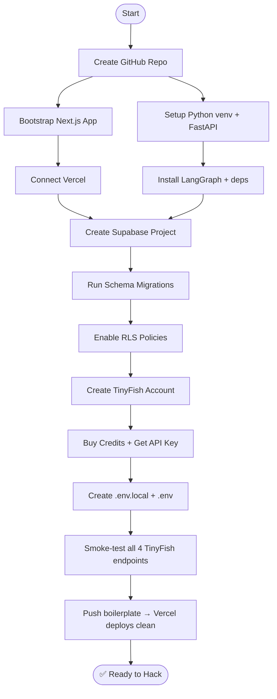

# 🛠️ Technical Checklist — Ghar Search (HackIIITD 2026)

> **Last updated:** Pre-event prep  
> **Stack:** Next.js 14 + FastAPI + LangGraph + TinyFish APIs + Supabase + Vercel  
> **Team:** Farhan (AI/full-stack) · Piyush (UI/Frontend)

---

## Setup Sequence Overview



---

## 1. Pre-Hackathon Setup Checklist

Complete **every item** before H0. Mark ✅ when done.

### 1.1 Accounts & Credentials

| Service | Action | Notes |
|---|---|---|
| **TinyFish** | Sign up at tinyfish.io | Use team email |
| **TinyFish Credits** | Purchase ≥ 500 credits | Budget \$30–50 for 24h |
| **TinyFish API Key** | Generate from dashboard | Store securely |
| **Supabase** | Create project `ghar-search` | Region: `ap-south-1` (Mumbai) |
| **Supabase Service Role Key** | Copy from Settings → API | Never expose to client |
| **Supabase Anon Key** | Copy from Settings → API | Safe for client-side |
| **Vercel** | Link GitHub repo to project | Auto-deploy `main` branch |
| **GitHub** | Create private repo `hackiiitd-ghar-search` | Add Piyush as collaborator |

### 1.2 Local Dev Environment

```bash
# Python setup (FastAPI worker)
python -m venv .venv
source .venv/Scripts/activate  # Windows: .venv\Scripts\activate
pip install fastapi uvicorn langgraph langchain langchain-openai \
            httpx python-dotenv pydantic reportlab supabase

# Next.js bootstrap
npx create-next-app@latest frontend \
  --typescript --tailwind --app --src-dir --import-alias "@/*"
cd frontend
npm install @supabase/supabase-js @supabase/ssr \
  lucide-react clsx tailwind-merge @radix-ui/react-dialog \
  react-hot-toast sonner

# Verify LangGraph version (must be ≥ 0.2)
pip show langgraph
```

### 1.3 Supabase Schema Migration (run BEFORE hackathon)

```sql
-- Run in Supabase SQL Editor
CREATE EXTENSION IF NOT EXISTS "uuid-ossp";
CREATE EXTENSION IF NOT EXISTS pg_cron;

CREATE TABLE properties (
  id          uuid PRIMARY KEY DEFAULT uuid_generate_v4(),
  user_id     uuid REFERENCES auth.users NOT NULL,
  address     text NOT NULL,
  rera_id     text,
  state       text,
  metadata    jsonb DEFAULT '{}',
  created_at  timestamptz DEFAULT now()
);

CREATE TABLE reports (
  id            uuid PRIMARY KEY DEFAULT uuid_generate_v4(),
  property_id   uuid REFERENCES properties NOT NULL,
  status        text DEFAULT 'pending',   -- pending|running|done|failed
  score         int,
  summary       jsonb DEFAULT '{}',
  pdf_url       text,
  created_at    timestamptz DEFAULT now(),
  updated_at    timestamptz DEFAULT now()
);

CREATE TABLE report_checks (
  id          uuid PRIMARY KEY DEFAULT uuid_generate_v4(),
  report_id   uuid REFERENCES reports NOT NULL,
  check_name  text NOT NULL,             -- rera|encumbrance|litigation|valuation|...
  status      text DEFAULT 'pending',
  result      jsonb DEFAULT '{}',
  evidence    text[],                    -- Storage URLs
  credits_used int DEFAULT 0,
  created_at  timestamptz DEFAULT now()
);

CREATE TABLE watchlist (
  id          uuid PRIMARY KEY DEFAULT uuid_generate_v4(),
  user_id     uuid REFERENCES auth.users NOT NULL,
  property_id uuid REFERENCES properties NOT NULL,
  alert_email text,
  last_run    timestamptz,
  is_active   boolean DEFAULT true,
  UNIQUE(user_id, property_id)
);
```

### 1.4 GitHub Repo Structure (pre-create)

```
hackiiitd-ghar-search/
├── frontend/          # Next.js 14 App Router
├── worker/            # FastAPI + LangGraph
│   ├── agents/
│   ├── graphs/
│   └── tools/
├── supabase/
│   └── migrations/
├── .env.example
└── README.md
```

---

## 2. Technology Deep-Dives

### 2.1 LangGraph — Parallel Fan-Out/Fan-In

The verification pipeline runs 6 checks in parallel (RERA, encumbrance, litigation, valuation, satellite imagery, news sentiment). LangGraph's `Send` API enables true parallel execution.

```python
from langgraph.graph import StateGraph, END
from langgraph.graph.message import add_messages
from typing import TypedDict, Annotated, List
import operator

class VerificationState(TypedDict):
    property_id: str
    address: str
    rera_id: str
    state: str
    # Fan-out results accumulate via reducer
    check_results: Annotated[list, operator.add]
    final_score: int
    report_id: str

def route_checks(state: VerificationState):
    """Fan-out: dispatch all 6 checks in parallel using Send."""
    from langgraph.types import Send
    checks = ["rera", "encumbrance", "litigation", "valuation", "satellite", "news"]
    return [Send("run_check", {**state, "check_name": c}) for c in checks]

def run_check(state: VerificationState):
    """Each parallel branch runs this. Results reduce into check_results."""
    check = state["check_name"]
    # ... call TinyFish or local tool
    return {"check_results": [{"check": check, "status": "pass", "score": 85}]}

def aggregate_results(state: VerificationState):
    scores = [r["score"] for r in state["check_results"] if "score" in r]
    return {"final_score": int(sum(scores) / len(scores)) if scores else 0}

builder = StateGraph(VerificationState)
builder.add_node("run_check", run_check)
builder.add_node("aggregate", aggregate_results)
builder.add_conditional_edges("__start__", route_checks, ["run_check"])
builder.add_edge("run_check", "aggregate")
builder.add_edge("aggregate", END)
graph = builder.compile()
```

### 2.2 TinyFish Agent API — RERA Verification Goal Template

```python
import httpx, os

TINYFISH_BASE = "https://api.tinyfish.io/v1"
HEADERS = {"Authorization": f"Bearer {os.getenv('TINYFISH_API_KEY')}"}

RERA_GOAL = """
You are a property due-diligence agent. Verify RERA registration for the property below.

Property: {address}
RERA ID: {rera_id}
State: {state_name}

Steps:
1. Navigate to the official RERA portal for {state_name}.
2. Search by RERA registration number: {rera_id}.
3. Extract: project name, promoter name, registration status, expiry date, approved units, completion date.
4. Take a screenshot of the search results page as evidence.

Return ONLY valid JSON matching the schema below. Do not add commentary.
"""

OUTPUT_SCHEMA = {
    "type": "object",
    "properties": {
        "rera_status": {"type": "string", "enum": ["registered", "expired", "revoked", "not_found"]},
        "promoter_name": {"type": "string"},
        "project_name": {"type": "string"},
        "registration_expiry": {"type": "string"},
        "approved_units": {"type": "integer"},
        "screenshot_url": {"type": "string"}
    },
    "required": ["rera_status"]
}

async def run_rera_agent(address: str, rera_id: str, state_name: str) -> dict:
    goal = RERA_GOAL.format(address=address, rera_id=rera_id, state_name=state_name)
    resp = httpx.post(f"{TINYFISH_BASE}/agent/run", headers=HEADERS, json={
        "goal": goal,
        "output_schema": OUTPUT_SCHEMA,
        "max_steps": 10,
        "use_browser": True  # RERA sites need JS rendering
    })
    task_id = resp.json()["task_id"]
    return await poll_agent_task(task_id)
```

### 2.3 Supabase Realtime — Live Progress in Next.js

```typescript
// frontend/src/hooks/useReportProgress.ts
"use client";
import { useEffect, useState } from "react";
import { createClient } from "@/lib/supabase/client";

type CheckStatus = { check_name: string; status: string; score?: number };

export function useReportProgress(reportId: string) {
  const supabase = createClient();
  const [checks, setChecks] = useState<CheckStatus[]>([]);

  useEffect(() => {
    if (!reportId) return;
    const channel = supabase
      .channel(`report-${reportId}`)
      .on("postgres_changes", {
        event: "*",
        schema: "public",
        table: "report_checks",
        filter: `report_id=eq.${reportId}`,
      }, (payload) => {
        const { new: row } = payload;
        setChecks(prev => {
          const idx = prev.findIndex(c => c.check_name === row.check_name);
          if (idx >= 0) { const next = [...prev]; next[idx] = row; return next; }
          return [...prev, row];
        });
      })
      .subscribe();
    return () => { supabase.removeChannel(channel); };
  }, [reportId, supabase]);

  return checks;
}
```

### 2.4 pg_cron — Nightly Watchlist Re-check

```sql
-- Enable pg_cron extension (Supabase Dashboard → Extensions)
SELECT cron.schedule(
  'nightly-watchlist-recheck',
  '0 2 * * *',   -- 2 AM IST every night
  $$
    SELECT net.http_post(
      url := 'https://your-worker.vercel.app/api/watchlist/trigger',
      headers := '{"Authorization": "Bearer " || current_setting("app.cron_secret")}'::jsonb,
      body := '{}'::jsonb
    );
  $$
);
```

### 2.5 Next.js App Router — API Routes vs Server Components

```typescript
// API Route (worker proxy) — app/api/verify/route.ts
import { NextRequest, NextResponse } from "next/server";
import { createClient } from "@/lib/supabase/server";

export async function POST(req: NextRequest) {
  const supabase = createClient();
  const { data: { user } } = await supabase.auth.getUser();
  if (!user) return NextResponse.json({ error: "Unauthorized" }, { status: 401 });

  const body = await req.json();
  const workerResp = await fetch(`${process.env.WORKER_URL}/verify`, {
    method: "POST",
    headers: { "Content-Type": "application/json",
                "X-Internal-Secret": process.env.INTERNAL_SECRET! },
    body: JSON.stringify({ ...body, user_id: user.id }),
  });
  return NextResponse.json(await workerResp.json());
}
```

---

## 3. Known Gotchas & Solutions

> [!WARNING]  
> Read ALL of these before H0. Each one is a time-bomb waiting to go off.

| # | Gotcha | Root Cause | Fix |
|---|--------|-----------|-----|
| 1 | **RERA sites block headless requests** | User-agent/IP detection | Use TinyFish Browser with `stealth: true` profile |
| 2 | **LangGraph fan-out state merging** | Parallel nodes write to same key | Use `Annotated[list, operator.add]` reducer on `check_results` |
| 3 | **Supabase RLS silently returns empty rows** | Missing `WITH CHECK` or wrong policy | Test with `anon` key in SQL editor; add `EXPLAIN (ANALYZE)` |
| 4 | **TinyFish credits drain on retries** | No exponential backoff, infinite loops | Set `max_steps: 10`; cache responses in Supabase; check credits before each run |
| 5 | **CORS: FastAPI blocks Next.js requests** | Missing `allow_origins` | Add `CORSMiddleware` with `origins=["http://localhost:3000", "https://your-vercel-app.vercel.app"]` |
| 6 | **Supabase Storage presigned URLs expire in 60s** | Default TTL | Use `createSignedUrl(path, 3600)` for 1h expiry; generate at display time |
| 7 | **Supabase Realtime not firing** | Table not added to `supabase_realtime` publication | Run: `ALTER PUBLICATION supabase_realtime ADD TABLE report_checks;` |
| 8 | **LangGraph `Send` API returns immediately** | It's async fan-out, not awaited | Wait on `graph.astream()` and collect events until `END` |
| 9 | **FastAPI async DB calls blocking event loop** | `supabase-py` uses sync client | Use `asyncio.to_thread()` or the async supabase client |
| 10 | **RERA portal uses CAPTCHA** | Cloudflare or reCAPTCHA | Add human-in-the-loop node in LangGraph; surface to UI via Realtime |
| 11 | **pg_cron not available on Supabase free tier** | Extension disabled | Check plan; alternatively use Vercel Cron Jobs (free) |
| 12 | **`next/headers` cannot be called in Client Components** | App Router boundary violation | Move server logic to Server Components or API Routes only |
| 13 | **PDF generation on Vercel times out (>10s)** | Serverless function limit | Run PDF generation in the FastAPI worker, not Next.js |
| 14 | **LangGraph state not persisted between restarts** | In-memory only by default | Use `SqliteSaver` or Supabase as checkpointer for long-running graphs |
| 15 | **TinyFish Agent JSON output malformed** | LLM doesn't follow schema strictly | Wrap with Pydantic validation; retry once with stricter prompt if parse fails |
| 16 | **Supabase `auth.users` join fails in RLS** | Service role needed for joins | Use service-role key only in server-side; never expose to client |
| 17 | **Vercel ENV vars not available in worker** | Worker is separate FastAPI service | Set env vars in Railway/Render separately from Vercel |

---

## 4. Code Templates to Prepare in Advance

Write these **before** the hackathon clock starts:

- [ ] `worker/tools/tinyfish.py` — unified wrapper for Search, Fetch, Agent, Browser
- [ ] `worker/graphs/verification_graph.py` — LangGraph StateGraph skeleton
- [ ] `worker/agents/rera_agent.py` — RERA goal template + Pydantic output model
- [ ] `frontend/src/lib/supabase/client.ts` — browser Supabase client factory
- [ ] `frontend/src/lib/supabase/server.ts` — server Supabase client factory (cookies)
- [ ] `frontend/src/hooks/useReportProgress.ts` — Realtime progress hook
- [ ] `supabase/migrations/001_initial_schema.sql` — all tables + RLS
- [ ] `worker/pdf/generator.py` — ReportLab PDF builder skeleton
- [ ] `.env.example` — complete list of all variables (see api-integration-guide.md)
- [ ] `worker/main.py` — FastAPI app with CORS + health check endpoint

---

## 5. Testing Strategy (24-hour Edition)

| Layer | Tool | When | What |
|---|---|---|---|
| Supabase schema | SQL Editor | H0–H1 | Insert dummy property + report rows |
| TinyFish API | `httpx` REPL | H1–H2 | Smoke-test Search + Fetch with a real property address |
| LangGraph graph | `pytest -k test_graph` | H4–H6 | Run graph with mocked TinyFish tools; assert state shape |
| FastAPI endpoints | `curl` / httpie | H6–H8 | POST `/verify`, check Supabase rows update |
| Realtime subscription | Browser DevTools | H10–H12 | Trigger check update in SQL Editor; watch Next.js UI update |
| PDF generation | `python -m worker.pdf.generator` | H16–H18 | Generate test PDF; open and visually inspect |
| End-to-end | Manual browser flow | H20–H22 | Full flow: submit property → watch progress → download PDF |
| Demo rehearsal | Stopwatch | H22–H24 | Complete flow under 3 minutes for judges |

---

## 6. Pre-Event Day-Of Ritual (Night Before)

1. `git pull` — ensure everyone is on the same commit
2. Run `npm run build` in frontend — catch TypeScript errors now
3. Run `pip install -r requirements.txt` — ensure no dep conflicts
4. Verify Supabase dashboard: tables exist, RLS enabled, Realtime publication set
5. Verify TinyFish dashboard: credits balance shows, API key active
6. Vercel: preview deployment green ✅
7. Slack/WhatsApp team channel pinned with all env var values
8. Print this checklist 🖨️

---

*Generated for HackIIITD 2026 — Team Ghar Search*
